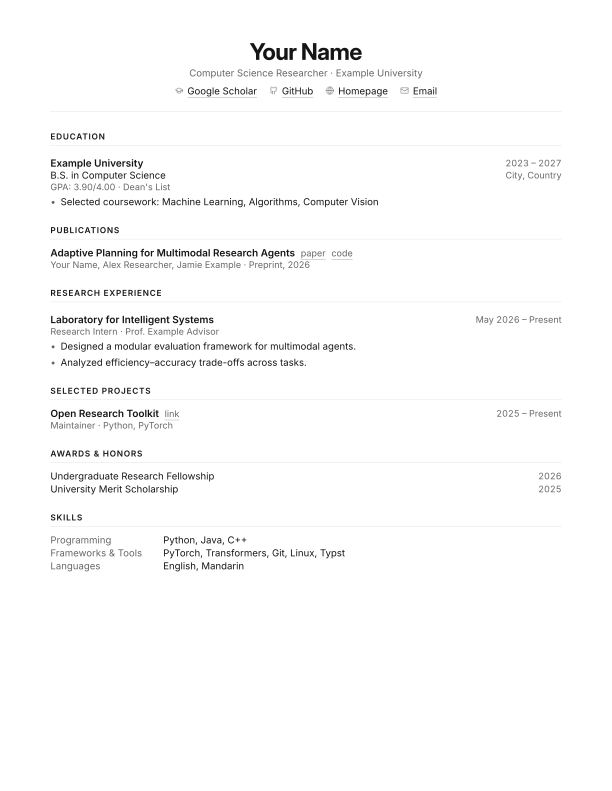
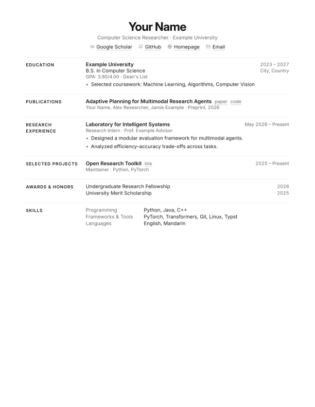
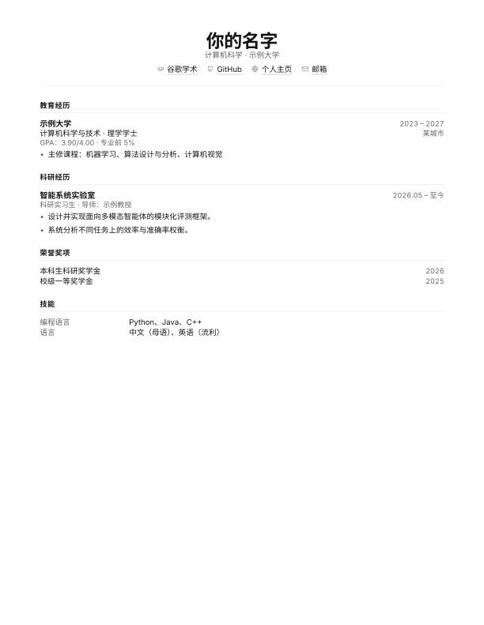
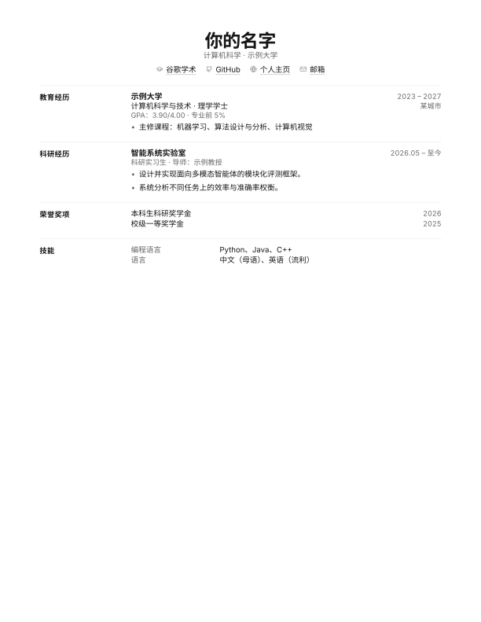
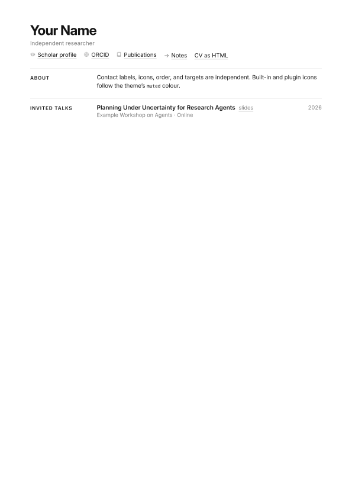

# Plugins

[中文](PLUGINS.zh-CN.md)

> Snippets below import `lib.typ` from a clone of this repository. With Typst Universe, use `#import "@preview/scholarline-cv:0.1.0": *` instead.

Scholarline CV follows one rule: **everything is a plugin**. The core, `cv()`, only sets up the page and stores the theme. Every visible part is a plugin. You can keep it, switch to a built-in alternative, wrap it, or replace it. The built-in components (`education`, `publication`, …) are written with the same public primitives you get, so your own components look exactly like the built-in ones.

## At a glance

| Slot | Default | Built-in alternative | Signature |
|---|---|---|---|
| `header` | `default-header` | — | `(name, subtitle, contacts) => content` |
| `section` | `default-section` | `margin-section` | `(title, body) => content` |
| `heading` | `default-heading` | — | `(title) => content`, used by `default-section` |
| `links` | `default-links` | `underline-links` | `(links) => content`, where `links` is an array of `(label:, url:)` |
| `icons` | built-in icon table | — | a dictionary of name → SVG string |

Pass plugins through `plugins:`. Omitted slots keep their defaults, and unknown slot names are an error.

```typst
#import "lib.typ": *

#show: cv.with(
  name: "Your Name",
  plugins: (section: margin-section, links: underline-links),
)
```

## Gallery

Every combination of the built-in plugins, rendered from `main.typ` and `examples/zh.typ`. Regenerate them with `assets/gallery/build.sh`.

| Default | `section: margin-section` |
|---|---|
|  |  |
| **`links: underline-links`** | **`margin-section` + `underline-links`** |
|  |  |
| **Chinese, default** | **Chinese, `margin-section`** |
|  |  |

Custom plugins from `examples/custom-links.typ`: an extra icon, a custom component, A4 paper, and a left-aligned header.



## 1. Switch to a built-in alternative

- `section: margin-section` puts small uppercase labels in a left margin column, with a hairline between sections.
- `links: underline-links` shows entry links as underlined labels (`paper`) instead of `paper ↗`.

```typst
#import "lib.typ": *

#show: cv.with(name: "Your Name", plugins: (section: margin-section))

#section("Publications")[
  #publication(title: "A Paper", links: ((label: "paper", url: "https://example.com"),))
]
```

## 2. Wrap a default

A plugin is just a function, so you can call the default and add to it.

```typst
#import "lib.typ": *

#show: cv.with(
  name: "Your Name",
  plugins: (
    // Prefix every section label with a section sign.
    heading: title => default-heading([§ #title]),
    // Keep the default header and add a muted "last updated" line below it.
    header: (name, subtitle, contacts) => {
      default-header(name, subtitle, contacts)
      align(right, entry-meta[Last updated November 2026])
    },
  ),
)

#section("Education")[#education(institution: "Example University", dates: "2023 – 2027")]
```

## 3. Add or replace icons

An icon is an SVG string that draws with `stroke="currentColor"`. It is tinted with the theme's `muted` colour and centred on the text line, just like the built-in icons. Use `read("my-icon.svg")` to load one from a file. A name that already exists replaces the built-in icon.

```typst
#import "lib.typ": *

#let book = "<svg xmlns=\"http://www.w3.org/2000/svg\" viewBox=\"0 0 24 24\" fill=\"none\" stroke=\"currentColor\" stroke-width=\"1.5\" stroke-linecap=\"round\" stroke-linejoin=\"round\"><path d=\"M4 19.5v-15A2.5 2.5 0 0 1 6.5 2H20v20H6.5a2.5 2.5 0 0 1 0-5H20\"/></svg>"

#show: cv.with(
  name: "Your Name",
  contacts: (contact("Publications", "https://example.com", icon: "book"),),
  plugins: (icons: (book: book)),
)
```

Built-in icons: `scholar`, `github`, `web`, `email`, `linkedin`, `orcid`, `phone`, `location`, `link`.

## 4. Write your own plugin

**A section plugin** that numbers sections, reusing the default layout:

```typst
#import "lib.typ": *

#let section-number = counter("my-section")
#let numbered-section(title, body) = {
  section-number.step()
  default-section(context [#section-number.display("01")#h(0.8em)#title], body)
}

#show: cv.with(name: "Your Name", plugins: (section: numbered-section))

#section("Education")[#education(institution: "Example University")]
#section("Skills")[#skill-line(label: "Programming", items: [Python])]
```

**A links plugin** that separates entry links with slashes:

```typst
#import "lib.typ": *

#let slash-links(links) = {
  h(0.6em)
  links.map(item => link(item.url, entry-meta(item.label))).join(entry-meta(" / "))
}

#show: cv.with(name: "Your Name", plugins: (links: slash-links))

#section("Publications")[
  #publication(title: "A Paper", links: (
    (label: "paper", url: "https://example.com/paper"),
    (label: "code", url: "https://example.com/code"),
  ))
]
```

## 5. Write your own component

Components are not a plugin slot. They are ordinary functions built from these primitives:

| Primitive | Purpose |
|---|---|
| `entry(lines, aside: (), body: none)` | Two-column entry: `lines` on the left, muted `aside` rows on the right, then `body`. `none` rows are dropped. |
| `entry-title(body)` | Semibold entry title |
| `entry-meta(body)` | Muted metadata text; `none` stays `none` |
| `entry-links(links)` | Entry links, styled by the `links` plugin |
| `dot-join(parts)` | Joins the non-`none` parts with ` · ` |
| `section-label(title)` | Small uppercase, letter-spaced label |
| `cv-icon(name)` | Tinted, centred icon from the icon table |
| `cv-theme()` | The resolved theme dictionary (call inside `context`) |

```typst
#import "lib.typ": *

#let talk(title: "", event: none, place: none, date: none, links: ()) = entry(
  ([#entry-title(title)#entry-links(links)], entry-meta(dot-join((event, place)))),
  aside: (date,),
)

#show: cv.with(name: "Your Name")

#section("Invited Talks")[
  #talk(title: "Planning Under Uncertainty", event: "Example Workshop", place: "Online", date: "2026",
    links: ((label: "slides", url: "https://example.com/slides"),))
]
```

## Writing good plugins

- **Return content.** A plugin is a plain function; no registration is needed.
- **Read the theme, don't hard-code it.** Inside `context`, `cv-theme()` gives you `ink`, `muted`, `rule`, `size`, `spacing`, and the other theme keys. Use them so theme overrides keep working. The primitives already do this.
- **Scale spacing with `spacing`.** Multiply fixed gaps by `cv-theme().spacing` so `theme: (spacing: 1.2)` still affects your plugin.
- **Keep headings real.** A custom `section` plugin should still emit `heading(level: 2, outlined: false, title)`, styled with a local `show heading` rule if needed, so PDF bookmarks and screen readers keep working. `margin-section` in `lib.typ` shows how.
