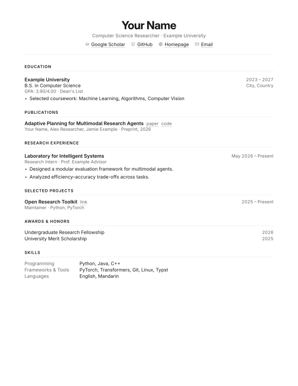
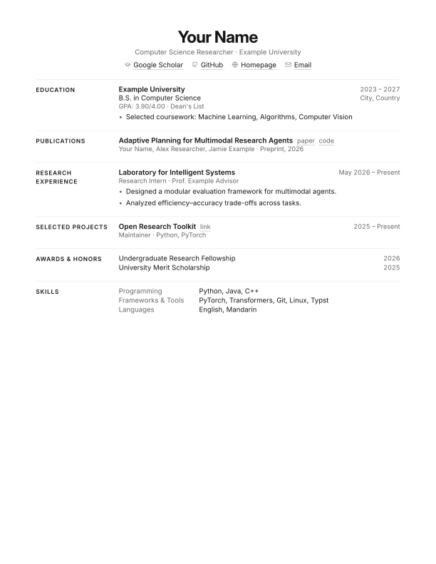
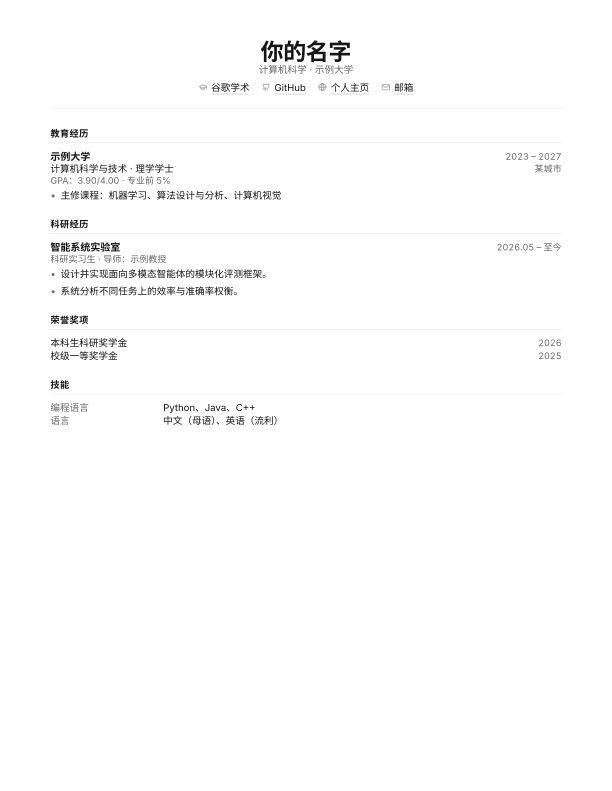
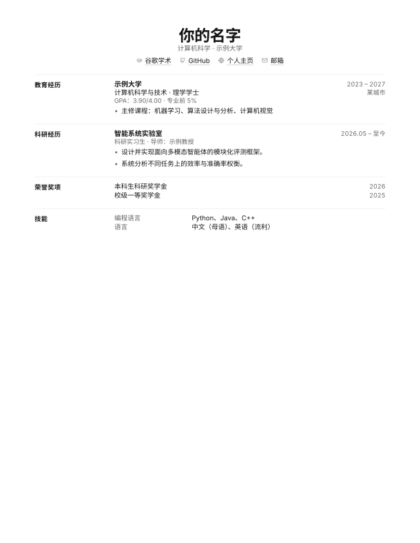
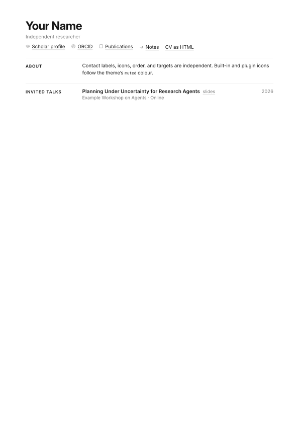

# 插件

[English](PLUGINS.md)

> 下面的代码从本仓库的 `lib.typ` 导入。通过 Typst Universe 使用时，请改成 `#import "@preview/scholarline-cv:0.1.0": *`。

Scholarline CV 只有一条原则：**一切皆插件**（Everything is a plugin）。核心 `cv()` 只负责页面设置和保存主题，页面上能看到的每个部分都是插件。你可以保留它、换成内置的备选、在它外面包一层，或者整个替换。内置组件（`education`、`publication` 等）也只用公开的原语编写，所以你自己写的组件和内置组件看起来完全一致。

## 一览

| 插件位 | 默认 | 内置备选 | 签名 |
|---|---|---|---|
| `header` | `default-header` | — | `(name, subtitle, contacts) => content` |
| `section` | `default-section` | `margin-section` | `(title, body) => content` |
| `heading` | `default-heading` | — | `(title) => content`，供 `default-section` 使用 |
| `links` | `default-links` | `underline-links` | `(links) => content`，`links` 是 `(label:, url:)` 数组 |
| `icons` | 内置图标表 | — | 名称 → SVG 字符串的字典 |

插件通过 `plugins:` 传入。没写的插件位保持默认，写了不存在的插件名会直接报错。

```typst
#import "lib.typ": *

#show: cv.with(
  name: "你的名字",
  lang: "zh",
  plugins: (section: margin-section, links: underline-links),
)
```

## 效果图

下面是内置插件的所有组合，由 `main.typ` 和 `examples/zh.typ` 渲染而成。重新生成请运行 `assets/gallery/build.sh`。

| 默认 | `section: margin-section` |
|---|---|
|  |  |
| **`links: underline-links`** | **`margin-section` + `underline-links`** |
|  |  |
| **中文，默认** | **中文，`margin-section`** |
|  |  |

`examples/custom-links.typ` 中的自定义插件：新增图标、自定义组件、A4 纸张和左对齐页眉。



## 1. 换成内置备选

- `section: margin-section`：章节名以小号大写放在左侧栏，章节之间用发丝线分隔。
- `links: underline-links`：条目链接显示为带下划线的文字（`paper`），代替默认的 `paper ↗`。

```typst
#import "lib.typ": *

#show: cv.with(name: "你的名字", lang: "zh", plugins: (section: margin-section))

#section("论文")[
  #publication(title: "一篇论文", links: ((label: "paper", url: "https://example.com"),))
]
```

## 2. 包装默认插件

插件就是函数，所以可以先调用默认实现，再在它前后添加内容。

```typst
#import "lib.typ": *

#show: cv.with(
  name: "Your Name",
  plugins: (
    // 在每个章节标签前加上 §。
    heading: title => default-heading([§ #title]),
    // 保留默认页眉，在下方加一行灰色的"最后更新"。
    header: (name, subtitle, contacts) => {
      default-header(name, subtitle, contacts)
      align(right, entry-meta[Last updated November 2026])
    },
  ),
)

#section("Education")[#education(institution: "Example University", dates: "2023 – 2027")]
```

## 3. 新增或替换图标

图标是一段 SVG 字符串，描边要写成 `stroke="currentColor"`。它会像内置图标一样，按主题的 `muted` 颜色着色，并与文字垂直居中。从文件读取可以用 `read("my-icon.svg")`；名称和内置图标相同时，会覆盖内置图标。

```typst
#import "lib.typ": *

#let book = "<svg xmlns=\"http://www.w3.org/2000/svg\" viewBox=\"0 0 24 24\" fill=\"none\" stroke=\"currentColor\" stroke-width=\"1.5\" stroke-linecap=\"round\" stroke-linejoin=\"round\"><path d=\"M4 19.5v-15A2.5 2.5 0 0 1 6.5 2H20v20H6.5a2.5 2.5 0 0 1 0-5H20\"/></svg>"

#show: cv.with(
  name: "你的名字",
  lang: "zh",
  contacts: (contact("论文列表", "https://example.com", icon: "book"),),
  plugins: (icons: (book: book)),
)
```

内置图标：`scholar`、`github`、`web`、`email`、`linkedin`、`orcid`、`phone`、`location`、`link`。

## 4. 编写自己的插件

**章节插件**：给章节加上编号，复用默认的章节样式。

```typst
#import "lib.typ": *

#let section-number = counter("my-section")
#let numbered-section(title, body) = {
  section-number.step()
  default-section(context [#section-number.display("01")#h(0.8em)#title], body)
}

#show: cv.with(name: "Your Name", plugins: (section: numbered-section))

#section("Education")[#education(institution: "Example University")]
#section("Skills")[#skill-line(label: "Programming", items: [Python])]
```

**链接插件**：条目链接之间用斜杠分隔。

```typst
#import "lib.typ": *

#let slash-links(links) = {
  h(0.6em)
  links.map(item => link(item.url, entry-meta(item.label))).join(entry-meta(" / "))
}

#show: cv.with(name: "Your Name", plugins: (links: slash-links))

#section("Publications")[
  #publication(title: "A Paper", links: (
    (label: "paper", url: "https://example.com/paper"),
    (label: "code", url: "https://example.com/code"),
  ))
]
```

## 5. 编写自己的组件

组件不是插件位，而是用下面这些原语写成的普通函数：

| 原语 | 作用 |
|---|---|
| `entry(lines, aside: (), body: none)` | 两列条目：左边是 `lines`，右边是灰色的 `aside`，下面是 `body`；值为 `none` 的行自动省略 |
| `entry-title(body)` | 半粗体的条目标题 |
| `entry-meta(body)` | 灰色元信息；传入 `none` 时返回 `none` |
| `entry-links(links)` | 条目链接，样式由 `links` 插件决定 |
| `dot-join(parts)` | 用 ` · ` 连接不为 `none` 的部分 |
| `section-label(title)` | 小号大写、加字距的标签 |
| `cv-icon(name)` | 从图标表取出的图标，已着色并垂直居中 |
| `cv-theme()` | 解析后的主题字典（需在 `context` 中调用） |

```typst
#import "lib.typ": *

#let talk(title: "", event: none, place: none, date: none, links: ()) = entry(
  ([#entry-title(title)#entry-links(links)], entry-meta(dot-join((event, place)))),
  aside: (date,),
)

#show: cv.with(name: "你的名字", lang: "zh")

#section("受邀报告")[
  #talk(title: "不确定性下的规划", event: "示例研讨会", place: "线上", date: "2026",
    links: ((label: "slides", url: "https://example.com/slides"),))
]
```

## 编写插件的建议

- **返回内容即可**：插件就是普通函数，不需要注册。
- **从主题取值，不要写死**：在 `context` 中用 `cv-theme()` 读取 `ink`、`muted`、`rule`、`size`、`spacing` 等主题键，这样别人改主题时你的插件也会跟着变。内置原语都是这样做的。
- **间距乘以 `spacing`**：固定间距都乘上 `cv-theme().spacing`，这样 `theme: (spacing: 1.2)` 对你的插件同样生效。
- **保留真正的标题**：自定义的 `section` 插件仍应输出 `heading(level: 2, outlined: false, title)`，需要换样式时用局部的 `show heading` 规则处理。这样 PDF 书签和读屏软件才能正常工作，写法可以参考 `lib.typ` 中的 `margin-section`。
