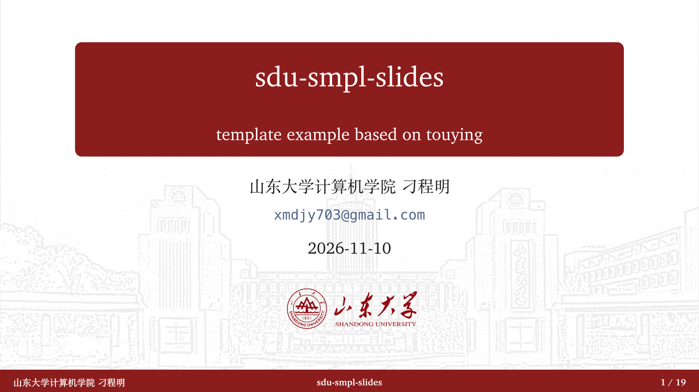
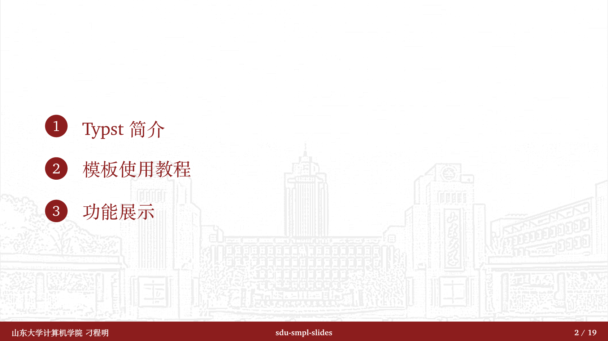
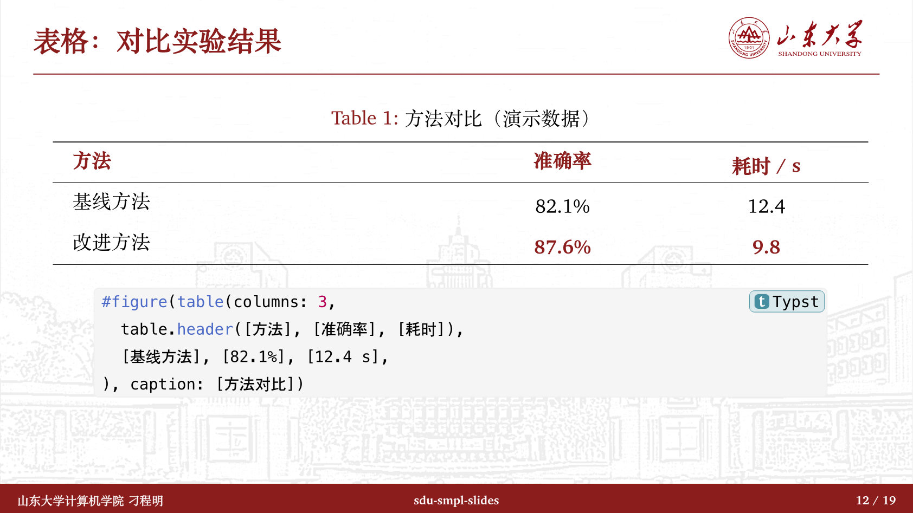
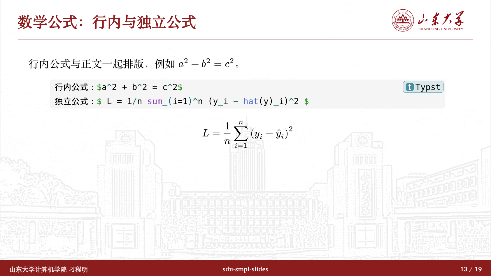
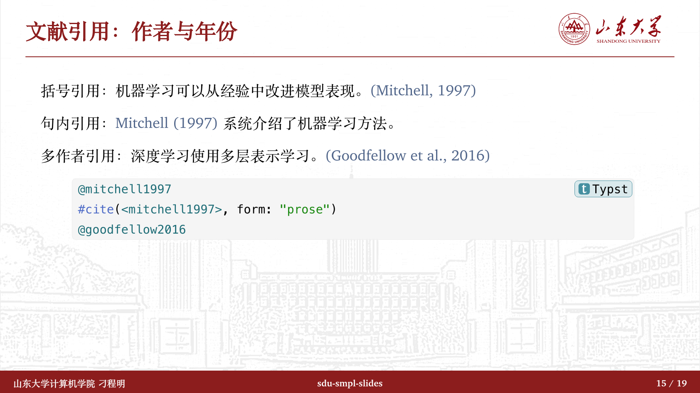

# sdu-smpl-slides

基于 Touying 的山东大学风格学术演示文稿，支持中文排版、目录、红色列表标记、三线表、数学公式、代码与作者—年份引用。

展示名称为 **sdu-smpl-slides**，拟提交的包标识为 **`sdu-smpl-slides`**。这是社区维护的非官方模板，尚未发布到 Typst Universe。



## 快速开始

### 当前仓库（发布前）

需要 Typst 0.15.0 或更新版本。在仓库根目录注册本地开发包并编译：

```sh
mkdir -p .typst/packages/preview/sdu-smpl-slides
ln -s "$PWD" .typst/packages/preview/sdu-smpl-slides/0.1.0
typst compile --package-path .typst/packages template/main.typ assets/example.pdf
```

软链接只需建立一次。修改 [template/main.typ](template/main.typ) 后重新执行编译命令即可；[references.bib](template/references.bib) 是配套文献数据。[查看完整示例 PDF](assets/example.pdf)。首次编译需要联网获取已发布的依赖。

预备发布名称统一为 `sdu-smpl-slides`，包导入、清单和文档均使用小写名称。

仓库中的编译 PDF 保存在 `assets/`，供 README 预览使用；`assets/` 已从包下载内容排除。`template/` 仅保留初始化项目需要的源文件与文献数据。

### 发布后的使用方式

以下命令需等待包正式发布后使用：

```sh
typst init @preview/sdu-smpl-slides:0.1.0 my-slides
cd my-slides
typst compile main.typ
```

最小文稿：

```typst
#import "@preview/touying:0.8.0": *
#import "@preview/sdu-smpl-slides:0.1.0": *

#show: sdu-theme.with(config-info(
  title: [报告标题],
  author: [作者姓名],
  institution: [学院或单位],
  date: datetime.today(),
))
#title-slide()
#outline-slide()

= 第一章
== 第一张内容页
- 一个要点
- 行内公式：$x^2 + y^2$

== 致谢 <touying:unoutlined>
#end-slide()
```

一级标题生成章节页并进入目录，二级标题组织内容页。

## 功能预览

以下图片来自当前示例的同一次构建。

| 目录 | 三线表 |
| --- | --- |
|  |  |

| 数学公式 | 作者—年份引用 |
| --- | --- |
|  |  |

## 依赖版本与兼容性

最低编译器版本为 **Typst 0.15.0**。主题使用 Touying 0.8.0、Codly 2.0.0、codly-languages 0.1.10、gentle-clues 1.3.1 和 Lovelace 0.3.1；pinit 0.2.2、cuti 0.4.0 保持不变。

代码块已迁移到 Codly 2 的 `codly.new` 和组件配置规则；自定义代码样式时应使用新版接口，旧版 `codly-init` 和 `codly(...)` 配置方式不再适用。

## 自定义与字体

```typst
#show: sdu-theme.with(
  config-info(title: [报告标题], author: [作者姓名]),
  aspect-ratio: "16-9",
  primary: rgb("#8C1D1D"),
  font: ("Libertinus Serif", "Noto Serif CJK SC"),
  mono-font: "DejaVu Sans Mono",
)
```

`font` 设置正文候选字体，`mono-font` 设置代码和外部链接字体。默认候选包含 XCharter、Charter、Songti SC、FandolSong，以及 Maple Mono、Menlo、DejaVu Sans Mono。字体文件不随包分发；请安装所需字体或在 Web 编辑器上传字体，也可以指定本机已安装字体。缺失候选字体会产生警告并回退，跨平台输出可能略有不同。

文献使用 `@key` 或 `#cite(<key>, form: "prose")`，文稿中需放置 `#bibliography("references.bib", title: none)`。默认样式为 APA，引用保留衬线字体并显示为蓝灰色。


## 许可与素材来源

项目原创代码及示例采用 [MIT](LICENSE) 许可，通过包系统导入的 Touying、Codly 等依赖保留各自许可。素材图片符合[山东大学名誉管理办法](https://www.dbxb.sdu.edu.cn/info/1039/1984.htm)，所有素材来源均来自官方网站。

## 致谢

基于 [Touying](https://github.com/touying-typ/touying) 构建，参考 [touying-sjtu](https://github.com/sjtug/touying-sjtu) 的视觉与实现思路。问题和建议请提交到[项目 Issues](https://github.com/xmdjy/sdu-touying-template/issues)。
