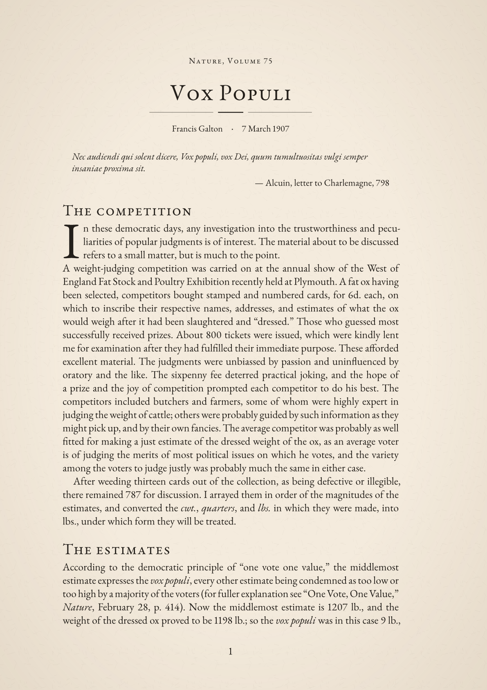
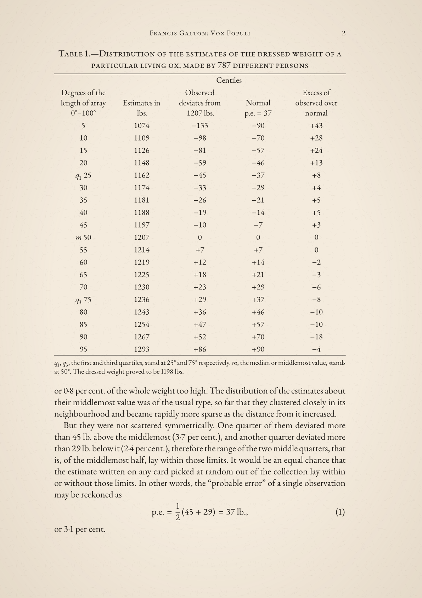
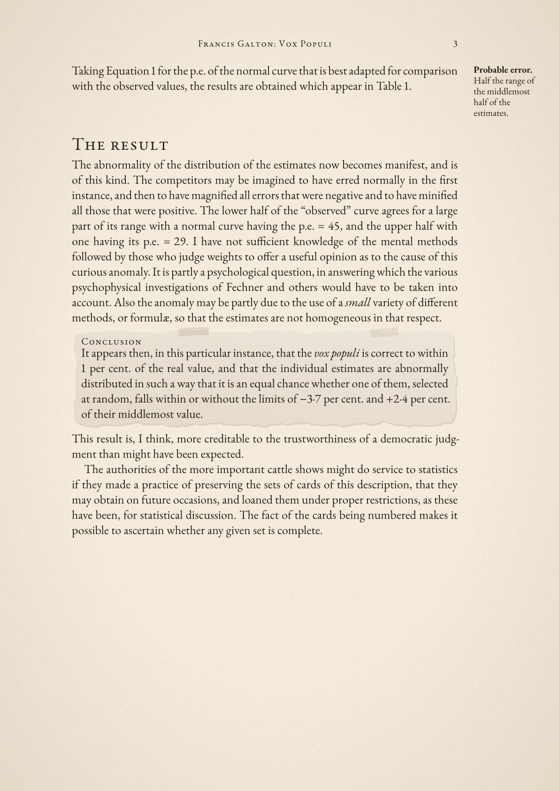
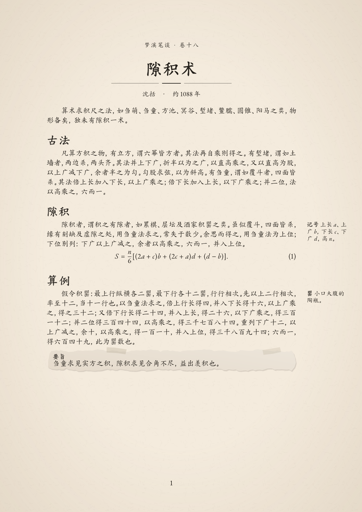

<!-- SPDX-License-Identifier: MIT-0 -->
# sepia-memo

Research memos with cream paper, Garamond Latin text and mathematics, Chinese handwriting,
drop capitals, margin notes, and torn-paper emphasis blocks. Requires Typst 0.15.0 or newer.

Available on [Typst Universe](https://typst.app/universe/package/sepia-memo/).

## Setup

Install [EB Garamond](https://ctan.org/pkg/ebgaramond) (regular, italic, bold,
and bold italic) and [Garamond-Math](https://github.com/YuanshengZhao/Garamond-Math/blob/42b7c154422ae45e6f834654648da4ac467c656b/Garamond-Math.otf).
On desktop, install through your font manager and restart the editor/preview;
verify both families with `typst fonts`. Alternatively pass `--font-path /path/to/fonts`.
In the Typst web app, upload them to your project if unavailable. Fonts are not
bundled. The starter downloads `droplet:0.3.1` on first compilation.

## Usage

[template/main.typ](template/main.typ) is the only starter: Francis Galton's
public-domain note "Vox Populi" (_Nature_, 1907). Replace its metadata and body
with your own. The whole file is below, then its three rendered pages.

```typ
// SPDX-License-Identifier: MIT-0
// Copyright (c) 2026 Chen Gao
// Text: F. Galton, "Vox Populi," Nature 75 (7 March 1907): 450–451; public
// domain. The epigraph, headings, and margin note are added; the diagram is
// omitted. To start your own memo, edit the metadata and replace everything
// after the show rule.
#import "@preview/sepia-memo:0.4.1": memo, memo-note, memo-inset
#import "@preview/droplet:0.3.1": dropcap

#show: memo.with(
  header: [Nature, Volume 75],
  title: [Vox Populi],
  author: "Francis Galton",
  date: [7 March 1907],
)

#set math.equation(numbering: "(1)")

#quote(block: true, attribution: [Alcuin, letter to Charlemagne, 798])[
  _Nec audiendi qui solent dicere, Vox populi, vox Dei, quum tumultuositas
  vulgi semper insaniae proxima sit._
]

= The competition

#dropcap(height: 3, gap: 4pt)[
  In these democratic days, any investigation into the trustworthiness and
  peculiarities of popular judgments is of interest. The material about to be
  discussed refers to a small matter, but is much to the point.
]

A weight-judging competition was carried on at the annual show of the West of
England Fat Stock and Poultry Exhibition recently held at Plymouth. A fat ox
having been selected, competitors bought stamped and numbered cards, for 6d.
each, on which to inscribe their respective names, addresses, and estimates of
what the ox would weigh after it had been slaughtered and "dressed." Those who
guessed most successfully received prizes. About 800 tickets were issued, which
were kindly lent me for examination after they had fulfilled their immediate
purpose. These afforded excellent material. The judgments were unbiassed by
passion and uninfluenced by oratory and the like. The sixpenny fee deterred
practical joking, and the hope of a prize and the joy of competition prompted
each competitor to do his best. The competitors included butchers and farmers,
some of whom were highly expert in judging the weight of cattle; others were
probably guided by such information as they might pick up, and by their own
fancies. The average competitor was probably as well fitted for making a just
estimate of the dressed weight of the ox, as an average voter is of judging the
merits of most political issues on which he votes, and the variety among the
voters to judge justly was probably much the same in either case.

After weeding thirteen cards out of the collection, as being defective or
illegible, there remained 787 for discussion. I arrayed them in order of the
magnitudes of the estimates, and converted the _cwt._, _quarters_, and _lbs._
in which they were made, into lbs., under which form they will be treated.

= The estimates

#figure(
  placement: auto,
  {
    table(
      columns: (1fr,) * 5,
      align: center,
      table.hline(stroke: 0.6pt),
      table.header(
        table.cell(rowspan: 2, align: bottom + center)[Degrees of the length of array 0°–100°],
        table.cell(rowspan: 2, align: bottom + center)[Estimates in lbs.],
        table.cell(colspan: 2, align: center)[Centiles],
        table.cell(rowspan: 2, align: bottom + center)[Excess of observed over normal],
        table.cell(align: bottom + center)[Observed deviates from 1207 lbs.],
        table.cell(align: bottom + center)[Normal \ p.e. $= 37$],
      ),
      table.hline(stroke: 0.3pt),
      [5], [1074], [−133], [−90], [+43],
      [10], [1109], [−98], [−70], [+28],
      [15], [1126], [−81], [−57], [+24],
      [20], [1148], [−59], [−46], [+13],
      [$q_1$ 25], [1162], [−45], [−37], [+8],
      [30], [1174], [−33], [−29], [+4],
      [35], [1181], [−26], [−21], [+5],
      [40], [1188], [−19], [−14], [+5],
      [45], [1197], [−10], [−7], [+3],
      [$m$ 50], [1207], [0], [0], [0],
      [55], [1214], [+7], [+7], [0],
      [60], [1219], [+12], [+14], [−2],
      [65], [1225], [+18], [+21], [−3],
      [70], [1230], [+23], [+29], [−6],
      [$q_3$ 75], [1236], [+29], [+37], [−8],
      [80], [1243], [+36], [+46], [−10],
      [85], [1254], [+47], [+57], [−10],
      [90], [1267], [+52], [+70], [−18],
      [95], [1293], [+86], [+90], [−4],
      table.hline(stroke: 0.6pt),
    )
    set align(left)
    set text(size: 10pt)
    [$q_1$, $q_3$, the first and third quartiles, stand at 25° and 75°
      respectively. $m$, the median or middlemost value, stands at 50°. The
      dressed weight proved to be 1198 lbs.]
  },
  caption: [Distribution of the estimates of the dressed weight of a particular
    living ox, made by 787 different persons],
) <tab-estimates>

According to the democratic principle of "one vote one value," the middlemost
estimate expresses the _vox populi_, every other estimate being condemned as
too low or too high by a majority of the voters (for fuller explanation see
"One Vote, One Value," _Nature_, February 28, p. 414). Now
the middlemost estimate is 1207 lb., and the weight of the dressed ox proved to
be 1198 lb.; so the _vox populi_ was in this case 9 lb., or 0·8 per cent. of
the whole weight too high. The distribution of the estimates about their
middlemost value was of the usual type, so far that they clustered closely in
its neighbourhood and became rapidly more sparse as the distance from it
increased.

But they were not scattered symmetrically. One quarter of them deviated more
than 45 lb. above the middlemost (3·7 per cent.), and another quarter deviated
more than 29 lb. below it (2·4 per cent.), therefore the range of the two middle
quarters, that is, of the middlemost half, lay within those limits. It would be
an equal chance that the estimate written on any card picked at random out of
the collection lay within or without those limits. In other words, the
"probable error" of a single observation may be reckoned as

$
  "p.e." = 1/2 (45 + 29) = 37 "lb.",
$ <eq-pe>

or 3·1 per cent.

#memo-note[
  *Probable error.* Half the range of the middlemost half of the estimates.
][
  Taking @eq-pe for the p.e. of the normal curve that is best adapted for
  comparison with the observed values, the results are obtained which appear
  in @tab-estimates.
]

= The result

The abnormality of the distribution of the estimates now becomes manifest, and
is of this kind. The competitors may be imagined to have erred normally in the
first instance, and then to have magnified all errors that were negative and to
have minified all those that were positive. The lower half of the "observed"
curve agrees for a large part of its range with a normal curve having the
p.e. $= 45$, and the upper half with one having its p.e. $= 29$. I have not
sufficient knowledge of the mental methods followed by those who judge weights
to offer a useful opinion as to the cause of this curious anomaly. It is partly
a psychological question, in answering which the various psychophysical
investigations of Fechner and others would have to be taken into account. Also
the anomaly may be partly due to the use of a _small_ variety of different
methods, or formulæ, so that the estimates are not homogeneous in that respect.

#memo-inset(title: [Conclusion])[
  It appears then, in this particular instance, that the _vox populi_ is
  correct to within 1 per cent. of the real value, and that the individual
  estimates are abnormally distributed in such a way that it is an equal chance
  whether one of them, selected at random, falls within or without the limits
  of −3·7 per cent. and +2·4 per cent. of their middlemost value.
]

This result is, I think, more creditable to the trustworthiness of a democratic
judgment than might have been expected.

The authorities of the more important cattle shows might do service to
statistics if they made a practice of preserving the sets of cards of this
description, that they may obtain on future occasions, and loaned them under
proper restrictions, as these have been, for statistical discussion. The fact
of the cards being numbered makes it possible to ascertain whether any given set
is complete.
```

Page 1 has the header, a block quotation, and the drop capital.



Page 2 has a floating table and a numbered equation.



Page 3 has a right-margin note from `memo-note` and a torn-paper `memo-inset` block.



Create and watch a memo with:

```sh
typst init @preview/sepia-memo:0.4.1 my-memo
typst watch my-memo/main.typ my-memo/main.pdf
```

## Options

Set these in `memo.with(...)`.

| Option | Default | Purpose |
| --- | --- | --- |
| `header` | `none` | Small-caps line above the title, such as a journal or series name |
| `title` | `auto` | Title and PDF metadata; defaults to Untitled memo or 未命名札记 |
| `short-title` | `none` | Title for the running head; defaults to `title` |
| `subtitle` | `none` | Subtitle content |
| `author` | `none` | Author as a string, content, or an array of either; also PDF metadata |
| `date` | `none` | Date content or string |
| `paper` | `"a4"` | Paper size; also supports `"us-letter"` |
| `lang` | `"en"` | Text language; `"zh"` enables Chinese typography |
| `font` | `auto` | EB Garamond; Chinese adds ChillKai handwriting |
| `math-font` | `"Garamond-Math"` | Math font |
| `paper-color` | `rgb("#F4EBDD")` | Background with faint fibers and a darker edge; `white` turns both off for printing |
| `ink` | `rgb("#231F1A")` | Text and title-rule color |

From page 2, a running head shows the author, title, and page number. Table
captions sit above their tables, in the form "Table 1.—Title" (Chinese: "表 1　标题").
Paragraphs are separated by indentation only. For roman section numbers, add
`#set heading(numbering: "I.")` after the show rule.

For fonts embedded in the Typst CLI, set `font: "Libertinus Serif"` and
`math-font: "New Computer Modern Math"`; the layout will differ from the preview.

- `memo-note(note)[paragraph]`: one short paragraph with a right-margin note.
  Use at the top level with the standard margins; the pair stays on one page.
- `memo-inset(title: [Assumption])[content]`: a torn-paper emphasis block.
  Use at the top level inside `memo`; it can contain prose, equations, and tables
  and continue across pages. The title is optional. Tape placement varies by block
  and stays stable when recompiling the same document.
- `quote(block: true, attribution: [...])[...]`: Typst's block quotation, set
  slightly smaller with the attribution on its own line.
- `printer-rule()`: import it from sepia-memo for a three-part divider.
  Its `ink` option defaults to `rgb("#231F1A")`.
- The starter's three-line drop cap comes from [droplet](https://typst.app/universe/package/droplet/).
  Wrap prose only; keep tables, display equations, and margin notes outside it.
  To remove it, delete the `dropcap(...)` wrapper and droplet import.

## Chinese

Install [ChillKai 2.0 (寒蝉正楷)](https://github.com/Warren2060/Chillkai/releases/tag/v2.000)
alongside the Garamond fonts, then set `lang: "zh"` in `memo.with(...)`.
This selects 12 pt Chinese handwriting, two-character paragraph indentation, upright
headings, outlined strong text, and underlined emphasis.
Latin text and mathematics retain their Garamond fonts. Typst handles Chinese
punctuation and mixed-script spacing.

ChillKai has one Regular face, with no bold or italic variants. Chinese titles,
headings, pasted-note titles, and `*strong*` use a 0.020 em outline on Chinese glyphs
and punctuation; Latin strong text uses Garamond's bold face. Body text remains
Regular, and `_emphasis_` uses an underline. Explicit `text(weight: "bold")` or
`text(style: "italic")` still selects Regular for ChillKai. Outlining leaves the
font file unchanged. English mode retains Garamond's bold and italic faces.

[examples/chinese.typ](https://github.com/ChennoShen239/sepia-memo/blob/v0.4.1/examples/chinese.typ) is the complete Chinese example:
Shen Kuo's gap-pile method (隙积术) from _Dream Pool Essays_ (梦溪笔谈), volume 18.
Body text, margin notes, and pasted annotations use the same Chinese font.
For a printed-book alternative, install Source Han Serif SC and set
`font: ((name: "EB Garamond", covers: "latin-in-cjk"), "Source Han Serif SC")`.
Drop capitals remain optional through droplet; the Chinese example uses ordinary paragraphs.


## Development

To preview changes from a clone of the repository, run the tests, or rebuild the
preview images, see [CONTRIBUTING.md](https://github.com/ChennoShen239/sepia-memo/blob/v0.4.1/CONTRIBUTING.md).

## Licenses and dependencies

Adapted from [Foadsf/vintage-latex](https://github.com/Foadsf/vintage-latex).
[NOTICE](NOTICE) records the source revision and changes; [LICENSE](LICENSE)
defines the file boundaries and links to complete terms.

| Included files | License |
| --- | --- |
| `lib.typ`, `src/*`, `thumbnail.png`, `preview-*.png` | [CC BY-SA 4.0](licenses/CC-BY-SA-4.0.txt) |
| `template/main.typ`, `README.md`, `typst.toml` | [MIT-0](licenses/MIT-0.txt) |

| External requirement | License |
| --- | --- |
| Typst 0.15.0+ compiler | [Apache-2.0](https://github.com/typst/typst/blob/v0.15.0/LICENSE) |
| droplet 0.3.1, imported by the starter | [MIT](https://github.com/typst/packages/blob/4d52f815df4d7789a48646033f32927ff6f92b92/packages/preview/droplet/0.3.1/LICENSE) |
| EB Garamond | [OFL-1.1](https://github.com/octaviopardo/EBGaramond12/blob/106a4a6d377987459ae5e68673a4570f13b957fb/OFL.txt) |
| Garamond-Math | [OFL-1.1](https://github.com/YuanshengZhao/Garamond-Math/blob/42b7c154422ae45e6f834654648da4ac467c656b/LICENSE) |
| ChillKai, for Chinese handwriting | [OFL-1.1](https://github.com/Warren2060/Chillkai/blob/ab172bd33249136db70e177e8a22d3ae721652dd/LICENSE) |
| Source Han Serif SC, optional Chinese print font | [OFL-1.1](https://github.com/adobe-fonts/source-han-serif/blob/7889f11bf31170b5d092a083b357c8c8130f89e0/LICENSE.txt) |

External tools, package code, and fonts are not bundled. Retain their respective
licenses and notices if redistributing them separately. Embedding OFL fonts does
not license the document under OFL. Authors retain rights in their own text;
any protected upstream material in an output retains its applicable obligations.
