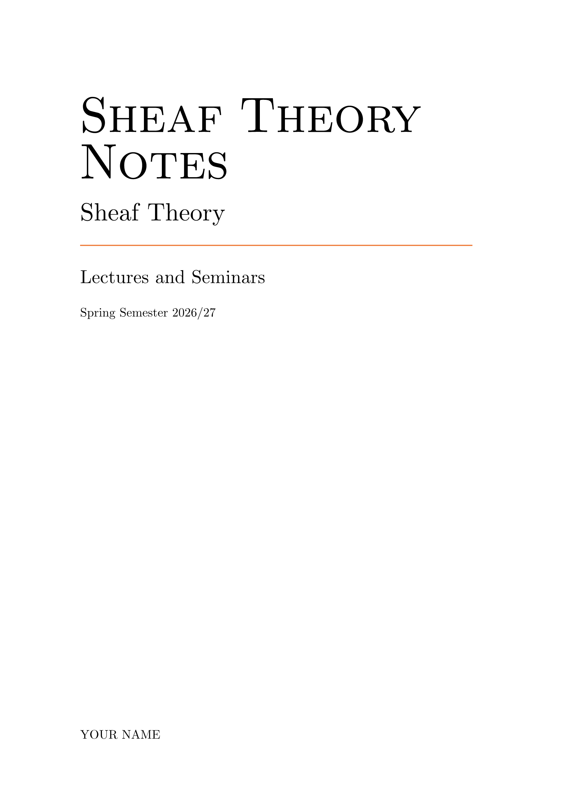

# Sheaffer

Print-friendly course notes with theorems and proofs.

Sheaffer is a Typst template for lecture notes and study summaries. It is built
for print: an ISO B5 page, book-like typography, and a single RGB accent color.
The starter document is a short course on sheaf theory that also serves as a tour
of the template's features.



## Usage

Create a new project from the template with the Typst CLI:

```sh
typst init @preview/sheaffer-notes:0.1.1 my-notes
```

You can also open the Typst web app, click "Start from template", and search for
`sheaffer-notes`.

Typst creates a directory with everything you need. The starting document is
`template/main.typ`: a sheaf theory conspectus (presheaves, sheaves, stalks,
sheafification, ringed spaces, and cohomology) that also demonstrates theorems
and proofs, margin notes, lists, references, footnotes, tables, figures, and code
blocks.

## Features

- Theorem-like environments with automatic numbering and cross-references
- Margin notes, including numbered notes that share the footnote counter
  (`wrapnote`) and standalone marks (`wrapnotemark`)
- Book-style layout on ISO B5 with a single RGB accent color
- A colorblind-friendly palette exported from the package
- Syntax highlighting derived from the same palette
- Configurable fonts and spacing

## Configuration

- Page size and margins are set in `template/main.typ`.
- The accent color is `ACCENT` in `src/_constants.typ` (RGB). Change it there to
  update the accent throughout the template.
- The palette (`BLUE`, `ORANGE`, `CYAN`, `VERMILION`, `GRAY`, `ACCENT`) is
  exported from the package and can be used directly in your document. Internal
  references are `VERMILION`, external URLs are `BLUE`, and code highlighting is
  derived from the same palette.
- Fonts default to Computer Modern and can be overridden in the document with
  `#show: style.with(fonts: (...))`. Spacing and leading live in
  `src/_constants.typ`.

See [`CUSTOMIZATION.md`](CUSTOMIZATION.md) for the file map and detailed
instructions.

## Development

Use `just install` to install the package into the `local` namespace. The
`just thumbnail` command rebuilds the preview images and requires ImageMagick and
`optipng`.

## Publishing

The version and package metadata live in `typst.toml`. A GitHub Actions workflow
publishes on tags matching `v*`: it packages the template and pushes a branch to
`xegors/typst-packages`, using the `REGISTRY_TOKEN` secret. A pull request to the
official `typst/packages` repository is opened from that branch; once merged, the
package is available as `@preview/sheaffer-notes`.

## Acknowledgements and license

Sheaffer is based on [Mousse notes](https://github.com/dogeystamp/mousse-notes).
The original license and attribution notice are preserved in `LICENSE`.
