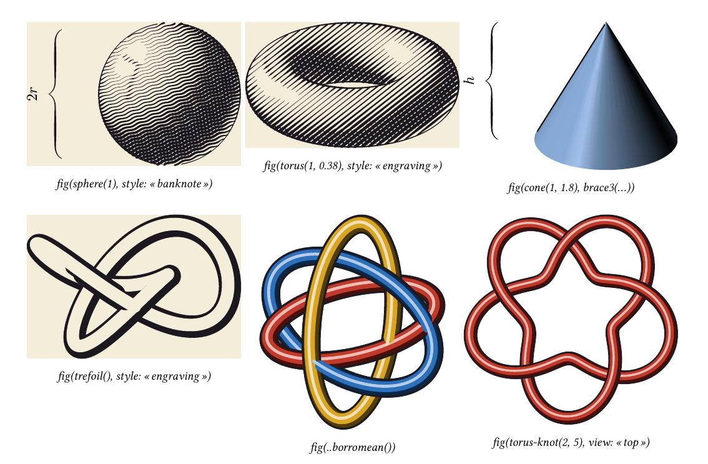

# solids3d — géométrie 3D et figures de collège

> **Version 0.4.0 — une API simple : `fig`.** Donnez un solide, une courbe de nœud ou une surface à `fig` : la
> caméra, la lumière, l'ombrage et les contours sont choisis pour vous.
>
> 
>
> ```typst
> #import "@preview/solids3d:0.4.0": *
>
> #fig(sphere(1))                                        // sphère éclairée et cernée
> #fig(torus(1, 0.4), style: "banknote", view: "high")   // gravure billet de banque
> #fig(trefoil(), style: "engraving")                    // nœud de trèfle gravé
> #fig(cone(1, 1.8), brace3((0, 0, 0), (0, 0, 1.8), $h$)) // accolade de cote
> #fig(paint(cylinder(.8, 1.6), orange), view: "front", style: "etching")
> ```
>
> `view` : `"iso" "front" "back" "side" "left" "top" "bottom" "low" "high"` ou `(azimut, élévation)` ;
> `style` : `"shaded" "engraving" "banknote" "etching" "vintage" "pencil"`. Le reste de ce document (et le
> manuel) décrit la couche avancée sur laquelle `fig` est bâtie.
>
> **Guides** : [manuel (anglais)](docs/manual-en.pdf) ·
> [guide avancé (français)](docs/guide-avance-fr.pdf).

Réimplémentation indépendante en **Typst 0.15.1**, inspirée du module
`solids.asy` d'Asymptote et des conventions de `three`,
`three_surface`, `three_light`, `graph3` et `obj` :

* projection 3D → 2D **orthographique** ou **perspective** (`orthographic(5,4,3)`, `perspective(camera:, up:, target:)`) ;
* **solides de révolution** `revolution(g, axis)`, `sphere`, `cylinder`, `cone`, tore… avec leur
  **squelette** (`draw(b, m, n, frontpen, backpen, longitudinalpen)`) : parallèles et méridiens de
  contour découpés en parties visibles (trait plein) et cachées (pointillés), exactement comme
  `solids.asy` (algorithme `tangent`/`transverse`/`longitudinal`) ;
* `skeleton`, `transverse`, `longitudinal`, `silhouette` ;
* **surfaces** éclairées (modèle de Phong-Blinn d'Asymptote, lumières `Headlamp`, `White`,
  `nolight`, `light(...)`, matériaux `material(...)`), à **ombrage lisse** (dégradés ajustés aux normales
  des coins, comme le `tensorshade` d'Asymptote), triées par profondeur, à **silhouette exacte** pour
  les surfaces de révolution, avec opacité par couche (arrière/avant) ;
* solides unitaires `unitsphere`, `unithemisphere`, `unitcylinder`, `unitcone`, `unitsolidcone`,
  `unitcube`, `unitdisk`, `unitplane`, `unitfrustum(a, b)`, `unitbox`, `box3`, `extrude`, `cone-over`,
  lecteur `obj(...)` ;
* **surfaces paramétriques et maillages** : `surface-grid` / `parametric-surface`,
  `heightfield`, `surface-mesh` / `mesh-surface`, normales aux sommets, coloration par cellule
  et grilles périodiques ;
* **styles vectoriels optionnels** inspirés des planches scientifiques anciennes : `picture(style: "vintage")` et `picture(style: "pencil")` rendent une planche papier/encre sans aplats gris. Une surface sans matériau, `hatch:` ni `stipple:` est gravée (trame de lignes dont l'épaisseur suit l'éclairage, comme le style `engraving` mais plus légère) ; les contours et les plumes pencil sont calculés par nibart ;
* **nibart intégré (depuis la 0.2)** — [nibart](https://github.com/fergousA/nibart) (`@preview/nibart:0.3.0`, MIT) fournit les plumes
  et les chemins : `picture(engine: "nibart")` (seul moteur depuis la 0.4) ;
  * `picture(style: "engraving")` : **gravure au burin / billet de banque** — trame de lignes (droites ou ondulées) dont
    l'épaisseur suit le ton, famille croisée dans les ombres, contours à la plume plate ; `engraving(...)`, `engraved(solide)` ;
  * `knot3(...)` : **nœuds et entrelacs tubulaires** (`trefoil`, `figure-eight`, `torus-knot`, `hopf-link`, `borromean`),
    styles `"gap"` et `"weave"` ;
  * `brace3(a, b, label:, ...)` : **accolades calligraphiques** entre deux points 3D ;
  * `plate(...)` : **cartouche gravé** (cadre à coins échancrés, fleuron) pour présenter une figure ;
* **figures pédagogiques collège** : annotations `point3`, `callout3`, `dimension3`,
  dont les textes sont centrés sur la cote et suivent automatiquement son
  inclinaison projetée ; `dx`/`dy` permettent d’ajuster les noms de points et
  les cotes (`rotate: false` ou angle explicite pour le contrôle de rotation).
  `dimension3` accepte `extensions: false` pour omettre les traits d’attache,
  et `pen`/`extension-pen` règlent séparément les styles `solid`, `dashed` ou
  `dotted` de la cote, de ses flèches et des traits conservés ;
  `edge-code3`, `equal-edges3`,
  `right-angle3`, `angle-mark3`, constructeurs
  `cuboid`, `regular-pyramid`, `regular-prism` et planches prêtes à copier
  (`examples/college.typ`, `examples/college-annotations.typ`) ;
* textes multilingues et **RTL** : labels arabes/hébreux dans les points, flèches et cotes
  (`examples/rtl.typ`), avec la direction contrôlée par Typst ;
* chemins 3D de Bézier `guide3`/`line3`/`spline3` (avec l'algorithme de **Hobby 3D** d'Asymptote
  pour `..`), `Arc3`, `Circle3`, `circle3`, `arc3`, `plane`, `graph3`, `subpath`, `reltime`, `arclength`… ;
* `tube3` (alias `tube`) transforme un `path3` en tube polygonal, utile pour les hélices, fils et tiges. `width` est le diamètre, `n` le nombre de côtés, `samples` raffine les segments de Bézier et `caps: true` ajoute les bouchons ; le repère transporté est autonome et ne charge aucune bibliothèque Asymptote ;
* `solid-plot` / `plot3d` composent surface, wireframe, hachures et contour
  d'un solide dans une même projection 3D → 2D ;
* repères `xaxis3`/`yaxis3`/`zaxis3` + `limits`, flèches `Arrow3` (cône 3D éclairé) ou `Arrow`
  (tête plate), `dot`, `label`/`Label` avec l'alignement d'Asymptote (`N`, `SE`, `2E`, direction 3D…) ;
* couche `sketch` statique inspirée de p5.js : `sketch-random`, `sketch-noise`,
  primitives 2D, transformations, projection de courbes 3D en chemins 2D et
  sortie SVG vectorielle déterministe ; `mesh-edges` fournit un wireframe
  dédupliqué ou limité aux arêtes de bord d'un maillage.

Le fichier [`examples/gallery.typ`](examples/gallery.typ) reprend 33 figures de la galerie
<https://asy.marris.fr/asymptote/Solides/> ; la source est conservée dans le
workspace et les PDF sont des sorties de build non livrées. Un exemple
supplémentaire de surface paramétrique est fourni dans
[`examples/parametric.typ`](examples/parametric.typ), une planche de figures annotées de collège
dans [`examples/college.typ`](examples/college.typ), les façades Asymptote dans
[`examples/modules.typ`](examples/modules.typ), un exemple arabe RTL dans
[`examples/rtl.typ`](examples/rtl.typ), une composition p5-like statique dans
[`examples/sketch.typ`](examples/sketch.typ) et une planche de solides avec
`solid-plot` dans [`examples/solid-plots.typ`](examples/solid-plots.typ), et une
expérience atlas entièrement statique dans
[`examples/shading-atlas-sketch.typ`](examples/shading-atlas-sketch.typ), avec
une seconde planche pour les polyèdres, prismes, pyramides et maillages
triangulés. L'exemple [`examples/tube3.typ`](examples/tube3.typ) montre une
hélice et une tige rendues avec le nouveau tube polygonal autonome. La
référence API détaillée est dans [`API.md`](API.md), le manuel dans
[`docs/manual.typ`](docs/manual.typ) et le guide avancé français dans
[`docs/guide-avance-fr.typ`](docs/guide-avance-fr.typ).

## Modules inspirés d'Asymptote

Les façades suivantes regroupent les réimplémentations Typst indépendantes des
familles de modules Asymptote correspondantes :

| module | contenu |
|---|---|
| `three.typ` | vecteurs, transformations, chemins 3D, projections et rendu |
| `three-surface.typ` | surfaces, révolutions, maillages et solides unitaires |
| `three-light.typ` | couleurs, pens, matériaux et lumières |
| `graph3.typ` | `graph3-plot` et `parametric-plot3`, avec axes optionnels |
| `solids.typ` | façade des solides et des squelettes |
| `obj3.typ` | lecteur Wavefront OBJ |
| `college.typ` | figures collège et polyèdres réguliers supplémentaires |
| `vintage.typ` | palettes, hachures, stippling et raccourcis de rendu vintage/pencil |
| `src/sketch.typ` | sketch 2D statique, random/noise déterministes et projection de points 3D |

Par exemple, une courbe paramétrique peut être produite directement :

```typst
#import "@preview/solids3d:0.4.0": graph3-plot

#graph3-plot(
  t => (t, t * t, t * t * t),
  -1, 1,
  n: 80,
  axes: true,
)
```

Les API groupées sont aussi disponibles comme modules exportés :

```typst
#import "@preview/solids3d:0.4.0": three, three_surface, three_light, college
#let figure = three.picture(
  projection: three.orthographic(5, 4, 3),
  three.draw(college.regular-tetrahedron(), three.paleblue),
)
```

Ces modules ne redistribuent pas de code source Asymptote : ils réimplémentent
les interfaces et les idées géométriques nécessaires en Typst.

## Installation

```typst
#import "@preview/solids3d:0.4.0": *
```

**Dépendance.** Depuis la 0.2, `solids3d` importe `@preview/nibart:0.3.0`, téléchargé automatiquement.
Typst 0.15.1 ou une version plus récente est requis.

## Premier exemple

```typst
#import "@preview/solids3d:0.4.0": *

#let P = orthographic(5, 4, 3)          // currentprojection = orthographic(5,4,3)
#let b = sphere(O, 1)                   // revolution b = sphere(O, 1)

#picture(size: 6cm, projection: P,      // size(6cm)
  draw(surface(b), withopacity(paleblue, 0.5)),            // draw(surface(b), paleblue+opacity(.5))
  draw(b, m: 5, frontpen: blue, backpen: pen(blue, linetype("8 8")), longitudinalpen: nullpen),
  dot(Label($O$, align: NW), O),                            // dot(Label("$O$", align=NW), O)
  xaxis3($x$, Arrow3), yaxis3($y$, Arrow3), zaxis3($z$, Arrow3),
)
```

Le résultat de `picture(...)` est un `box` Typst : on peut le placer dans une `figure`, une grille, etc.


## Styles vintage et pencil draw (optionnels)

Les styles sont une couche de rendu vectoriel : ils ne rasterisent pas la scène
et ne changent ni la projection ni le tri des surfaces. Le rendu historique
reste donc opt-in ; `picture(...)` sans `style` conserve exactement le style
normal.

Depuis la 0.4, `solids3d` ne contient plus de module WebAssembly : les enveloppes de plume
(`pencil-pen`) et les contours sont calculés par nibart, et toute surface sans matériau,
`hatch:` ni `stipple:` est gravée par le mécanisme du style `engraving` (trame de lignes
dont l'épaisseur suit l'éclairage, lignes cachées éliminées), avec une trame plus légère.
Un `hatch:`, un `stipple:` ou un matériau explicite garde le hachage par patch projeté.

```typst
#import "@preview/solids3d:0.4.0": *

#let P = orthographic(6, 3, 2)
#let b = cylinder(O, 1, 2)
#let s = surface(b)

#picture(width: 6cm, projection: P, style: "vintage",
  draw(s, hatch: vintage-hatch(angle: 32),
    stipple: vintage-stipple(count: 24, seed: 2)),
  draw(b, m: 6,
    frontpen: pencil-pen(paint: vintage-ink),
    backpen: pencil-pen(paint: vintage-pale-ink),
    longitudinalpen: nullpen),
)

#pencil-picture(width: 6cm, projection: P,
  // Le pencil utilise ici des hachures croisées ; le stippling reste optionnel.
  draw(surface(sphere(O, 1)), stipple: none),
  draw(sphere(O, 1), m: 7,
    frontpen: pencil-pen(paint: pencil-ink, roughness: 0.18,
      pressure: 0.12, passes: 1, seed: 8)),
)
```

L'API principale est :

- `style: "vintage"` : fond `vintage-paper`, palette `vintage-ink` et
  `vintage-pale-ink`, surfaces gravées (trame de lignes selon l'éclairage) ou hachures par
  patch si `hatch:`/`stipple:` est explicite ;
- `style: "pencil"` : esquisse monochrome graphite/encre avec enveloppe
  elliptique *remplie* ; les surfaces implicites restent sur le papier et leur
  ton vient des hachures ou du stippling explicite. Les back-lines implicites
  sont supprimées dans ce mode comme dans une vue à lignes cachées retirées ;
  un `backpen` explicite reste toutefois une demande de l'auteur ;
- `pencil-pen(paint: ..., thickness: ..., roughness: ..., passes: ..., seed: ...,
  nib-angle: ..., nib-ratio: ..., pressure: ..., samples: ...)` : plume
  explicite à enveloppe elliptique, entièrement vectorielle. `samples` permet
  de faire varier les axes `a` et `b` le long du trait ; `pressure` peut alors
  provoquer la rupture sous la largeur imprimable. `passes` vaut 1 par défaut ;
  des passes supplémentaires restent disponibles pour une esquisse volontairement
  plus dense. `pencilize-pen` adapte une plume existante sans perdre son
  épaisseur ni ses pointillés ; `plain: true` sur une plume est l'opt-out
  explicite pour conserver un contour vectoriel classique dans un style
  d'illustration ;
- `vintage-shaded(shape, hatch: ..., stipple: ..., pen: ..., outline: ...)`
  compose le remplissage gravé et son contour comme dans la planche source
  `examples/shading-atlas.typ`.
  Les hachures/stipples restent posés avant projection ; `outline: (plain: true,
  paint: ..., thickness: ...)` produit un tracé normal au-dessus, tandis que
  `outline: auto` réutilise la plume elliptique de la texture ;
- `vintage-hatch(spacing: ..., angle: ..., cross: ..., broken: ..., segment: ..., gap: ..., light: ..., count: ..., length: ..., crosshatch: ..., seed: ..., pen: ...)` et
  `draw(surface(...), hatch: ...)` : pour les formes standards, hachures
  éclairées posées sur la géométrie avant projection (`count`, `length`,
  `crosshatch`, `seed`) ; pour les surfaces génériques, hachures courtes
  découpées dans la projection de chaque patch. Avec `lit: true` (défaut),
  leur densité suit l'incidence de la lumière ; elles restent vectorielles et
  compatibles avec `zsort: "global"` ;
- `vintage-stipple(count: ..., seed: ..., min-size: ..., max-size: ..., gamma: ..., distribution: ..., light: ..., max-patch-count: ..., pen: ...)` et
  `draw(surface(...), hatch: none, stipple: ...)` : points vectoriels déterministes
  échantillonnés dans chaque patch projeté.
  Le paramètre `lit: true` adapte le nombre et la taille des points à la lumière ;
  Les points sont émis séparément du contour en SVG comme en backend natif. Le
  stippling reste opt-in ; `stipple: none` le désactive explicitement ;
- `vintage-picture(...)` et `pencil-picture(...)` : raccourcis des deux styles,
  `pencil-draw(...)` : raccourci pour un chemin ou une surface avec enveloppe
  graphite (les backpens implicites d'un squelette sont retirés), et
  `vintage-material(...)` : matériau sépia pratique pour une surface.

Voir [`examples/styles.typ`](examples/styles.typ) pour une planche côte à côte,
[`examples/shaded-fill.typ`](examples/shaded-fill.typ) pour un contour normal
sur un remplissage gravé, [`examples/shaded-stipple.typ`](examples/shaded-stipple.typ)
pour les variantes `random` et `fibonacci`, [`examples/shading-atlas.typ`](examples/shading-atlas.typ)
pour l'atlas de hachures éclairées et de stippling, et
[`examples/styles.typ`](examples/styles.typ) pour comparer les rendus SVG et natifs.

## Correspondance Asymptote → Typst

| Asymptote | Typst (`solids`) |
|---|---|
| `size(6cm); size(6cm,0)` | `picture(size: 6cm, ...)`, `picture(width: 6cm, ...)` (les labels sont inclus dans la taille, comme en Asymptote) |
| `currentprojection = orthographic(5,4,3)` | `picture(projection: orthographic(5,4,3), ...)` ; `perspective(5,4,2)` est la projection par défaut |
| `orthographic(camera=..., up=..., target=..., zoom=.95)` | `orthographic(camera: ..., up: ..., target: ..., zoom: 0.95)` |
| `currentlight = White; nolight; light(10,0,10); light(paleyellow,(5,-5,10),(0,0,-10))` | `picture(light: White, ...)`, `nolight`, `light(10, 0, 10)`, `light(paleyellow, (5,-5,10), (0,0,-10))` ; `light: (0,5,5)` (triple → lumière) |
| `triple v = (1,2,3); X, Y, Z, O` | tuples `(1, 2, 3)` ; `X`, `Y`, `Z`, `O` |
| `a*X`, `u+v`, `u-v`, `dot`, `cross`, `unit` | `vmul(a, X)`, `vadd`, `vsub`, `vdot`, `vcross`, `vunit` |
| `shift(v)*obj`, `scale3(s)*obj`, `zscale3(3)*obj`, `rotate(30,Z)*obj`, `reflect(...)` | `apply(shift(v), obj)`, `apply(scale3(s), obj)`, `apply(zscale3(3), obj)`, `apply(rotate3(30, Z), obj)`, `reflect3` ; composition : `apply(compose(shift(v), scale3(2)), obj)` |
| `A--B--C--cycle` | `line3(A, B, C, cyclic: true)` |
| `A..B..C..cycle` | `spline3(A, B, C, cyclic: true)` (Hobby 3D) |
| `A{dir}..B--C` | `guide3(A, (dir: d), "..", B, "--", C)` |
| `g1^^g2` (tableau de chemins) | `(g1, g2)` |
| `circle(c, r, normal)`, `Circle(c, r, normal, n)` | `circle3(c, r, normal: Z)`, `Circle3(c, r, normal: Y, n: 32)` |
| `arc(...)`, `Arc(c, v1, v2, normal, n)` | `arc3(...)`, `Arc3(c, v1, v2, normal: Z, n: 12)`, `Arc3-angles(c, r, θ1, φ1, θ2, φ2, ...)` |
| `plane(u, v, o)`, `unitsquare3`, `unitcircle3`, `box(a, b)`, `unitbox` | `plane(u, v, o)`, `unitsquare3`, `unitcircle3`, `box3(a, b)`, `unitbox` |
| `graph(F, a, b, operator ..)` | `graph3(F, a, b, n: 100, join: "..")` |
| `revolution(c, g, axis)`, `sphere(c, r)`, `cylinder(c, r, h, axis)`, `cone(c, r, h, axis, n)` | idem : `revolution(g, Z)`, `revolution(c, g, axis)`, `sphere(O, 1)`, `sphere(1, n: 4*nslice)`, `cylinder(O, 1, 2)`, `cone(O, r, h, Z, 1)` ; en plus `torus(R, a)` |
| `draw(b, m=5, frontpen=blue, backpen=..., longitudinalpen=nullpen)` | `draw(b, m: 5, frontpen: blue, backpen: ..., longitudinalpen: nullpen)` (ou positionnel : `draw(b, 1, blue + 1pt)`) |
| `skeleton s; b.transverse(s, reltime(b.g, .5), P); s.transverse.front/back` | `let s = transverse(b, reltime(b.g, 0.5), P)` → `s.front`, `s.back` ; `skeleton(b, m: 0, P: P)` → `.transverse.front`, `.longitudinal.back`… |
| `b.longitudinal(s, P)` | `longitudinal(b, P)` |
| `b.silhouette()` | `silhouette(b)` (calculée avec la projection de la `picture`) ou `silhouette(b, m: 64, P: P)` |
| `b.slice(t, n)`, `b.vertex(i, j)` | `slice(b, t, n: nslice)`, `vertex(b, i, j)` |
| `surface(b)`, `surface(b, 4)` | `surface(b)`, `surface(b, n: 4)` |
| `surface(path3)`, `surface(faces)` | `surface(g)`, `surface(faces)` ; couronne : `surface((outer, inner), planar: true)` |
| `surface(F, u0, u1, v0, v1)` (surface paramétrique) | `surface-grid((u,v) => F(u,v), u0, u1, v0, v1, nu: 16, nv: 12)` ; alias `parametric-surface` |
| `graph3(F, ...)` pour `z=F(x,y)` | `heightfield((x,y) => F(x,y), x0, x1, y0, y1)` |
| `mesh(vertices, faces)` | `surface-mesh(vertices, faces)` (indices zéro-based, ou `indices: "one"`, `smooth: false` pour un polyèdre facetté) |
| `extrude(g, Z)`, `unitsphere`, `unitcube`, `unitfrustum(a, b)`… | idem (`extrude(g, Z)`, …) |
| `draw(surface(b), paleblue+opacity(.5))` | `draw(surface(b), withopacity(paleblue, 0.5))` ou `pen(paleblue, opacity(0.5))` ou `paleblue.transparentize(50%)` |
| `draw(unitcube, blue+opacity(.6), orange)` (meshpen) | `draw(unitcube, withopacity(blue, 0.6), orange)` ou `meshpen: orange` |
| `material(diffusepen=red, specularpen=white, shininess=.9)` | `material(diffuse: red, specular: white, shininess: 0.9)` |
| `pen[] surfacepen = {...}; draw(obj("cube.obj", surfacepen), nolight)` | `draw(obj(read("cube.obj")), (paleblue, palered, ...), nolight)` |
| `1bp+blue`, `linetype("8 8", 8)`, `dashed`, `dotted`, `.5bp+blue+dashed` | `blue + 1pt`, `linetype("8 8", offset: 8)`, `dashed`, `dotted`, `pen(blue, 0.5pt, dashed)` |
| `lightgrey+white`, `.9white` | `color-add(lightgrey, white)`, `color-scale(0.9, white)` |
| `dot(v)`, `dot(Label("$O$", align=SE), v)`, `dot(unitbox, blue)`, `dot(g, 4bp+green)` | `dot(v)`, `dot(Label($O$, align: SE), v)`, `dot(unitbox, blue)`, `dot(g, green + 4pt)` |
| `label("$S$", pS, N)`, `label("$O$", O, 2E)`, `Label("$a$", align=-Y+X)` | `label($S$, pS, N)`, `label($O$, O, pair-scale(2, E))`, `Label($a$, align: vadd(vneg(Y), X))` |
| annotations collège (`\prismereg`, `\pyramreg`, cotes et flèches) | `point3`, `callout3`, `dimension3`, `right-angle3`, `cuboid`, `regular-pyramid`, `regular-prism` |
| `draw(Label("$x$", align=N), O--a*X, red, Arrow3)` | `draw(Label($x$, align: N), line3(O, vmul(a, X)), red, Arrow3)` |
| `draw("$r$", g, N, red)` | `draw($r$, g, N, red)` |
| `limits(O, X+Y+Z); xaxis3(Label("$x$",1), red, Arrow3)` | `limits(O, (1,1,1)), xaxis3(Label($x$, 1), red, Arrow3)` (dans la liste des commandes de `picture`) |
| `xaxis3("$x$", Arrow3())` | `xaxis3($x$, arrow3())` ; `arrow3(size: 10pt, angle: 15, style: "flat")` |
| `dotfactor = 3.5; viewportmargin = (5,5)` | `picture(dotfactor: 3.5, margin: 5pt, ...)` |
| `shipout(bbox(5mm, Fill(white)))` | `picture(inset: 5mm, fill: white, ...)` |
| `nslice = 4*nslice` | paramètre `n:` de `sphere`, `surface`, `draw`, `transverse`… (`nslice = 12`) |

Non porté : `intersectionpoints(path3, surface)`, `polyhedron_js`, le rendu OpenGL/PRC (`settings.render`),
`render(merge=true)`, les étiquettes 3D (`Label` avec `transform3`). Les surfaces paramétriques
vectorielles sont désormais disponibles via `surface-grid` et `surface-mesh`.

## Fonctionnement et rendu

Tout est calculé en 2D après projection, comme le fait Asymptote quand `settings.render = 0`
(sortie vectorielle) : les images de la galerie du site, elles, sont des rendus OpenGL calculés
pixel par pixel. Pour s'en approcher en pur vectoriel, `picture` procède ainsi :

* chaque **patch** de surface est projeté puis **trié du plus lointain au plus proche à l'intérieur de
  chaque `draw`** ; comme en Asymptote 2D, l'ordre des `draw` compte (les lignes ne sont pas
  « profondeur-testées » contre les surfaces : dessinez les parties cachées d'un squelette avant la
  surface et les parties visibles après, voir `fig_ab01` dans la galerie). `picture(zsort: "global")`
  trie ensemble les patchs de tous les `draw(surface)` de l'image ;
* **ombrage lisse** (`shading: "smooth"`, défaut) : l'éclairage (Phong-Blinn d'Asymptote, `color()` de
  `three_light.asy`) est évalué aux quatre coins et au centre de chaque patch — comme le `tensorshade`
  d'Asymptote — et le patch est rempli avec un **dégradé linéaire** ajusté (moindres carrés) à ces
  couleurs. Là où l'éclairage n'est pas assez linéaire (reflets spéculaires), le patch est
  **subdivisé** automatiquement (jusqu'à deux niveaux) ; `shading: "flat"` retrouve une couleur par
  patch (normale au centre), plus rapide et plus compact ; `shading: "none"` conserve directement
  la couleur diffuse sans calcul d'éclairage, pour les schémas et exports très légers ;
* **silhouette exacte** (`refine: true`, défaut) : pour les surfaces de révolution, les patchs à
  cheval sur le contour apparent sont **redécoupés le long des génératrices de silhouette**
  (résolution analytique de `n(θ)·v = 0`), ce qui supprime les « festons » du contour que produit
  un maillage à 12 tranches (Asymptote 2D les a aussi). Les découpes invisibles à la taille finale
  sont sautées ;
* **transparence** : une surface translucide est dessinée en deux couches — patchs tournés vers
  l'arrière, puis patchs tournés vers l'avant — chaque couche étant un **groupe** portant l'opacité
  (`<g opacity>` SVG). On voit donc bien deux épaisseurs de verre et non le maillage des patchs ;
* les patchs opaques reçoivent un trait de 0,5 pt de leur propre couleur (paramètre `seam:` de `draw`)
  pour masquer les filets d'anticrénelage entre patchs voisins ;
* **moteur de sortie** : par défaut chaque `picture` produit une image **SVG** intégrée dans la page
  (`backend: "svg"`), ce qui est vectoriel dans le PDF ; `backend: "typst"` émet des `curve` Typst
  natives (sans dégradés ni groupes d'opacité : couleurs plates et opacité par patch). Les labels
  restent du contenu Typst ordinaire dans les deux cas ;
* les surfaces de révolution sont maillées avec `n` (= `nslice` = 12) tranches ; les solides unitaires
  avec 32 tranches ; hors styles historiques, les parties cachées des squelettes utilisent
  `linetype((4,4), offset: 4, scale: false)` si le `backpen` n'a pas de type de trait
  (comportement de `defaultbackpen`). En `style: "pencil"` ou `"vintage"`, le `backpen` implicite
  est supprimé ; un `backpen` explicitement fourni est conservé.

Options de `picture` : `size`, `width`, `height`, `unitsize`, `projection`, `light`, `limits`, `margin`,
`inset`, `fill`, `stroke`, `radius`, `clip`, `baseline`, `dotfactor`, `arrowsize`, `zsort` (`"command"` /
`"global"`), `shading` (`"smooth"` / `"flat"` / `"none"`), `refine` (`true` / `false`),
`backend` (`"svg"` / `"typst"`).

### Performance et taille des fichiers

Typst mémorise chaque appel de fonction pendant une compilation ; les boucles internes de ce paquet
sont écrites de façon « inline » pour limiter la mémoire. Ordres de grandeur (Typst 0.15, 1 cœur) :
une sphère de 144 patchs se rend en ≈ 0,8 s (≈ 0,25 s en `shading: "flat"`), une sphère de
2304 patchs éclairée par `White` en ≈ 3,5 s ; la galerie complète (33 figures) en ≈ 22 s et ≈ 0,8 Go
de mémoire. Une
`silhouette` (64 tranches par défaut) coûte ≈ 0,5 s en orthographique et ≈ 1 s en perspective.

Chaque dégradé devient un motif de dégradé dans le PDF (≈ 0,5 Ko par patch) : la galerie fait 6,7 Mo.
Pour des figures légères, utilisez `shading: "flat"` (≈ 5× plus compact, ≈ 2× plus rapide),
`shading: "none"` (couleur diffuse, sans éclairage) ou `refine: false` ; avec `shading: "flat"`,
augmentez `n` (par ex. `sphere(O, 1, n: 24)`, `surface(b, n: 24)`) pour un ombrage plus fin.
Une surface paramétrique se contrôle de la même façon avec `nu` et `nv` : commencez à 12×8,
puis augmentez seulement si la silhouette ou les détails l'exigent.

## Organisation du code

| fichier | contenu |
|---|---|
| `src/vec.typ` | triplets, transformations 4×4 (`shift`, `scale3`, `rotate3`, `reflect3`, `align3`, `look`) |
| `src/path3.typ` | chemins de Bézier 3D, `guide3` et algorithme de Hobby 3D, arcs, cercles, boîtes, `graph3` |
| `src/path2.typ` | chemins 2D projetés (extrema, rotation, boîtes englobantes) |
| `src/projection.typ` | `orthographic`, `perspective`, `project` |
| `src/pens.typ` | couleurs d'Asymptote, `pen`, `linetype`, `material`, `light`, éclairage |
| `src/surface.typ` | patchs, surfaces de révolution, grilles paramétriques, maillages, `extrude`, solides unitaires |
| `src/solids.typ` | `revolution`, `slice`, `transverse`, `longitudinal`, `skeleton`, `silhouette`, `sphere`, `cylinder`, `cone`, `torus` |
| `src/picture.typ` | commandes `draw`/`dot`/`label`/axes et le rendu (`picture`) |
| `src/plot.typ` | façades `solid-plot` et `plot3d` pour composer les scènes de solides |
| `src/obj.typ` | lecteur Wavefront OBJ |
| `src/education.typ` | annotations et constructeurs pour figures pédagogiques de collège |

Licence : LGPL-3.0-or-later (comme Asymptote, dont les algorithmes de solides sont repris).
Les exemples pédagogiques sont inspirés par les familles de figures de
[pas-cours](https://ctan.org/pkg/pas-cours), sans reprise de son code source.
