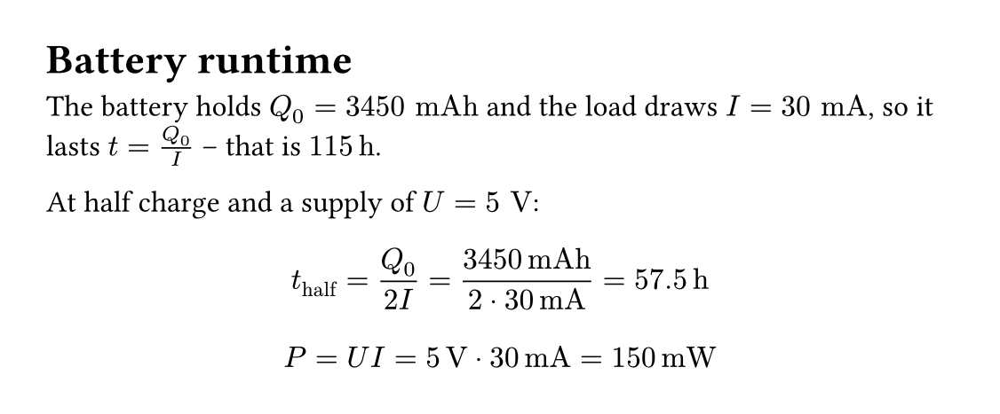
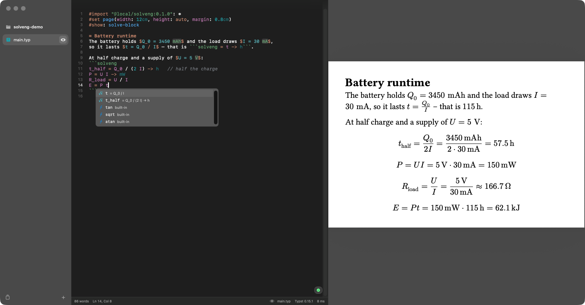
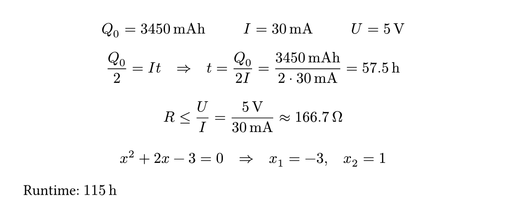
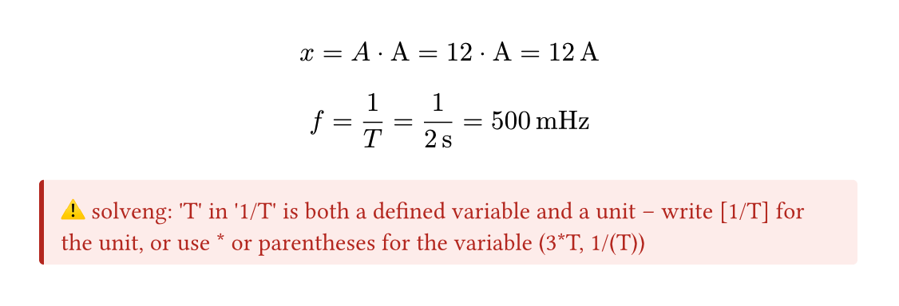
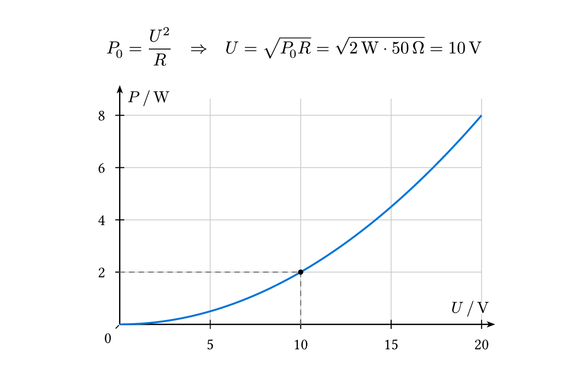

# solveng

Unit-aware engineering calculations that read like your notes. **Write the math as you normally would – solveng evaluates it.** Equations in the text define values, `solveng` code blocks are calculated line by line, and every result comes with the rearranged formula, the substituted numbers and a sensible unit.

````typ
#import "@preview/solveng:0.1.0": *
#show: solve-block

= Battery runtime
The battery holds $Q_0 = 3450 "mAh"$ and the load draws $I = 30 "mA"$,
so it lasts $t = Q_0 / I$ – that is ```solveng = t -> h```.

At half charge and a supply of $U = 5 "V"$:
```solveng
t_half = Q_0 / (2 I) -> h
P = U I
```
````



That is the whole document – no function calls for the calculation:

- **Math defines values.** Every `$… = …$` in the text is read: `$I = 30 "mA"$` is a value, `$t = Q_0 / I$` is computed, `$Q_0/2 = I t$` is solved for the unknown. The equation stays exactly as you wrote it.
- **Code blocks calculate themselves.** Each line of a ```` ```solveng ```` block is solved and shown with all steps; `-> h` picks the unit, `;` separates a system, `//` is a comment.
- **Inline code shows a result:** ```` ```solveng t = Q_0/I -> h``` ```` gives *t = 115 h*, ```` ```solveng = t -> h``` ```` just *115 h*.

## Write it in Typewright

[Typewright](https://github.com/BierDav/typewright), a native Typst editor for macOS and the browser, knows solveng: code in ```` ```solveng ```` blocks is highlighted – values, units, variables, functions – and completion offers the variables and functions your document has defined, with their values, solveng's functions, and units with prefixes wherever a unit goes. Next to it, the live preview shows every result as you type.



```sh
brew install --cask bierdav/tap/typewright
```

or open [bierdav.github.io/typewright](https://bierdav.github.io/typewright/) in the browser.

## Math and code in a solve-block

`#show: solve-block` calculates the whole document; `#solve-block[…]` only a part, whose definitions are dropped afterwards.

- **Math:** every equation with `=` is a definition. A number followed by units is a value (`$9.81 "m"/"s"^2$`, `$frac(3450 "mAh", 30 "mA")$`); in a worked chain `$R = 7.2 "k"Omega = 7200 Omega$` the first `=` defines and the rest are steps. Equations without `=`, derivations (`⇒`, `≈`) and aligned equations are left alone; `equations: false` turns math off.
- **Code:** each line of ```` ```solveng ```` is shown like `#solve(line)`. Code without a language stays a code sample; in documents that are all calculations `#show: solve-block.with(plain-code: true)` calculates it too, and `` `= t -> h` `` is enough inline.
- **Exercises:** `#show: solve-block.with(reset: heading)` starts over at every heading.

## Calls: def and solve

The same calculations as function calls – for options per result, or outside a solve-block:

```typ
#import "@preview/solveng:0.1.0": *
#def("Q0 = 3450 mAh", "I = 30 mA", "U = 5 V")   // silent definitions
#defined()                                       // Q₀ = 3450 mAh   I = 30 mA   U = 5 V
#solve("Q0/2 = I t", unit: "h")                  // Q₀/2 = I t ⇒ t = Q₀/(2I) = 3450 mAh/(2·30 mA) = 57.5 h
#solve("R <= U/I")                               // inequalities, polynomials (all roots), systems
#solve("x^2 + 2x - 3 = 0")
Runtime: #solve("Q0/I", unit: "h", inline: true, steps: "value")   // Runtime: 115 h
```



Both mix freely: inside a solve-block, `#solve(…)` and `#defined()` see the values defined by the math around them.

## Units and variables

Many symbols are also units: `A` (area, ampere), `V`, `T`, `h`, `C`, `W`, `m`, `s`, … solveng tells them apart by *how* they are written, never by guessing. In strings a unit is read only right after a number (`"I = 30 mA"`) or in brackets (`[5 V]`); in math quoted text is a unit (`$3 "h"$`). If a value could mean both, solveng refuses it and shows how to write either meaning:

```typ
#import "@preview/solveng:0.1.0": *
#def("A = 12")
#solve("x = A [A]")                  // x = A · A = 12 · A = 12 A
#def("T = 2 s")
#solve("f = 1/(T)")                  // f = 1/T = 1/(2 s) = 500 mHz
#def("g = 1/T")                      // error: 'T' in '1/T' is both a defined variable and a unit – …
```



Your own units: `#solve-config(units: (bar: "100 kPa", rpm: "1/min", T: none))` – `none` removes one and frees its name.

## Plots

```typ
#import "@preview/solveng:0.1.0": *
#def("R = 50 Ω", "P0 = 2 W")
#solve("P0 = U^2/R")
#graph("P = U^2/R", x: "U")                     // range 0…2·U, the solved point marked
#graph("cos(w) = w")                            // both sides as curves, the crossing marked
#graph("P = U^2/R", x: "R", xrange: ("10 Ω", "1 kΩ"), width: 10cm)
```



Ranges, ticks, axis labels and units are picked automatically; marks, ranges and sizes can be set, see the [reference](https://github.com/BierDav/solveng/blob/v0.1.0/docs/reference.md#graph).

## Options

Every option works for the rest of the document, for a part, or directly on one call:

```typ
#import "@preview/solveng:0.1.0": *
#show: solve-config.with(digits: 3, layout: "column")   // your defaults
#def("U = 5 V", "I = 30 mA")
#solve-config(form: "fraction")[#solve("I3 = I/3")]     // only inside the brackets
#solve("R = U/I", digits: 2, separator: ",")            // only this call
#defined(show-si: true, style: "inline")
```

The most used ones: `digits`, `separator` (`auto`: from the document language), `form` (`"auto"`, `"decimal"`, `"fraction"`, `"input"`), `steps` (`"full"`, `"formula"`, `"result"`, `"value"`), `layout` (`"row"`, `"column"`), `preferred-units`, `errors` (`"document"` shows problems as red notes, `"panic"` stops the compilation). All of them: [reference](https://github.com/BierDav/solveng/blob/v0.1.0/docs/reference.md#options).

## Reference

[docs/reference.md](https://github.com/BierDav/solveng/blob/v0.1.0/docs/reference.md) has every function, argument and option, how values and units are written, `lambdify` (expressions as plain Typst functions), HTML export, how the solver works and its limits.
