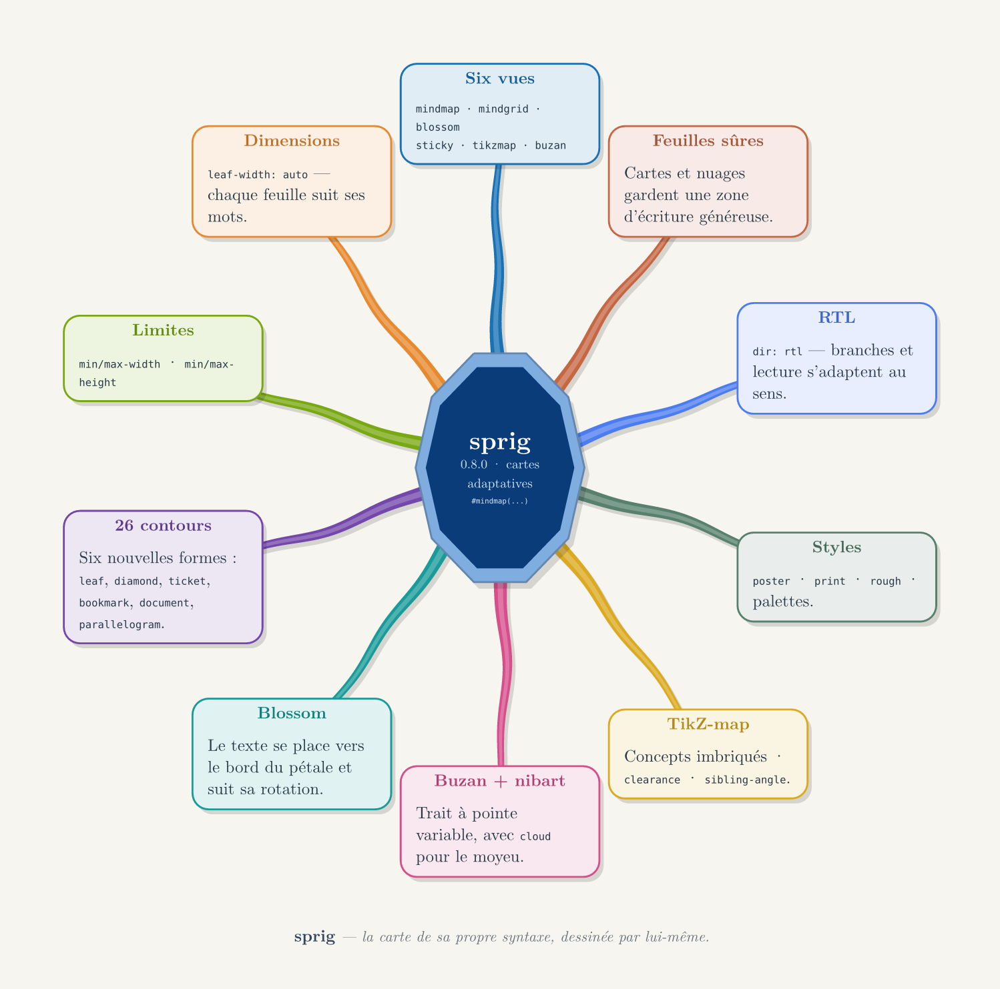

# Sprig

Adaptive mind maps for Typst. Sprig provides six layouts, content-sized leaves,
custom shapes, nested concepts, and right-to-left support.



## Install

```typ
#import "@preview/sprig:0.8.0": *
```

Sprig requires Typst 0.15.0 or later. Buzan-style maps use `nibart` 0.3.0 for
variable-width strokes; Typst fetches this dependency when needed. Set
`stroke-engine: "native"` to use Sprig's built-in stroke renderer.

## Quick start

```typ
#import "@preview/sprig:0.8.0": *

#mindmap([*Water cycle*],
  leaf-width: auto,
  min-width: 1.8cm,
  max-width: 4.6cm,
  min-height: 1.0cm,
  max-height: 5.0cm,
  branch(title: [Evaporation], shape: "leaf")[Sunlight warms the water.],
  branch(title: [Condensation], shape: "cloud")[Vapour forms clouds.],
  branch(title: [Precipitation], shape: "ticket")[Water returns as rain or snow.],
  branch(title: [Collection])[Streams flow back to the sea.],
)
```

## Layouts

| Function | Use |
| --- | --- |
| `mindmap` | Radial maps and directional trees with nested branches. |
| `blossom` | A flower-shaped map with one petal per branch. |
| `mindgrid` | A routed grid of labelled nodes. |
| `sticky` | A board of notes with optional pins, tape, and numbering. |
| `tikzmap` | A concept map with nested concepts and cyclic or directional growth. |
| `buzan` | A hand-drawn radial map with words placed along variable-width strokes. |

All layouts measure leaf content. Set `min-width`, `max-width`, `min-height`,
and `max-height` on the layout or override them on an individual `branch`,
`node`, `note`, or `concept`. Width values accept centimetre numbers or Typst
lengths. Text wraps within the available width. If a height limit cannot be met,
Sprig reports the conflict instead of clipping the text.

## Common options

- `shape:` selects a built-in outline or a custom `(w, h, r) => points` function.
- `palette:` selects a named palette or a list of Typst colours.
- `theme: "print"` removes filled backgrounds for economical printing.
- `dir: rtl` mirrors branch order and adapts text alignment.
- `rough: true` adds a reproducible hand-drawn treatment.

The built-in outline set includes `round`, `sharp`, `none`, `pill`, `tag`,
`shield`, `cloud`, `asym`, `cumulus`, `banner`, `ellipse`, `circle`, `note`,
`folder`, `hex`, `arrow`, `bubble`, `cut`, `torn`, `wave`, `diamond`,
`parallelogram`, `bookmark`, `ticket`, `document`, and `leaf`.

## Examples and reference

The `examples/` directory contains complete Typst documents for adaptive sizing,
`mindmap`, Blossom, Buzan, grids, sticky-note boards, concept maps, printing,
and right-to-left text. The French reference manual is maintained as
[`docs/manual.typ`](docs/manual.typ). The cover image is generated from
[`gallery/cover.typ`](gallery/cover.typ).

## License

MIT. See [`LICENSE`](LICENSE) for the license text and copyright notice.
