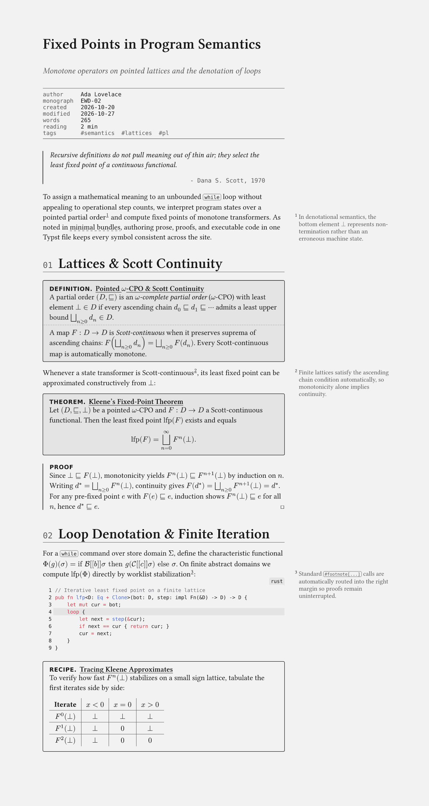
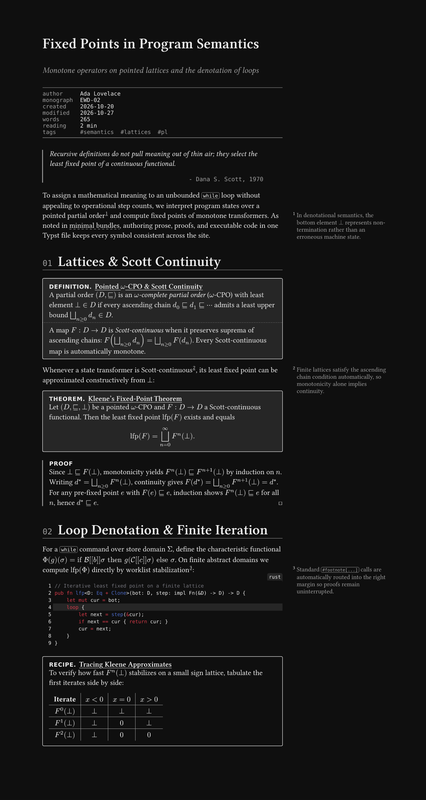

# `thyme`

**Build static sites and blogs from Typst documents: typed HTML, `.typ` source transparency, zero-JS CSS i18n, XML sitemaps & feeds, and a monochrome scholarly `blog` preset.**

[](docs/manual.pdf)
[](https://typst.app)
[](LICENSE)

|         Light (`oklch` monochrome)         |          Dark (`light-dark()`)           |
| :----------------------------------------: | :--------------------------------------: |
|  |  |

`thyme` builds static sites from Typst's native `bundle` and typed `html` targets. The standard `typst` CLI does the work: `typst compile` and `typst watch` need no wrapper CLI and no client-side JavaScript.

The core is zero-CSS and unopinionated. Import it (`#import "@preview/thyme:0.1.0": *`) to build a site with your own stylesheet. The `blog` preset adds a monochrome scholarly theme: native MathML, right-margin sidenotes and citations, static `/tags/` archives, backlinks, Obsidian frontmatter, theorem and proof environments, and two-column print output.

The public surface is eight names in core and thirty-nine in `blog`. Everything else in `src/` is a module-level function that `site` and the presets call; the module paths are stable, the names inside them are not. See [`docs/api.md`](docs/api.md).

---

## Highlights

- **Pure `typst` CLI workflow**: `typst watch --features html,bundle -f bundle site.typ dist` runs Typst's built-in live-reloading dev server; `typst compile` emits the complete production web root in one pass.
- **No HTML builder of its own.** Markup that plain Typst content cannot express goes through Typst's built-in [typed `html.*` constructors](https://typst.app/docs/reference/html/typed/) — `html.elem("div", attrs: (class: "note"), body)`. Nothing to learn, nothing to keep correct, and `math`, `@label` links and components interpolate as usual.
- **Tadi Web `.typ` Source Transparency**: Mounting pages via capability `path(...)` (`src: path("site.typ")`, `#mount(path("contact.typ"))`, `#post(path("posts/foo.typ"))`) co-emits verbatim `.typ` source files (`/site.typ`, `/contact.typ`, `/posts/foo.typ`) and adds a monospace `.typ` link in the top bar.
- **Single-URL Zero-JS CSS i18n & `hreflang` Alternates**: Write `#tr(en: [...], de: [...])` inline or look up keys from a `@preview/linguify`-compatible `lang.toml` dictionary (`#tr("key", from: toml("lang.toml"))`); `thyme` emits a CSS `:root:has(#thyme-lang-de:checked)` switcher (`en · de`) in the top bar **only on pages with two or more languages**, honors `set text(lang: ...)` in paged PDFs, and supports multi-URL `alternates` across `<head>` and `sitemap.xml`.
- **SEO, Full-HTML Syndication & Academic Metadata**: Emits valid `sitemap.xml`, `404.html`, and summary or **full semantic HTML** RSS 2.0 (`rss.xml`) & Atom 1.0 (`atom.xml`) feeds (`feed-content: "summary" | "full"`) via `@preview/syndicate`, plus opt-in OpenGraph (`og:*`) and Google Scholar Highwire (`citation_*`) `<meta>` tags.
- **Scholarly `blog` Preset**: Perceptual `oklch` / `light-dark()` monochrome palette, unified _STIX Two Text_ (`smcp` / `c2sc` small caps) + _STIX Two Math_ + _Helvetica Neue_ + _Commit Mono_ stacks (`font-faces: auto | none | str`, deterministic zero-`local()` `@font-face` rules, and one-line self-hosting via `font-base: "/fonts/"` + `font-version`), AST-normalized native MathML (applied automatically — crisp inline `$F(e)$` & `$F(d^*)` without `measure()` or SVG hacks), content-hashed `css/style.css?v=<hash>`, conditional copy-button JS (`copy-button: auto` — zero `<script>` on codeless pages), `@preview/marge` sidenotes + `#mcite` margin bibliography citations, static `/tags/<tag>/` archive pages, `#toc()`, compile-time `#backlinks()`, post navigation, `spicky`-style math/proof environments, `zebraw`, `tablem`, and `cheq`.

---

## Quick Start

### 1. Scholarly Blog (`blog` Preset)

Scaffold a ready-to-compile blog with `typst init`:

```sh
typst init @preview/thyme:0.1.0 my-blog
cd my-blog
typst compile --features html,bundle --format bundle site.typ public
```

Or wire `site.typ` by hand:

```typst
#import "@preview/thyme:0.1.0": *
#import "@preview/thyme:0.1.0": blog

#show: blog.site.with(
  description: "Notes on programming languages, formal methods, and systems.",
  url: "https://blog.example.org",
  author: "Ada Lovelace",
  src: path("site.typ"),
)

= `folio`

Notes on programming languages, formal methods, mathematics, and systems.

#blog.links(
  direction: "row",
  link("https://example.org")[example.org],
  [@rss[rss]],
  [@atom[atom]],
)

== Posts

#blog.post(path("posts/fixed-points.typ")) <fixed-points>
#blog.post(path("posts/minimal-bundles.typ")) <minimal-bundles>
```

### 2. Custom Portfolio / Landing Site (Unopinionated Core)

Bring your own `styles.css` with zero preset styles injected (see [`examples/portfolio/`](examples/portfolio)):

```typst
#import "@preview/thyme:0.1.0": *

#show: site.with(
  url: "https://example.org",
  title: "Ada Lovelace",
  description: "Symbolic computation and analytical engines.",
  stylesheets: (path("styles.css"),),
  src: path("site.typ"),
  wrap-main: false,
)

#file("pgp.txt", path("pgp.txt"))
#mount(path("contact.typ")) <contact>

#html.elem("header", attrs: (class: "hero"), {
  html.elem("p", attrs: (class: "eyebrow"),
    tr(en: [Symbolic Computation], de: [Symbolische Berechnung]))
  html.h1("Ada Lovelace")
  html.p[Bernoulli schedules in $O(n^2)$ operations · #link(<contact>)[contact]]
})
```

---

## `robots.txt` and `llms.txt`

Both files have formats this package would only guess at, so it does not write them. You
provide the file and point at it; the bytes are copied into the bundle root unchanged.

```typ
#show: site.with(
  url: "https://example.org",
  robots: path("robots.txt"),
  llms: path("llms.txt"),
)
```

Leave either unset and no file is emitted. There is no third state: a site either carries the
file you wrote or it carries nothing.

`robots-txt(...)` is exported if you want a starting point for a `robots.txt`. Run it, look at
the output, then keep the file it produces. [`llms.txt`](https://llmstxt.org) is a short
Markdown file, so it is easier to write directly than to generate.

---

## Serving `.typ` Sources Inline (`Content-Type: text/plain`)

To ensure browsers display co-emitted `.typ` sources inline in a tab rather than downloading them, configure your static web server to send `Content-Type: text/plain; charset=utf-8` for `*.typ`. With [`static-web-server`](https://static-web-server.net) (`sws.toml`):

```toml
[[advanced.headers]]
source = "**/*.typ"
headers = { Content-Type = "text/plain; charset=utf-8", Content-Disposition = "inline" }
```

---

## Stability & Versioning

`thyme` follows [Semantic Versioning](https://semver.org/spec/v2.0.0.html). Because Typst packages
are pinned per-version (`@preview/thyme:0.1.0`), upgrading is always an explicit, reviewable change
in the imports next to `typst.toml`. Nothing is fetched at compile time beyond the version you
name.

What the version number promises:

| Surface                                                                                                                                                                  | Guarantee                                                                                                                            |
| :----------------------------------------------------------------------------------------------------------------------------------------------------------------------- | :----------------------------------------------------------------------------------------------------------------------------------- |
| Names re-exported by `#import "@preview/thyme:0.1.0": *`                                                                                                                 | **Stable** across `0.x` patch releases; renamed only in a minor release, with the old name gone (no deprecation aliases; see below). |
| Names re-exported by `#import blog: *`                                                                                                                                   | Same as above.                                                                                                                       |
| Everything else in `src/` (module-level functions)                                                                                                                       | **Not public.** Importable, and the module paths are stable, but the names change whenever the engine or a preset needs them to.     |
| Named arguments of `site`, `blog.site`, `webpage`, `post`, `mount`, `file`                                                                                               | **Stable** across patch releases. Additive parameters are non-breaking.                                                              |
| Emitted file layout (`index.html`, `404.html`, `.typ` siblings, `sitemap.xml`, `rss.xml`, `atom.xml`, `tags/`, plus `robots.txt` / `llms.txt` when you pass `path(...)`) | **Stable**; new optional outputs only behind opt-in options.                                                                         |
| CSS class names (`blog-*`, `thyme-*`)                                                                                                                                    | Treat as **semi-public**. They are used for theming and styling, so a change ships with a CHANGELOG note.                            |
| Anything prefixed `_` in `src/`                                                                                                                                          | **Private**. No guarantee; may change in any release.                                                                                |

### Deliberately no deprecation aliases

Renames in `thyme` are **hard renames**: the old name is removed in the same release that adds the
new one. Accumulating aliases would make the public surface grow without bound and make it
impossible to tell which spelling is canonical. The CHANGELOG records every rename, and a frozen
downstream can simply stay pinned to its existing version — the compile-time package model makes a
rename a non-event for anyone who is not actively upgrading.

---

## Documentation & Examples

- **[API Surface (`docs/api.md`)](docs/api.md)**: the exported surface of the core and the `blog` preset, grouped by purpose.
- **[Package Reference Manual (`docs/manual.pdf`)](docs/manual.pdf)**: API documentation generated from source doc-comments with `@preview/tidy:0.4.3`.
- **[`template/`](template)**: starter monochrome blog (`typst init @preview/thyme:0.1.0`).
- **[`examples/portfolio/`](examples/portfolio)**: zero-CSS core `thyme` site using a custom `styles.css`, plus native `html.elem`, `#tr(en: ..., de: ...)`, `file` and `webpage`.
- **[`examples/blog/`](examples/blog)**: a `blog.site` showcase with bilingual `en`/`de` switching (`#tr(...)` and `lang.toml`), co-located folder assets (`posts/state-machine/{site.typ,dfa.svg}`), mounted `webpage` subpages (`about.typ`), full-HTML Atom and RSS feeds, static `/tags/` archives, `#toc()`, `#mcite(...)` margin citations, compile-time backlinks, post navigation, and OpenGraph and Google Scholar `<meta>` tags.

---

## License

Dual-licensed under **`MIT AND MIT-0`** ([`LICENSE`](LICENSE)):

- Library source (`src/`): **MIT**
- Starter template & examples (`template/`, `examples/`): **MIT-0** (No Attribution)

---

## Contributing

### Hacking on thyme

`just check` verifies the whole repository: the three example sites, the unit tests and the
manual. It uses the compiler version pinned in `typst.toml` and does not write to the worktree.

```sh
just fmt           # format every .typ file
just fmt --check   # verify formatting without writing
just lint          # ruff over the Python, typstyle over the Typst
just check         # the full gate; read-only, writes nothing
just preview       # template/ + examples/ into a browsable preview/
```

`typstyle` is not part of the Typst CLI. Install it with
`cargo install typstyle --version 0.15.2 --locked`.
The CI setup action pins the same version, so local and CI formatting cannot drift.

### Releasing

To publish a version, run `just release X.Y.Z`. The version is the only argument; the recipe
derives the `vX.Y.Z` tag from it. The recipe checks that version against `typst.toml` and
`CHANGELOG.md`, requires a clean worktree, and requires your branch to match `origin`. It then
runs the full gate, rebuilds `docs/manual.pdf` and `thumbnail.png`, commits, and pushes the
commit and the tag together. The commit is `Release X.Y.Z` and the tag `thyme X.Y.Z`, so the
release never stops to ask for a message; the changelog section is only used for the release
notes. The tag starts
`.github/workflows/release.yaml`, which publishes a GitHub Release with `docs/manual.pdf`
attached and pushes the submission branch to your fork. It then tries to open the Typst
Universe PR. The `typst` org does not let a fine-grained token do that, so when it is refused the
job writes the compare link to its summary and one click finishes the submission.

A fine-grained token cannot open a pull request into `typst/packages` at all, because the
organisation restricts who may. `just release` therefore prints the compare link and the
filled-in PR text once it has pushed, and the workflow prints the same text when it is
refused. Both fill in `.github/universe-pr.md` from `typst.toml`. Open the link, paste the
body, and the PR is done. `just release --pr` reprints it later without releasing anything.

Releasing is one command, with a read-only mode so you can validate before you tag:

```sh
just release 0.1.0 --check     # version vs typst.toml vs CHANGELOG.md, nothing written
just release 0.1.0             # the gate, then commit, tag v0.1.0, and push
just release --notes           # the CHANGELOG section, as CI publishes it
```
