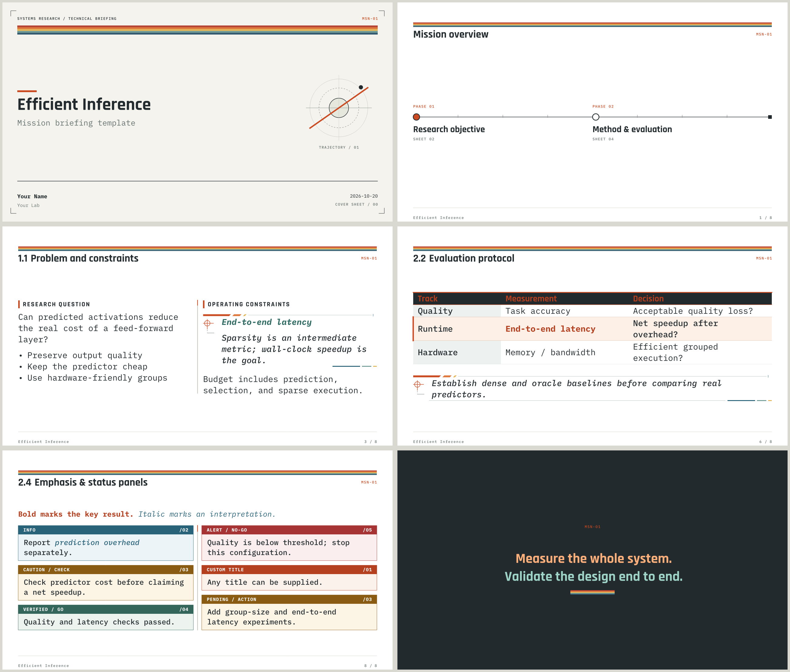

# touying-nasa-punk

An aerospace mission-briefing theme for [Touying](https://github.com/touying-typ/touying):
livery rails, a vector orbital cover mark, phase-tracked section slides, a flight-plan
outline, and instrument-panel callouts. Built on Touying's Metropolis theme.



## Quick start

```bash
typst init @preview/touying-nasa-punk:0.1.0
```

or import it into an existing document:

```typst
#import "@preview/touying-nasa-punk:0.1.0": *

#show: nasa-punk-theme.with(
  mission: [SYSTEMS RESEARCH / TECHNICAL BRIEFING],
  mission-code: [MSN-01],
  config-info(title: [Efficient Inference], author: [Your Name], date: datetime.today()),
)

#title-slide()
#outline-slide()

= Research objective
== Problem
#slide[
  #cols[Left column][Right column]
  #pause
  #hint[*Key takeaway* with an engineering annotation.]
]

#focus-slide[*Measure the whole system.*]
```

The package re-exports Touying, so `#pause`, `config-info`, etc. are available from the
single import. Add `#set heading(numbering: "1.1")` to number slide titles.

## Theme options

`nasa-punk-theme` accepts every Touying config (`config-info`, `config-common`, …) plus:

| Option | Default | Description |
|---|---|---|
| `aspect-ratio` | `"16-9"` | `"16-9"` or `"4-3"` |
| `mission` | `none` | Cover-sheet header; falls back to the title |
| `mission-code` | `[]` | Orange code shown on every slide header |
| `fonts` | see below | Partial dictionary merged into `default-fonts` |

## Slides and helpers

| Function | Purpose |
|---|---|
| `title-slide(extra: none)` | Cover sheet with crop marks and orbital mark |
| `outline-slide(title: [Mission overview], depth: 1)` | Flight-plan timeline of sections; `depth: 2` lists subsections |
| `slide(title: auto)[...]` | Regular slide; level-2 headings become titles |
| `new-section-slide` | Generated automatically for level-1 headings |
| `focus-slide[...]` | Dark full-screen statement |
| `cols(columns:, gutter:, divider: true)[...][...]` | Columns with orange-capped dividers |
| `hint[...]` | Annotation with a registration-target marker |
| `callout(kind: "note", title: auto)[...]` | Panel; `kind`: `note`, `info`, `warning`, `success`, `danger` |
| `todo[...]` | `PENDING / ACTION` callout |
| `table-highlight(..cells)` | Spread into `table(...)` to accent a whole row |
| `tag[...]`, `rail()`, `palette` | Small caption, livery stripes, and color palette |

Tables are styled automatically: the first row is a dark header and the first column is
tinted. Level-3 headings render as tracked-caps section labels.

## Fonts

Typst packages cannot ship fonts. Install these for the intended look:

- [Rajdhani](https://fonts.google.com/specimen/Rajdhani) — titles
- [IBM Plex Mono](https://fonts.google.com/specimen/IBM+Plex+Mono) — body text
- [Maple Mono NF](https://github.com/subframe7536/maple-font) — code
- [Sarasa Gothic SC](https://github.com/be5invis/Sarasa-Gothic) — CJK fallback (optional)

Rajdhani and IBM Plex Mono are available in the Typst web app. To substitute any of them:

```typst
#show: nasa-punk-theme.with(
  fonts: (code: ("IBM Plex Mono",), title: ("Rajdhani", "Noto Sans CJK SC")),
)
```

## License

The theme (`src/`) is licensed under [MIT](LICENSE). The template directory
(`template/`) is licensed under [MIT-0](LICENSE-MIT-0), so decks created from it can be
used and shared without attribution.
