# typart

SmartArt-style diagrams for Typst posters, papers and presentations: flowcharts, process, cycle, hierarchy, relationship, matrix and pyramid diagrams, plus data widgets (bars, gauges, waffle, KPI cards), timelines, Gantt charts and tables.

- **Fast.** Every widget is drawn with native Typst primitives and has no dependencies; a diagram costs a few milliseconds, and a `flowchart` is about 40× faster than the same diagram in fletcher.
- **Text always fits.** Boxes grow to fit their longest label; round and slanted shapes keep their size and shrink all labels to one shared size that fits, as SmartArt does.
- **Connectable components.** `flowchart` composes nodes, chained edges and titled groups, laid out on a grid or automatically; with `panels` and `loop-ring` it rebuilds typical paper figures (see [Paper figures](#paper-figures)).

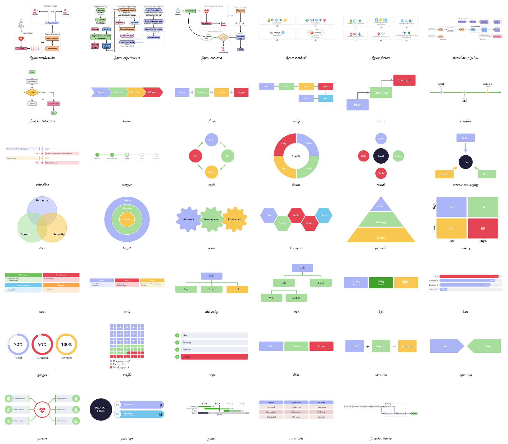

## Installation

```typst
#import "@preview/typart:0.2.1": *
```

## Items and colours

Unless noted otherwise, every widget takes a list of items where each item is either a label (content) or a `(label, color)` tuple that overrides that item's colour. Items without an explicit colour cycle through the built-in `palette` (lavender, green, amber, red, sky), which is also exported for your own use.

Dimension parameters given as plain numbers (`w`, `h`, `radius`, …) are centimetres; they also accept any Typst length (`2.5cm`, `40pt`, …). Parameters documented with `pt`/`cm` defaults are regular Typst lengths.

Sizes documented as heights are minimums: boxes grow to fit their text. Spacings that carry arrows (`stairs`, `arrows`, `cycle`, `radial`) never shrink below what keeps every arrow visible.

## Flowcharts and pipelines

`flowchart` builds method, pipeline and decision diagrams from three components:

- `node(name, [(column, row)], body, ..style)` — a box, pill, circle, ellipse, diamond, loop or no shape at all (`shape: none`) with any content (icons, images, math), and an optional `caption` hanging below it. `shape: none` gives a bare icon or plot.
- `edge("a", "b", "c", ..)` — connects nodes (or named groups) in a chain: `a → b → c`. Routing is automatic: straight when the two shapes face each other, elbowed otherwise, and around the row when the straight line is blocked or would overlap a reverse edge. `via:` forces a route through grid points, `bend:` curves the edge.
- `group(title, "a", "b", ..)` — a dashed frame around nodes, titled on its border or `inside: true`; give it a `name` to connect edges to the whole frame.

Nodes with a `(column, row)` position sit on a grid whose columns and rows take the size of their largest node; gaps widen to fit group frames, and leave room for an arrow wherever an edge crosses them; fractional positions such as `(0.5, 1)` sit between tracks (centred over two nodes) and widen them when needed. Leave the position out and the layout is automatic: each node goes one layer after its longest chain of predecessors (topological order), and is aligned with its predecessors inside its layer.

See [Paper figures](#paper-figures) for complete diagrams built with these pieces.

```typst
#flowchart(
  node("data", [Raw data]), node("clean", [Cleaning]), node("feat", [Features]),
  node("a", [Model A]), node("b", [Model B]), node("ens", [Ensemble]),
  node("out", [Report], shape: "pill", fill: rgb("#a7dd9b")),
  edge("data", "clean", "feat", "a", "ens", "out"),
  edge("feat", "b", "ens"),
  group([Training], "a", "b", "ens"),
)
```

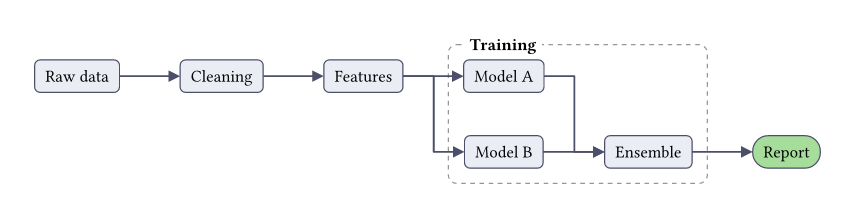

A decision flowchart, top to bottom, with edge labels and a dashed back edge:

```typst
#flowchart(
  dir: ttb,
  node("start", [Start], shape: "pill", fill: rgb("#a7dd9b")),
  node("read", [Read input]),
  node("ok", [Valid?], shape: "diamond", fill: rgb("#f9c74f")),
  node("run", [Process]),
  node("err", [Report error], fill: rgb("#f38ba8")),
  node("end", [End], shape: "pill", fill: rgb("#a7dd9b")),
  edge("start", "read", "ok"),
  edge("ok", "run", label: [yes]),
  edge("ok", "err", label: [no]),
  edge("run", "end"),
  edge("err", "end"),
  edge("err", "read", dash: "dashed", label: [retry]),
)
```

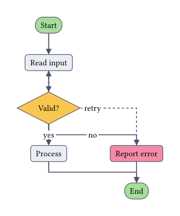

A research pipeline placed on the grid, with groups (nodes may hold any content, e.g. `image(...)` plots):

```typst
#set text(size: 9pt)
#let (key, model, feature, feat, eval) = (rgb("#8f8fde"), rgb("#a9a9e6"), rgb("#f5b57a"), rgb("#89b4fa"), rgb("#f38ba8"))
#flowchart(
  spacing: (12mm, 12mm),
  node("pwd", (3, -1), [User password], fill: key),
  node("sha", (4, -1), [SHA-256], fill: key),
  node("map", (5, -1), [Chaotic map \ (logistic / tent)], fill: model),
  node("smat", (6, -1), [Projection \ $S in RR^(d times n)$], fill: model),
  node("ecg", (0, 0), [ECG signal], fill: white),
  node("ppg", (0, 1), [PPG signal], fill: white),
  node("dct1", (1, 0), [DCT], fill: feature),
  node("dct2", (1, 1), [DCT], fill: feature),
  node("cat", (2, 0), [Concatenate \ first halves], fill: white),
  node("idct", (3, 0), [IDCT], fill: feature),
  node("mfcc", (4, 0), [MFCC], fill: feat),
  node("x", (5, 0), [Features \ $x in RR^n$], fill: feat),
  node("tpl", (6, 0), [Template \ $t = S x$], fill: model),
  node("match", (6, 1), [Cosine matcher], fill: eval),
  node("metrics", (5, 1), [AUC · EER · DET], fill: white),

  edge("pwd", "sha", "map", "smat", "tpl"),
  edge("ecg", "dct1", "cat", "idct", "mfcc", "x", "tpl", "match", "metrics"),
  edge("ppg", "dct2", "cat"),

  group([Chaotic projection], "pwd", "sha", "map", "smat"),
  group([Signal fusion], "dct1", "dct2", "cat", "idct", title-pos: bottom),
  group([Feature extraction], "mfcc", "x"),
  group([Evaluation], "match", "metrics", title-pos: bottom),
)
```

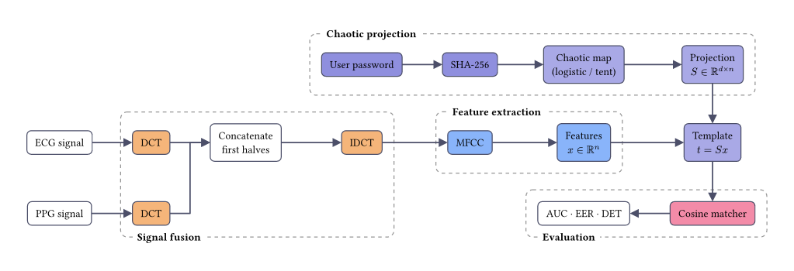

### flowchart

| Parameter | Default | Description |
|---|---|---|
| `..children` | — | Nodes, edges and groups, in any order. |
| `dir` | `ltr` | Flow direction for automatic layout and elbow routing: `ltr` or `ttb`. |
| `spacing` | `(1.4cm, 1cm)` | Minimum gap between columns and between rows (one length for both); gaps widen to fit group frames and titles. |
| `node-fill` | `rgb("#ebedf5")` | Default node fill. |
| `node-stroke` | `0.8pt + rgb("#4c4f69")` | Default node outline. |
| `edge-stroke` | `1.2pt + rgb("#4c4f69")` | Default edge stroke. |
| `loop-stroke` | `3pt + rgb("#a7dd9b")` | Default stroke of `loop` nodes. |
| `radius` | `4pt` | Corner radius of `rect` nodes. |
| `inset` | `7pt` | Default padding inside nodes. |
| `group-stroke` | dashed `luma(150)` | Default group frame. |
| `group-inset` | `10pt` | Space between a group frame and its nodes. |
| `title-style` | `(weight: "bold")` | Text settings for every group title, e.g. `(weight: "regular", fill: luma(110), size: 18pt)`. |
| `caption-style` | `(:)` | Text settings for every node caption, e.g. `(size: 10pt)`. |
| `independent-columns` | `false` | `true` lets each lane (columns joined by nodes placed between them) size its own rows, so a tall node in one lane does not stretch the others. |

### node

| Parameter | Default | Description |
|---|---|---|
| `name` | — | Identifier used by edges and groups (a string or a label). |
| `pos` | automatic | Optional `(column, row)` position; fractions place a node between tracks. Give it to all nodes, or to none. |
| `body` | — | Any content. |
| `shape` | `"rect"` | `"rect"`, `"pill"`, `"circle"`, `"ellipse"`, `"diamond"`, `"loop"` (an open ellipse with an arrowhead, coloured by `stroke`) or `none` (the content alone). |
| `caption` | `none` | Content below the shape; edges leaving downwards start under it. |
| `fill` | `node-fill` | Fill colour. |
| `stroke` | `node-stroke` | Outline. |
| `width` | `auto` | Fixed width (the text wraps inside); `auto` = natural width. |
| `height` | `auto` | Minimum height of the shape. |
| `inset` | `inset` | Padding. |

### edge

| Parameter | Default | Description |
|---|---|---|
| `..names` | — | Two or more node or group names; consecutive pairs are connected. |
| `marks` | `"->"` | `"->"`, `"<-"`, `"<->"` or `"-"`. |
| `label` | `none` | Content shown on the longest leg of the edge. |
| `stroke` | `edge-stroke` | Stroke of this edge. |
| `dash` | `none` | Dash pattern, e.g. `"dashed"`, `"dotted"`. |
| `route` | `auto` | `"straight"`, `"hv"`, `"vh"`, `"hvh"`, `"vhv"` (h = horizontal, v = vertical leg) or `"detour"`. |
| `via` | `()` | Grid points the edge passes through, e.g. `((1.5, 4), (1.5, 0))`; fractions allowed. |
| `bend` | `0deg` | Curves the edge by this angle; positive bends to the left of the direction of travel. |

### group

| Parameter | Default | Description |
|---|---|---|
| `title` | — | Title of the frame; `none` for a plain frame. |
| `..names` | — | Nodes to enclose. |
| `name` | `none` | Lets edges start or end at the frame. |
| `inside` | `false` | `true` writes the title inside the frame, centred, instead of on its border. |
| `title-pos` | `top` | `top` or `bottom`. |
| `fill` | `none` | Frame background. |
| `stroke` | `group-stroke` | Frame outline. |
| `stretch` | `none` | Edges that grow until they meet another frame or node, or the outer edge of the diagram: `bottom`, `right`, `(bottom, right)`, … Groups stretch in declaration order. |
| `join` | `none` | Name of another group; the two frames are drawn as the outline of their union (one shape when they touch). |

## Paper figures

Building blocks for figures in papers and posters: `panels` lays out framed sub-figures with captions and a), b)… labels; `loop-ring` draws a "repeat / continuous" ring around any content; `flowchart` composes method diagrams. The figures below are complete examples, set in [Inter](https://rsms.me/inter/) (any installed font works); icons are Font Awesome glyphs.

**Images.** A `node` body, a `panels` item and a `loop-ring` accept any content, so a picture is just `image(...)`; the path is resolved from your own document. Combine it with `shape: none` for a bare picture, and with `caption:` for a label under it:

```typst
#flowchart(
  node("sig", (0, 0), image("images/ecg.svg", width: 3cm), shape: none, caption: [ECG]),
  node("model", (1, 0), [Model]),
  edge("sig", "model"),
)
#panels(columns: 2, (image("images/ecg.svg", width: 4cm), [Raw signal]), ([Filtered], [Caption]))
```

A method diagram in three lanes: `independent-columns: true` lets each lane stack its own rows, captions hang under the boxes, fractional positions centre a node over two columns, routes go through grid points (`via`), arrows reaching the same side of a node get their own slots, `stretch` grows the K-Fold frame to the right and the Validation frame down until they meet, and `join` draws both as one outline:

```typst
#set text(font: "Inter", size: 16pt, weight: "bold")
#let (green, red, blue, orange, violet) = (rgb("#a7dd9b"), rgb("#f38ba8"), rgb("#89b4fa"), rgb("#f9b98a"), rgb("#b4bcfa"))

#flowchart(
  node-stroke: 1.5pt + black,
  title-style: (weight: "regular", fill: luma(110), size: 18pt),
  caption-style: (size: 10pt),
  independent-columns: true,
  spacing: (12mm, 9mm),
  edge-stroke: 1.5pt + black,
  radius: 10pt,
  inset: 10pt,
  node("dataset", (0.5, 0), [Dataset], fill: green, caption: [Dataset Name \ Users: Number]),
  node("load", (0.5, 1), [Load Data], fill: green, caption: [Num. Segments: N \ Size segment: Fs\*t]),
  node("sig1", (0, 2), [Signal1], fill: red),
  node("sig2", (1, 2), [Signal2], fill: blue),
  node("seg", (0.5, 3), [Segment-by-segment \ preprocessing], fill: green),
  node("pre1", (0, 4), [Signal1 \ Prepo], fill: red.darken(10%)),
  node("pre2", (1, 4), [Signal2 \ Prepo], fill: blue.darken(10%)),

  node("feat", (2.5, 0), [Feature extraction], fill: orange,
    caption: [Wavelet: bior3.3 \ characteristics by coefficient: \ [mean, std, var, kurtosis, skewness, \ energy, entropy, max, min, median, iqr, range, mad]]),
  node("f1", (2, 1), [Signal1 F], fill: red.lighten(50%)),
  node("f2", (3, 1), [Signal2 F], fill: blue.lighten(50%)),
  node("merge", (2.5, 2), [Merging features], fill: orange),
  node("final", (2.5, 3), [Final features], fill: rgb("#f5c2e7")),
  node("kfold", (2.5, 4), [Stratified K-Fold], fill: violet, caption: [Folds: 5 \ [Fold 1] [Fold 2] … [Fold k]]),

  node("list", (4, 0), [List of classifiers], fill: violet,
    caption: [classifiers: [Random Forest, Logistic \ Regression, KNN, Decision Tree, \ Naive Bayes, Extra Trees, LDA]]),
  node("cv", (4, 1), [Cross-Validation loop], fill: violet, caption: [Train and test classifier by classifier]),
  node("report", (4, 2), [Classification Report], fill: violet, caption: [Save in parquet packages]),
  node("viz", (4, 3), [Visualization], fill: violet),

  edge("dataset", "load"),
  edge("load", "sig1", "seg", "pre1"),
  edge("load", "sig2", "seg", "pre2"),
  edge("pre1", "feat", via: ((0, 4.7), (1.6, 4.7), (1.6, 0))),
  edge("pre2", "feat", via: ((1, 4.55), (1.5, 4.55), (1.5, 0))),
  edge("feat", "f1", "merge", "final", "kfold"),
  edge("feat", "f2", "merge"),
  edge("kfold", "list", via: ((3.45, 4), (3.45, 0))),
  edge("list", "cv", "report", "viz"),

  group([Preprocessing], "dataset", "load", "sig1", "sig2", "seg", "pre1", "pre2", inside: true),
  group([Feature Engineering], "feat", "f1", "f2", "merge", "final", inside: true),
  group(none, "kfold", name: "kfold-box", stretch: right),
  group([Validation and Results], "list", "cv", "report", "viz", inside: true, stretch: bottom,
    join: "kfold-box"),
)
```

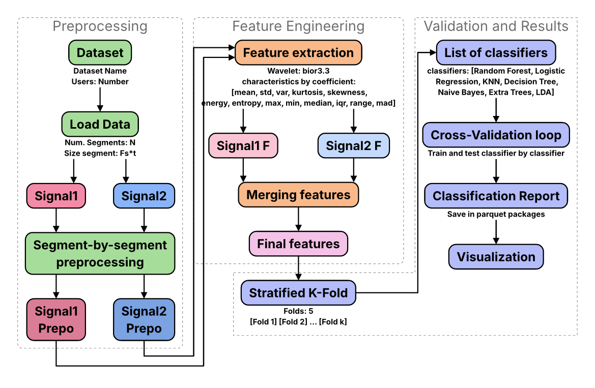

A continuous-authentication scheme: icons as nodes, edges between whole groups, a decision diamond, a `loop` node and a curved back edge:

```typst
#set text(font: "Inter", size: 12pt, weight: "bold")

#flowchart(
  node-stroke: 1.2pt + black,
  title-style: (weight: "regular", fill: luma(110), size: 14pt),
  spacing: (14mm, 16mm),
  edge-stroke: 2.5pt + black,
  radius: 8pt,
  node("user", (0, 0), icon("\u{f007}", fill: rgb("#64b5f6"), size: 36pt), caption: [Sesion \ Request], shape: none),
  node("auth", (1, 0), [Authentication \ Request], fill: rgb("#a7dd9b")),
  node("watch", (2, 0), icon("\u{f21e}", fill: rgb("#f44336"), size: 44pt), shape: none),
  node("capture", (2, 1), [Signal Capture], fill: rgb("#f38ba8")),
  node("plot", (3, 1), icon("\u{f201}", fill: rgb("#e53935"), size: 44pt), shape: none),
  node("convert", (4, 0), [Convert to \ Features], fill: rgb("#f9b98a")),
  node("vector", (4, 1), text(weight: "regular", size: 16pt, $[F_1, F_2, ..., F_n]$), shape: none),
  node("model", (4, 2), [Pre-trained \ model], fill: rgb("#b4bcfa")),
  node("classify", (4, 3), [Classify], fill: rgb("#b4bcfa")),
  node("check", (3, 2), [Is #icon("\u{f007}", fill: rgb("#64b5f6"), size: 22pt) ?], shape: "diamond", fill: rgb("#f6dfac"), stroke: 1pt + black),
  node("again", (2, 2), [New session \ time], shape: "loop", fill: white, stroke: 5pt + rgb("#a7dd9b")),
  node("ended", (3, 3), icon("\u{f506}", fill: rgb("#f06292"), size: 36pt), caption: [Session ended], shape: none),

  edge("user", "auth", "capture-box"),
  edge("watch", "capture", "plot"),
  edge("capture-box", "features"),
  edge("convert", "vector"),
  edge("features", "model-box"),
  edge("model", "classify"),
  edge("model", "check"),
  edge("check", "again", label: text(weight: "regular")[yes]),
  edge("check", "ended", label: text(weight: "regular")[no]),
  edge("again", "auth", bend: 45deg),

  group([Continuous signal capture], "watch", "capture", "plot", name: "capture-box", inside: true),
  group([Feature extraction], "convert", "vector", name: "features", inside: true),
  group([Model], "model", "classify", name: "model-box", inside: true),
  group([Verification module], "again", "check", inside: true),
)
```

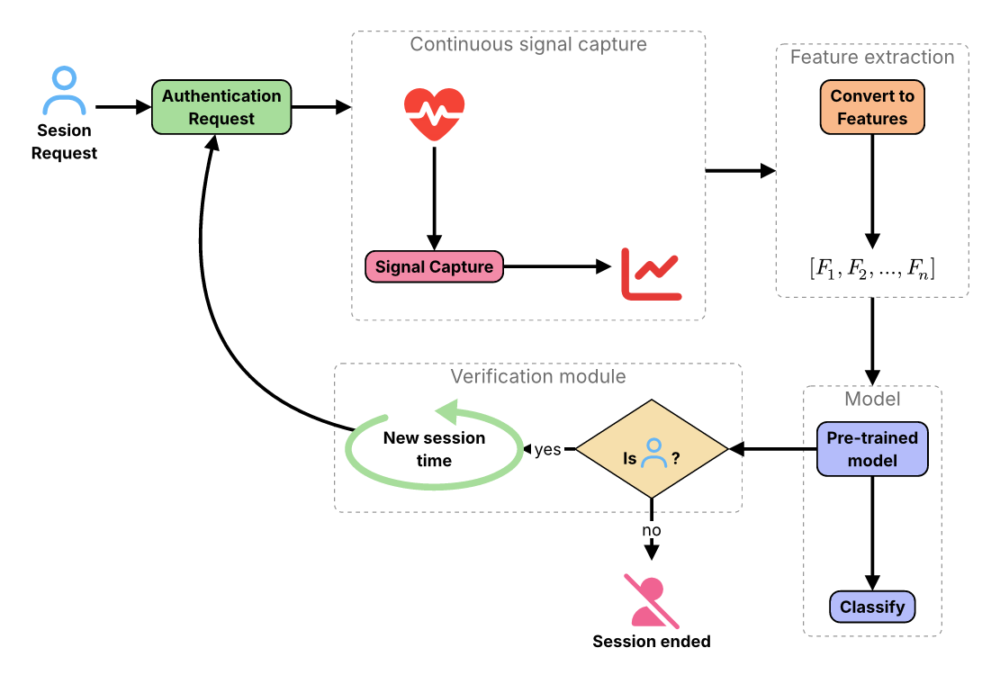

A verification pipeline with an image node (`images/ecg.svg`), edges between whole groups and two branches leaving one node through waypoints:

```typst
#set text(font: "Inter", size: 13pt, weight: "bold")

#flowchart(
  node-stroke: 1.2pt + black,
  title-style: (weight: "regular", size: 15pt),
  spacing: (10mm, 9mm),
  edge-stroke: 2.5pt + black,
  radius: 8pt,
  group-stroke: (paint: luma(120), thickness: 1pt, dash: "dashed"),
  node("user", (0, 0), icon("\u{f007}", fill: rgb("#c48b9f"), size: 44pt), caption: [Sesion \ Request], shape: none),
  node("watch", (0, 1), icon("\u{f21e}", fill: rgb("#f44336"), size: 52pt), shape: none),
  node("capture", (0, 2), [Capture], fill: rgb("#f38ba8"), width: 4cm),
  node("ecg", (1, 2), image("images/ecg.svg", width: 3cm), shape: none),
  node("feat", (2, 1), [Feature extraction], fill: rgb("#f9b98a"), width: 4.6cm, height: 1.6cm),
  node("prep", (2, 2), [Preprocesing], fill: rgb("#f9b98a"), width: 4.6cm, height: 1.6cm),
  node("rejected", (1, -1), icon("\u{f235}", fill: rgb("#f06292"), size: 44pt), caption: [Rejected], shape: none),
  node("or", (2, -1), text(weight: "regular", size: 18pt)[OR], shape: none),
  node("accepted", (3, -1), icon("\u{f4fc}", fill: rgb("#c48b9f"), size: 44pt), caption: [Accepted], shape: none),
  node("auth", (2, 0), [Autentication], fill: rgb("#b4bcfa"), width: 4.6cm),

  edge("user", "capture-box", "features", "verification"),
  edge("watch", "capture", "ecg"),
  edge("prep", "feat"),
  edge("auth", "rejected", via: ((1.75, -1),)),
  edge("auth", "accepted", via: ((2.25, -1),)),

  group([Signal Capture], "watch", "capture", "ecg", name: "capture-box", inside: true),
  group([Feature Engineering], "feat", "prep", name: "features", inside: true),
  group([Verification Stage], "rejected", "or", "accepted", "auth", name: "verification", inside: true),
)
```

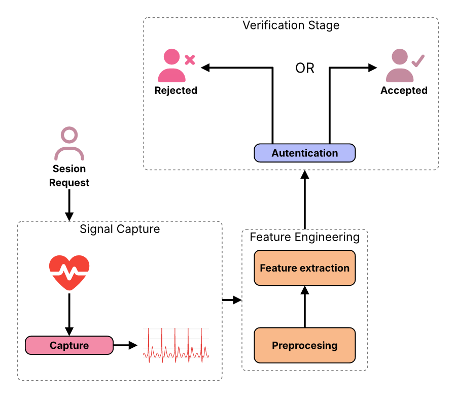

Sub-figure grids with `panels`:

```typst
#set text(font: "Inter", size: 12pt)

#panels(columns: 3, numbering: "1)",
  (hstack(icon("\u{f023}", fill: rgb("#8bc34a")), icon("\u{f27a}", fill: rgb("#2196f3")), icon("\u{f06e}", fill: rgb("#26a69a"))), [Something a user knows]),
  (hstack(icon("\u{f3cf}", fill: rgb("#29b6f6")), icon("\u{f084}", fill: rgb("#ffc107")), icon("\u{f2c2}", fill: rgb("#2196f3"))), [Something in a user's possession]),
  (hstack(icon("\u{f577}", fill: rgb("#29b6f6")), icon("\u{f007}", fill: rgb("#90a4ae")), icon("\u{f06e}", fill: rgb("#00897b"))), [Something the user is]),
  (hstack(icon("\u{f554}", fill: rgb("#e53935")), icon("\u{f11c}", fill: rgb("#e53935")), icon("\u{f25a}", fill: rgb("#1e88e5"))), [Something the user does]),
  (hstack(icon("\u{f3c5}", fill: rgb("#ef5350")), icon("\u{f1eb}", fill: rgb("#1e88e5"))), [Somewhere that a user is]),
  (hstack(icon("\u{f519}", fill: rgb("#1e88e5")), icon("\u{f1bb}", fill: rgb("#43a047"))), [Something that is in the user's environment]),
)
```

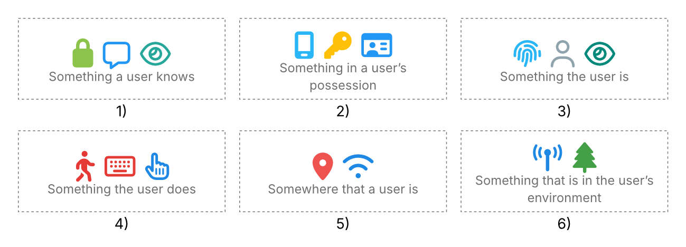

```typst
#set text(font: "Inter", size: 12pt)
#let op(t) = text(size: 22pt, t)

#panels(columns: 2,
  (hstack(icon("\u{f023}", fill: rgb("#8bc34a")), op[OR], icon("\u{f577}", fill: rgb("#29b6f6")), op[OR], icon("\u{f084}", fill: rgb("#ffc107"))), [Single-Factor]),
  (hstack(icon("\u{f06e}", fill: rgb("#26a69a")), op[And], icon("\u{f577}", fill: rgb("#29b6f6")), op[OR], icon("\u{f3c5}", fill: rgb("#ef5350"))), [Multi-Factor]),
  (hstack(icon("\u{f83e}", fill: rgb("#e53935")), op[Merge], icon("\u{f577}", fill: rgb("#29b6f6"))), [Multimodal]),
  (loop-ring(hstack(icon("\u{f21e}", fill: rgb("#e53935")), [Verification]), stroke: 4pt + rgb("#a7dd9b")), [Continuous]),
)
```

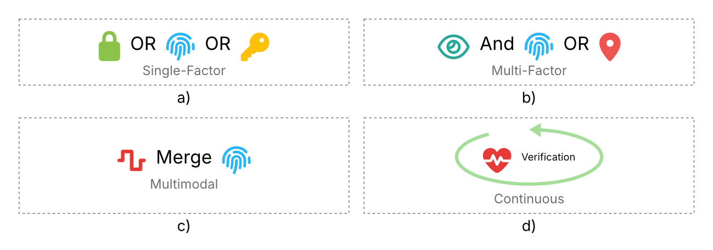

### panels

| Parameter | Default | Description |
|---|---|---|
| `..items` | — | Panels: `(body, caption)` or just `body`. |
| `columns` | `2` | Panels per row; panels in a row share their height. |
| `numbering` | `"a)"` | Numbering pattern for the labels below the panels; `none` hides them. |
| `stroke` | dashed `luma(120)` | Panel frame. |
| `fill` | `none` | Panel background. |
| `radius` | `0pt` | Panel corner radius. |
| `caption-fill` | `luma(110)` | Caption colour. |
| `caption-size` | `1.3em` | Caption size. |
| `label-size` | `1.5em` | Label size. |
| `inset` | `12pt` | Padding inside panels. |
| `gutter` | `18pt` | Space between panels. |

### icon and hstack

Two helpers for figure content: `icon` sets a glyph from an icon font (Font Awesome 7 Free by default, used by the examples above), and `hstack` puts items side by side on a common middle line.

```typst
#hstack(icon("\u{f023}", fill: rgb("#8bc34a")), text(size: 22pt)[OR], icon("\u{f084}", fill: rgb("#ffc107")))
```

| Parameter | Default | Description |
|---|---|---|
| `icon(glyph, ..)` | — | The glyph, e.g. `"\u{f023}"` (any font's codepoint). |
| `fill` | `auto` | Glyph colour; `auto` = the current text colour. |
| `size` | `34pt` | Glyph size. |
| `font` | `"Font Awesome 7 Free"` | Icon font. |
| `hstack(..items, ..)` | — | Items to lay out in a row. |
| `gap` | `1em` | Space between items. |

### loop-ring

| Parameter | Default | Description |
|---|---|---|
| `body` | — | Content inside the ring. |
| `stroke` | `3pt + rgb("#a7dd9b")` | Ring colour and thickness. |
| `inset` | `6pt` | Space between the content and the ring. |

## List

### steps
A vertical numbered list of steps.

```typst
#steps(([Plan], [Execute], [Review], ([Deploy], rgb("#e64553"))))
```

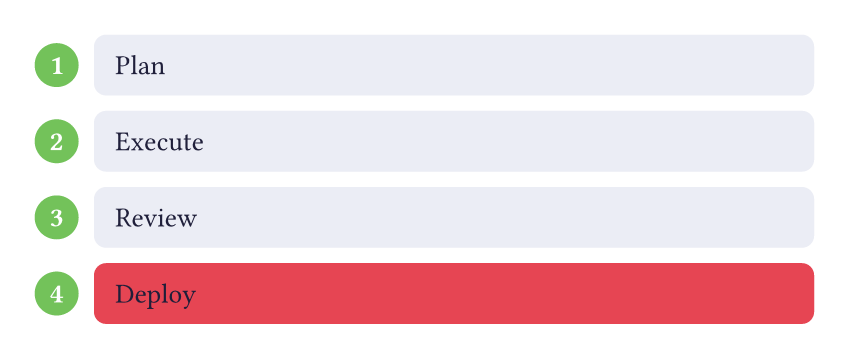

| Parameter | Default | Description |
|---|---|---|
| `items` | — | Steps; label or `(label, color)` (colour overrides the box fill). |
| `accent` | `rgb("#73c25a")` | Number-circle fill. |
| `box-fill` | `rgb("#ebedf5")` | Default step box fill. |
| `text-fill` | `rgb("#1f1f3a")` | Text colour. |
| `size` | `18pt` | Text size. |
| `radius` | `8pt` | Box corner radius. |
| `gutter` | `10pt` | Space between steps and between circle and box. |
| `inset` | `14pt` | Box padding. |

### hlist
A horizontal row of equally sized coloured blocks.

```typst
#hlist(([Plan], [Execute], ([Review], rgb("#e64553"))))
```


| Parameter | Default | Description |
|---|---|---|
| `items` | — | Blocks; label or `(label, color)`. |
| `text-fill` | `white` | Text colour. |
| `size` | `18pt` | Text size. |
| `height` | `3cm` | Minimum block height; blocks grow to fit the tallest label. |
| `radius` | `8pt` | Block corner radius. |
| `gutter` | `10pt` | Gap between blocks. |
| `inset` | `12pt` | Block padding. |

### cards
Columns with a coloured header over a tinted body (horizontal bullet list). Headers share one height, and so do bodies.

```typst
#cards((
  ([Goals], list([Faster delivery], [Lower cost])),
  ([Risks], list([Scope creep], [Budget overrun]), rgb("#e64553")),
  ([Actions], [Weekly review of progress against the plan.]),
))
```

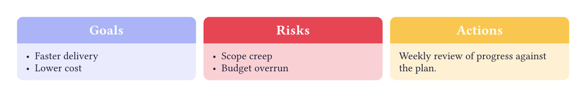

Items are tuples `(title, body)` or `(title, body, color)`.

| Parameter | Default | Description |
|---|---|---|
| `items` | — | Card tuples (see above). |
| `columns` | `auto` | Cards per row; `auto` = all in one row. Cards in a row share their header and body heights. |
| `text-fill` | `white` | Header text colour. |
| `body-fill` | `auto` | Body background; `auto` = the header colour lightened. |
| `body-text` | `rgb("#1f1f3a")` | Body text colour. |
| `size` | `18pt` | Header text size. |
| `body-size` | `14pt` | Body text size. |
| `gutter` | `10pt` | Gap between cards. |
| `radius` | `8pt` | Card corner radius. |
| `inset` | `12pt` | Header and body padding. |

### swot
A SWOT analysis as a 2×2 of cards (built on `cards`).

```typst
#swot(
  [- Experienced team \ - Unique dataset],
  [- Small budget],
  [- New market \ - Open data],
  [- Competition],
)
```

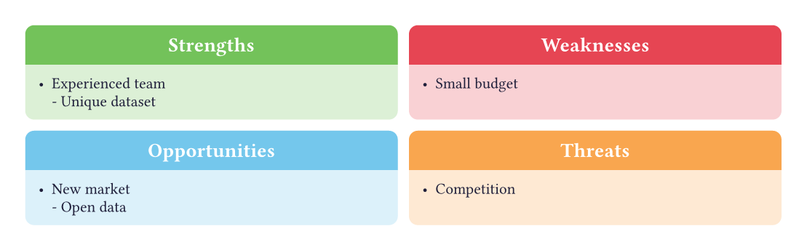

| Parameter | Default | Description |
|---|---|---|
| `strengths`, `weaknesses`, `opportunities`, `threats` | — | Body of each quadrant. |
| `titles` | `([Strengths], [Weaknesses], [Opportunities], [Threats])` | Quadrant titles (e.g. to translate them). |
| `colors` | green, red, sky, orange | Header colour of each quadrant. |
| `..style` | | Any `cards` parameter (`size`, `body-size`, `gutter`, `radius`, `inset`, …). |

### hexagons
A zig-zag strip of nested hexagons (honeycomb).

```typst
#hexagons(([Idea], [Design], ([Build], rgb("#e64553")), [Launch], [Learn]))
```

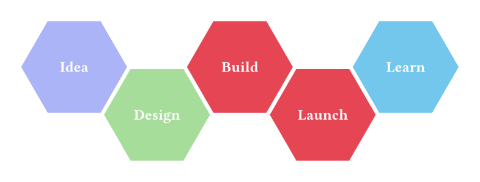

| Parameter | Default | Description |
|---|---|---|
| `items` | — | Hexagons; label or `(label, color)`. |
| `r` | `2` | Hexagon radius (centre to corner). |
| `gap` | `0.15` | Gap between neighbouring edges. |
| `text-fill` | `white` | Text colour. |
| `size` | `16pt` | Text size. |

## Process

### flow
Blocks joined by block arrows (basic process), horizontal or vertical.

```typst
#flow(([Input], [Process], [Review], ([Output], rgb("#e64553"))))
#flow(([Input], [Process], [Output]), dir: ttb)
```

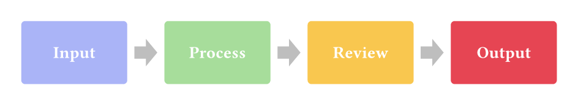

| Parameter | Default | Description |
|---|---|---|
| `items` | — | Blocks; label or `(label, color)`. |
| `dir` | `ltr` | `ltr` for a row, `ttb` for a column. |
| `w` | `4` | Block width. |
| `h` | `2.4` | Minimum block height; blocks grow to fit the tallest label. |
| `gap` | `1.4` | Space between blocks (where the arrows sit). |
| `accent` | `luma(190)` | Arrow colour. |
| `text-fill` | `white` | Text colour. |
| `size` | `18pt` | Text size. |
| `radius` | `0.15` | Block corner radius. |

### chevron
A sequence of right-pointing chevron arrows.

```typst
#chevron(([Phase 1], [Phase 2], [Phase 3], [Phase 4]))
```

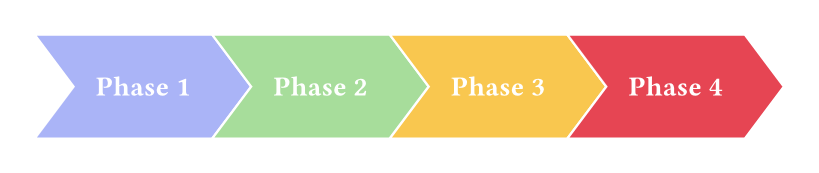

| Parameter | Default | Description |
|---|---|---|
| `items` | — | Chevrons; label or `(label, color)`. |
| `w` | `5` | Chevron width. |
| `h` | `2.4` | Minimum chevron height; grows to fit the tallest label. |
| `notch` | `0.9` | Depth of the arrow notch/point. |
| `text-fill` | `white` | Text colour. |
| `size` | `18pt` | Text size. |

### snake
A bending process that wraps into multiple rows.

```typst
#snake(([Step 1], [Step 2], [Step 3], [Step 4], [Step 5], [Step 6]))
```

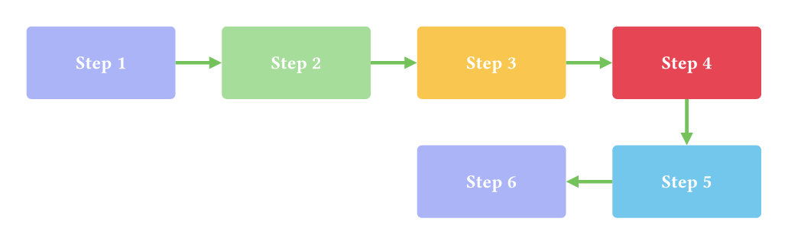

| Parameter | Default | Description |
|---|---|---|
| `items` | — | Steps; label or `(label, color)`. |
| `cols` | `4` | Items per row before wrapping. |
| `w` | `4.5` | Box width. |
| `h` | `2.2` | Minimum box height; boxes grow to fit the tallest label. |
| `gx` | `1.4` | Horizontal gap between boxes. |
| `gy` | `1.4` | Vertical gap between rows. |
| `accent` | `rgb("#73c25a")` | Arrow colour. |
| `text-fill` | `white` | Text colour. |
| `size` | `16pt` | Text size. |
| `radius` | `0.15` | Box corner radius. |

### stairs
An ascending stair-step process.

```typst
#stairs(([Plan], [Develop], ([Launch], rgb("#e64553"))))
```

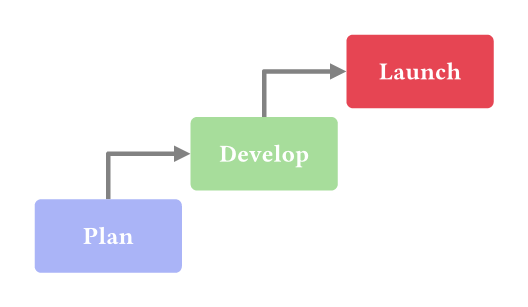

| Parameter | Default | Description |
|---|---|---|
| `items` | — | Steps; label or `(label, color)`. |
| `w` | `3.4` | Box width. |
| `h` | `1.7` | Minimum box height; boxes grow to fit the tallest label. |
| `dx` | `3.6` | Horizontal offset between steps (at least half a box plus room for the arrow). |
| `dy` | `1.9` | Vertical rise between steps (at least one box height, so steps never overlap). |
| `accent` | `luma(130)` | Arrow colour. |
| `text-fill` | `white` | Text colour. |
| `size` | `16pt` | Text size. |
| `radius` | `0.15` | Box corner radius. |

### timeline
A horizontal timeline with alternating labels above and below the line.

```typst
#timeline((("2024", [Start]), ("2025", [Pilot]), ("2026", [Launch])))
```

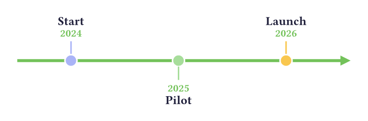

Items are tuples `(date, label)` or `(date, label, color)`.

| Parameter | Default | Description |
|---|---|---|
| `items` | — | Milestone tuples (see above). |
| `accent` | `rgb("#73c25a")` | Axis line and date colour. |
| `text-fill` | `rgb("#1f1f3a")` | Milestone label colour. |
| `size` | `16pt` | Label size. |
| `date-size` | `14pt` | Date size. |
| `step` | `5` | Horizontal distance between milestones. |

### vtimeline
A vertical timeline with cards alternating left and right of a central spine.

```typst
#vtimeline((
  ("2023", [Pilot study with 20 participants]),
  ("2024", [Data collection across three hospitals], rgb("#e64553")),
  ("2025", [Journal paper]),
  ("2026", [Product launch]),
))
```

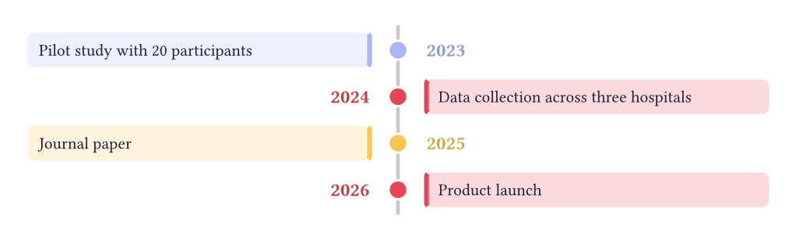

Items are tuples `(date, body)` or `(date, body, color)`.

| Parameter | Default | Description |
|---|---|---|
| `items` | — | Milestone tuples (see above). |
| `accent` | `luma(200)` | Spine colour. |
| `text-fill` | `rgb("#1f1f3a")` | Card text colour. |
| `size` | `14pt` | Card text size. |
| `date-size` | `16pt` | Date size. |
| `gap` | `10pt` | Space between rows. |
| `radius` | `6pt` | Card corner radius. |

### stepper
Numbered milestones on a line, marking what is done, what is in progress and what is next.

```typst
#stepper(([Proposal], [Data collection], [Model], [Paper], [Defense]), current: 2)
```


| Parameter | Default | Description |
|---|---|---|
| `items` | — | Milestone labels. |
| `current` | `0` | Index of the milestone in progress; earlier ones are done (✓), later ones upcoming. |
| `step` | `4.5` | Distance between milestones. |
| `node` | `0.55` | Circle radius. |
| `accent` | `rgb("#73c25a")` | Colour of done and current milestones. |
| `todo` | `luma(205)` | Colour of upcoming milestones. |
| `text-fill` | `rgb("#1f1f3a")` | Label colour. |
| `size` | `14pt` | Label size. |

### gantt
A Gantt chart with task bars, progress indicator, grid lines, and a "today" marker.

```typst
#gantt(
  (
    ("Planning",     0, 12, 100),
    ("Development",  6, 30, 60),
    ("Testing",     24, 40, 30),
    ("Papers",       0, 48, 20, false),
  ),
  span: 48, grid-step: 12,
  periods: ("Year 1", "Year 2", "Year 3", "Year 4"),
  today: 20,
)
```

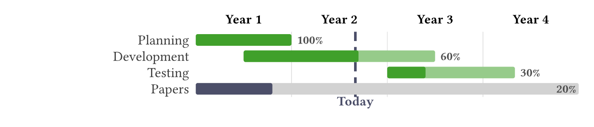

Each task is a tuple `(name, start, end)`, `(name, start, end, progress)` or `(name, start, end, progress, group)` — `group: false` renders the bar greyed instead of in the accent colour.

| Parameter | Default | Description |
|---|---|---|
| `tasks` | — | List of task tuples (see above). |
| `span` | `48` | Total length of the time axis, in any unit (months, years, …). |
| `grid-step` | `auto` | Faint vertical line every N units; `auto` = one per period boundary. |
| `today` | `none` | Unit position of the dashed "Today" marker; `none` = off. |
| `today-label` | `[Today]` | Text under the "Today" marker. |
| `periods` | `()` | Axis header labels, spread evenly across the span. |
| `accent` | `rgb("#40a02b")` | Colour of highlighted task bars. |
| `base-color` | `luma(210)` | Bar fill for non-highlighted (`group: false`) tasks. |
| `done-color` | `rgb("#4c4f69")` | Progress fill for non-highlighted tasks; also the "today" marker colour. |
| `progress-color` | `auto` | Filled progress portion of every bar; `auto` = derive from the above. |
| `track-color` | `auto` | Unfilled bar colour; `auto` = `accent` lightened. |
| `row-gap` | `0pt` | Vertical space between task rows. |
| `period-gap` | `0pt` | Space between the period header and the first task. |
| `name-fr` | `15` | Width ratio of the task-name column. |
| `bar-fr` | `33` | Width ratio of the timeline column. |
| `gutter` | `10pt` | Gap between the name and timeline columns. |

## Cycle

### cycle
Nodes arranged on a ring connected by curved arrows.

```typst
#cycle(([Plan], [Do], [Check], ([Act], rgb("#e64553"))))
```

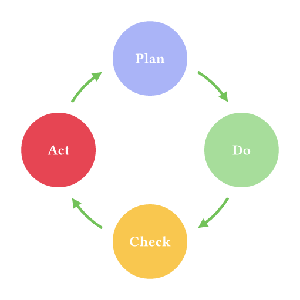

| Parameter | Default | Description |
|---|---|---|
| `items` | — | Nodes; label or `(label, color)`. |
| `radius` | `auto` | Ring radius; `auto` scales with the item count. Never smaller than needed to keep an arrow between neighbours. |
| `node` | `1.5` | Node circle radius. |
| `arrow` | `rgb("#73c25a")` | Arrow colour. |
| `text-fill` | `white` | Text colour. |
| `size` | `16pt` | Text size. |

### donut
A ring split into labelled segments (segmented cycle), clockwise from the top.

```typst
#donut(([Plan], [Build], [Test], ([Ship], rgb("#e64553"))), center: [Cycle])
```

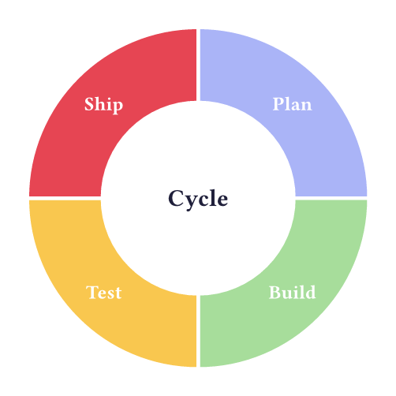

| Parameter | Default | Description |
|---|---|---|
| `items` | — | Segments; label or `(label, color)`. |
| `center` | `none` | Label in the hole. |
| `radius` | `5` | Outer radius. |
| `thickness` | `2.2` | Ring width. |
| `text-fill` | `white` | Segment text colour. |
| `center-fill` | `rgb("#1f1f3a")` | Centre label colour. |
| `size` | `16pt` | Segment text size (the centre is 4pt larger). |

## Hierarchy

### hierarchy
A root node with a row of children beneath it.

```typst
#hierarchy([CEO], (([Eng], rgb("#a7dd9b")), [Sales], [HR]))
```

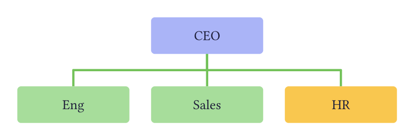

| Parameter | Default | Description |
|---|---|---|
| `root` | — | Root node label. |
| `children` | — | Child items; label or `(label, color)`. |
| `root-fill` | `rgb("#aab4f7")` | Root box fill. |
| `box-fill` | `auto` | Child box fill; `auto` = cycle the palette. A `(label, color)` child always keeps its own colour. |
| `text-fill` | `rgb("#1f1f3a")` | Text colour. |
| `accent` | `rgb("#73c25a")` | Connector line colour. |
| `box-w` | `5.2` | Box width. |
| `box-h` | `1.7` | Minimum box height; all boxes grow to fit the tallest label. |
| `gap-x` | `1.0` | Horizontal gap between children. |
| `level-gap` | `3.2` | Vertical distance between root and children. |
| `size` | `18pt` | Text size. |

### tree
A multi-level tree hierarchy. A node is a label, `(label, children)`, `(label, color)`, or `((label, color), children)`. Box heights grow automatically to fit wrapped text.

```typst
#tree(([CEO], (([Eng], ([Web], [Mobile])), [Sales])))
```

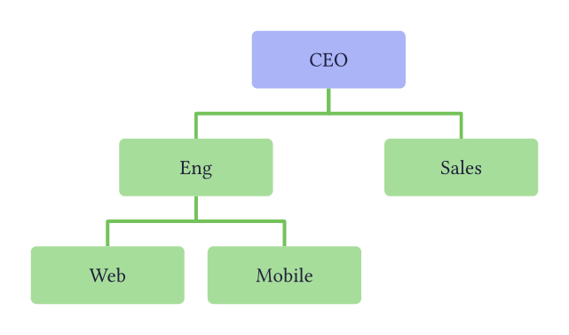

| Parameter | Default | Description |
|---|---|---|
| `root` | — | Root node (see node forms above). |
| `box-w` | `4` | Box width. |
| `box-h` | `1.5` | Minimum box height. |
| `xstep` | `4.6` | Horizontal spacing per leaf. |
| `ystep` | `2.8` | Vertical spacing between levels. |
| `root-fill` | `rgb("#aab4f7")` | Root box fill. |
| `box-fill` | `rgb("#a7dd9b")` | Non-root box fill. |
| `text-fill` | `rgb("#1f1f3a")` | Text colour. |
| `accent` | `rgb("#73c25a")` | Connector line colour. |
| `size` | `15pt` | Text size. |
| `filled` | `true` | `false` draws outlined boxes instead of filled ones. |
| `outline` | `2.5pt` | Outline thickness when `filled: false`. |
| `pad` | `0.3` | Vertical padding around wrapped text. |

## Relationship

### venn
A 2- or 3-circle Venn diagram.

```typst
#venn((([Behavior], rgb("#aab4f7")), [Signal], [Security]))
```

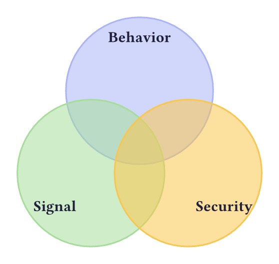

| Parameter | Default | Description |
|---|---|---|
| `items` | — | 2 or 3 items; label or `(label, color)`. |
| `radius` | `3.4` | Circle radius. |
| `text-fill` | `rgb("#1f1f3a")` | Label colour. |
| `size` | `20pt` | Label size. |
| `transparency` | `45%` | Circle fill transparency (higher = more see-through). |

### target
Concentric rings (bullseye), outermost item first.

```typst
#target(([Vision], [Mission], [Goal]))
```

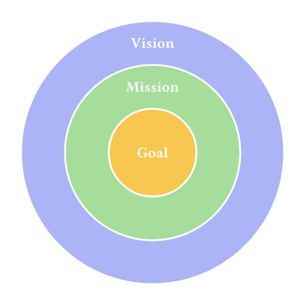

| Parameter | Default | Description |
|---|---|---|
| `items` | — | Rings from outside in; label or `(label, color)`. |
| `radius` | `5` | Outer ring radius. |
| `text-fill` | `white` | Label colour. |
| `size` | `16pt` | Label size. |

### radial
A centre circle joined by spokes to satellite circles.

```typst
#radial([Goal], ([People], [Process], ([Tools], rgb("#e64553")), [Data]))
```

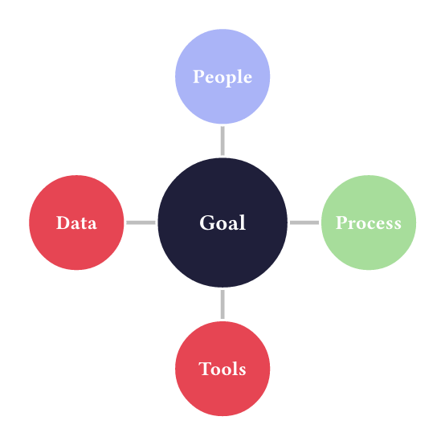

| Parameter | Default | Description |
|---|---|---|
| `center` | — | Label of the centre circle. |
| `items` | — | Satellites, clockwise from the top; label or `(label, color)`. |
| `radius` | `auto` | Minimum centre-to-satellite distance; satellites always stay apart and clear of the centre. |
| `node` | `1.4` | Satellite radius. |
| `core-r` | `1.9` | Centre radius. |
| `core-fill` | `rgb("#1f1f3a")` | Centre fill. |
| `accent` | `luma(190)` | Spoke colour. |
| `text-fill` | `white` | Satellite text colour. |
| `size` | `16pt` | Text size (the centre is 2pt larger). |

### arrows
Converging or diverging arrows around a central core.

```typst
// converging
#arrows(([Idea 1], [Idea 2], [Idea 3]), core: [Core])

// diverging
#arrows(([Branch 1], [Branch 2]), diverge: true)
```

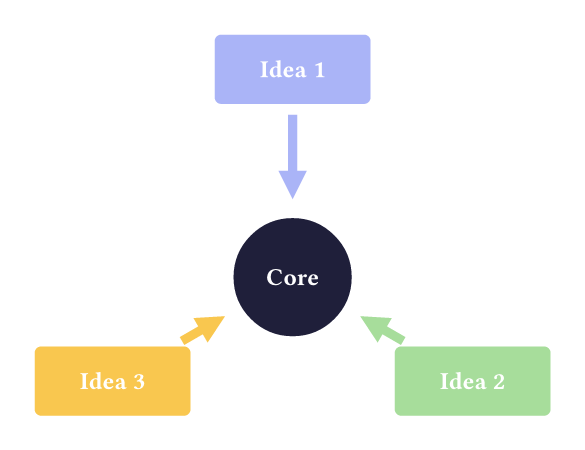
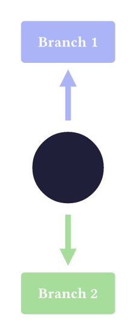

| Parameter | Default | Description |
|---|---|---|
| `items` | — | Outer boxes; label or `(label, color)`. |
| `core` | `none` | Label inside the central circle. |
| `diverge` | `false` | `true` points the arrows outward instead of inward. |
| `radius` | `4.8` | Distance from centre to the boxes; grows if an arrow would be shorter than 0.8cm. |
| `bw` | `3.6` | Box width. |
| `bh` | `1.6` | Minimum box height; boxes grow to fit the tallest label. |
| `text-fill` | `white` | Text colour. |
| `size` | `16pt` | Text size. |
| `core-fill` | `rgb("#1f1f3a")` | Central circle fill. |
| `core-r` | `1.4` | Central circle radius. |

### opposing
Two block arrows facing each other.

```typst
#opposing(([Pros], [Cons]))
```

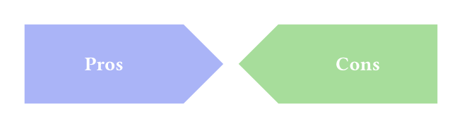

| Parameter | Default | Description |
|---|---|---|
| `items` | — | Exactly 2 items; label or `(label, color)`. |
| `w` | `6.5` | Arrow width. |
| `h` | `2.6` | Minimum arrow height; grows to fit the labels. |
| `notch` | `1.3` | Depth of the arrow point. |
| `gap` | `0.5` | Gap between the two points. |
| `text-fill` | `white` | Text colour. |
| `size` | `18pt` | Text size. |

### equation
An A + B = C equation-style diagram (last item is the result).

```typst
#equation(([Input 1], [Input 2], [Output]))
```

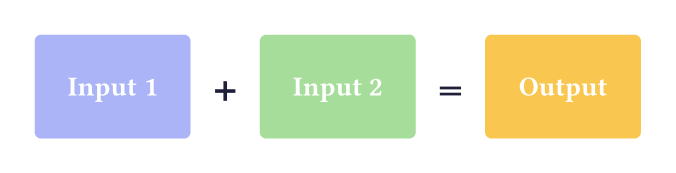

| Parameter | Default | Description |
|---|---|---|
| `items` | — | Operands then result; label or `(label, color)`. |
| `w` | `3.6` | Box width. |
| `h` | `2.4` | Minimum box height; boxes grow to fit the tallest label. |
| `gap` | `1.6` | Gap between boxes (where operators sit). |
| `text-fill` | `white` | Text colour. |
| `size` | `18pt` | Text size. |
| `op-size` | `32pt` | Operator (`+`, `=`) size. |
| `op-fill` | `rgb("#1f1f3a")` | Operator colour. |
| `radius` | `0.15` | Box corner radius. |

### gears
Up to 3 interlocking cogwheels (extra items are ignored).

```typst
#gears(([Research], [Development], [Production]))
```

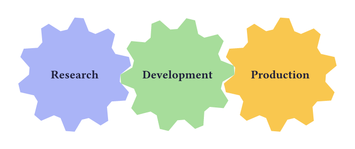

| Parameter | Default | Description |
|---|---|---|
| `items` | — | Up to 3 gears; label or `(label, color)`. Neighbouring gears always mesh, whatever the tooth count. |
| `r` | `2.6` | Gear radius. |
| `teeth` | `10` | Number of teeth per gear. |
| `text-fill` | `rgb("#1f1f3a")` | Label colour. |
| `size` | `15pt` | Label size. |

## Matrix and pyramid

### matrix
A 2x2 matrix with optional axis labels. Cells in order: top-left, top-right, bottom-left, bottom-right.

```typst
#matrix(([TL], [TR], [BL], [BR]),
  x-axis: ("Low", "High"),
  y-axis: ("High", "Low"))
```

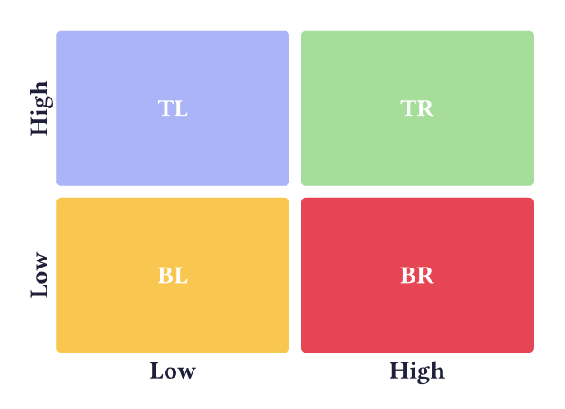

| Parameter | Default | Description |
|---|---|---|
| `cells` | — | 4 cells; label or `(label, color)`. |
| `x-axis` | `none` | `(left, right)` labels below the matrix. |
| `y-axis` | `none` | `(top, bottom)` labels beside the matrix. |
| `cw` | `6` | Cell width. |
| `ch` | `4` | Minimum cell height; cells grow to fit the tallest label. |
| `gutter` | `0.3` | Gap between cells. |
| `text-fill` | `white` | Cell text colour. |
| `size` | `18pt` | Text size. |
| `axis-fill` | `rgb("#1f1f3a")` | Axis label colour. |
| `radius` | `0.12` | Cell corner radius. |

### pyramid
A pyramid or funnel diagram (use `flip: true` for a funnel).

```typst
#pyramid(([Vision], [Strategy], [Tactics]))
```

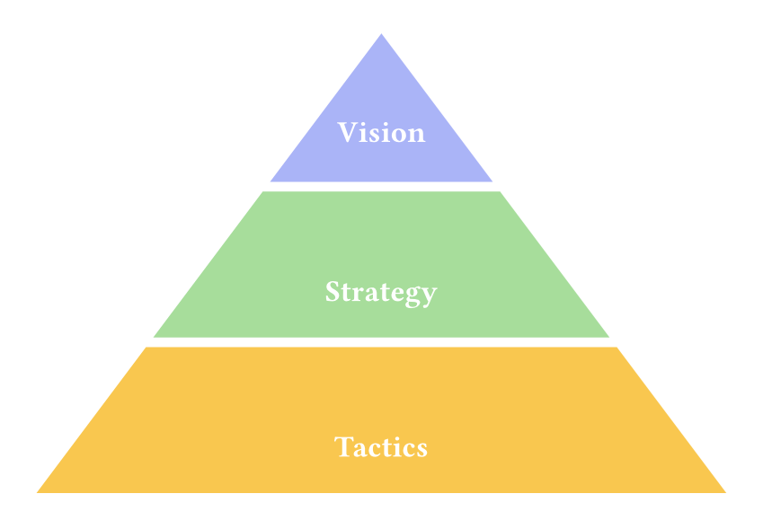

| Parameter | Default | Description |
|---|---|---|
| `levels` | — | Top-to-bottom levels; label or `(label, color)`. |
| `width` | `18` | Base width. |
| `height` | `12` | Total height. |
| `text-fill` | `white` | Label colour. |
| `size` | `22pt` | Label size. |
| `gap` | `0.18` | Gap between levels. |
| `flip` | `false` | `true` renders an inverted pyramid (funnel). |

## Data and poster

### kpi
Stat cards displaying a large value and a caption.

```typst
#kpi((("< 1%", [Target EER]),
      ("99%", [Accuracy], rgb("#40a02b")),
      ("500+", [Users])))
```

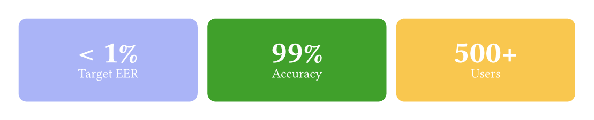

Items are tuples `(value, caption)` or `(value, caption, color)`.

| Parameter | Default | Description |
|---|---|---|
| `items` | — | Card tuples (see above). |
| `h` | `3.6cm` | Minimum card height; cards grow to fit their content. |
| `value-size` | `38pt` | Big value size. |
| `label-size` | `16pt` | Caption size. |
| `text-fill` | `white` | Text colour. |
| `gutter` | `12pt` | Gap between cards. |
| `radius` | `10pt` | Card corner radius. |
| `inset` | `14pt` | Card padding. |

### bars
Labelled horizontal bars with their values: results tables made visual. A value that does not fit inside its bar is drawn right after it.

```typst
#bars(
  (([Ours], 94.2, rgb("#e64553")), ([Baseline A], 88.7), ([Baseline B], 81.3), ([Baseline C], 12.5)),
  unit: "%", max: 100,
)
```

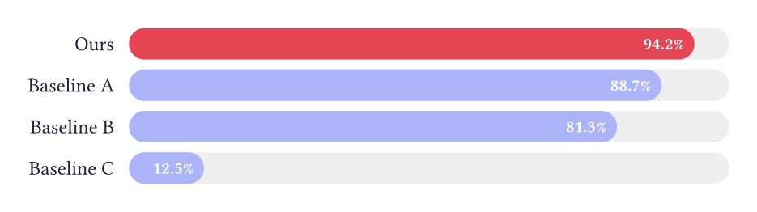

Items are tuples `(label, value)` or `(label, value, color)`.

| Parameter | Default | Description |
|---|---|---|
| `items` | — | Bar tuples (see above). |
| `max` | `auto` | Value of a full bar; `auto` = the largest value. |
| `unit` | `""` | Suffix after each value, e.g. `"%"`. |
| `accent` | `rgb("#aab4f7")` | Bar colour for items without their own. |
| `track` | `luma(238)` | Background of each bar. |
| `text-fill` | `rgb("#1f1f3a")` | Label colour (and of values outside their bar). |
| `value-fill` | `white` | Colour of values inside their bar. |
| `size` | `16pt` | Label size (values are 85% of it). |
| `bar-h` | `0.9cm` | Bar height. |
| `gap` | `8pt` | Space between bars. |

### gauges
Progress rings with a big percentage and a caption.

```typst
#gauges(((72, [Recall]), (91, [Precision], rgb("#e64553")), (100, [Coverage])))
```

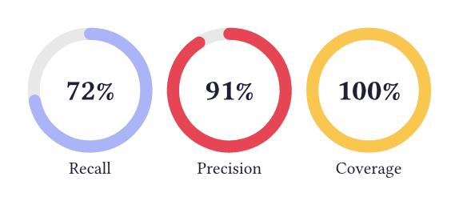

Items are tuples `(percent, caption)` or `(percent, caption, color)`.

| Parameter | Default | Description |
|---|---|---|
| `items` | — | Gauge tuples (see above); percent from 0 to 100. |
| `radius` | `1.8` | Ring radius. |
| `thickness` | `0.35` | Ring thickness. |
| `track` | `luma(232)` | Unfilled part of the ring. |
| `text-fill` | `rgb("#1f1f3a")` | Text colour. |
| `value-size` | `24pt` | Percentage size. |
| `label-size` | `14pt` | Caption size. |
| `gutter` | `12pt` | Space between gauges. |

### waffle
A grid of squares showing shares of a whole, with a legend; cells beyond the parts stay grey.

```typst
#waffle(([Responders], 62), ([Partial], 23), ([No change], 15, rgb("#e64553")))
```

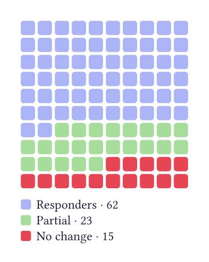

Each part is `(label, count)` or `(label, count, color)`.

| Parameter | Default | Description |
|---|---|---|
| `..parts` | — | Parts, in order (see above). |
| `total` | `100` | Number of cells. |
| `columns` | `10` | Cells per row. |
| `cell` | `0.55cm` | Cell size. |
| `gap` | `3pt` | Space between cells. |
| `rest` | `luma(232)` | Colour of cells not covered by any part. |
| `text-fill` | `rgb("#1f1f3a")` | Legend text colour. |
| `size` | `14pt` | Legend text size. |

### pill-steps
A central hub with connected pill-shaped step rows. Requires [Font Awesome 7 Free](https://fontawesome.com) for icons.

```typst
#pill-steps(
  (
    ([Research], [Gather requirements],
      icon("\u{f0eb}", size: 26pt)),
    ([Develop],  [Build the solution],
      icon("\u{f0ae}", size: 26pt), rgb("#74c7ec")),
  ),
  title: [PROJECT STEPS],
)
```

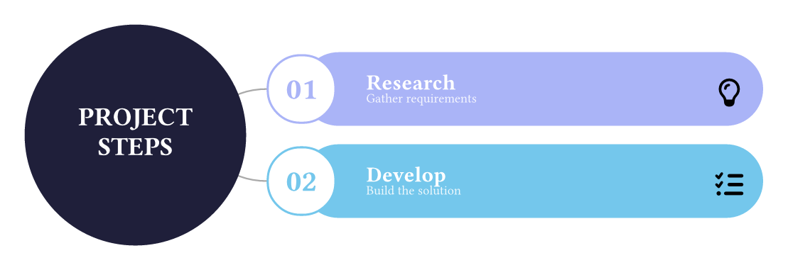

Items are tuples `(title, body)`, `(title, body, icon)`, or `(title, body, icon, color)`. The icon may be a Font Awesome glyph string or any pre-styled content. Pill heights grow automatically to fit wrapped text.

| Parameter | Default | Description |
|---|---|---|
| `items` | — | Step tuples (see above). |
| `title` | `[INFOGRAPHIC \ STEPS]` | Text inside the hub circle. |
| `hub-body` | `none` | Optional smaller text under the hub title. |
| `hub-r` | `3.6cm` | Hub circle radius. |
| `step-r` | `1.1cm` | Step-number circle radius. |
| `pill-w` | `15cm` | Pill width. |
| `pill-h` | `2.4cm` | Minimum pill height. |
| `vgap` | `0.6cm` | Vertical gap between pills. |
| `gap-hub` | `1.8cm` | Gap between the hub and the pills. |
| `text-fill` | `white` | Pill title colour. |
| `body-fill` | `white.transparentize(12%)` | Pill body text colour. |
| `hub-fill` | `rgb("#1f1f3a")` | Hub circle fill. |
| `hub-text` | `white` | Hub text colour. |
| `step-circle-fill` | `white` | Step-number circle fill (outlined in the pill colour). |
| `step-text-fill` | `auto` | Step number colour; `auto` = the pill's colour. |
| `connector` | `luma(170)` | Connector curve colour. |
| `connector-dot-fill` | `white` | Connector dot fill. |
| `dot-stroke` | `luma(150)` | Connector dot outline. |
| `icon-color` | `auto` | Icon colour; `auto` = leave the icon content as given. |
| `icon-font` | `"Font Awesome 7 Free"` | Font used when the icon is a glyph string. |
| `icon-size` | `26pt` | Icon size for glyph strings. |
| `title-size` | `20pt` | Pill title size. |
| `body-size` | `12pt` | Pill body size. |
| `step-size` | `28pt` | Step number size. |
| `pad-y` | `0.3cm` | Vertical padding inside each pill. |

### process
A heartbeat-ring process diagram with icon badges and connector arms. Requires [Font Awesome 7 Free](https://fontawesome.com).

```typst
#process(
  (
    ("\u{f02d}", "1. Review methods"),
    ("\u{f51e}", "2. Data collection"),
    ("\u{f83e}", "3. Signal analysis"),
  ),
)
```

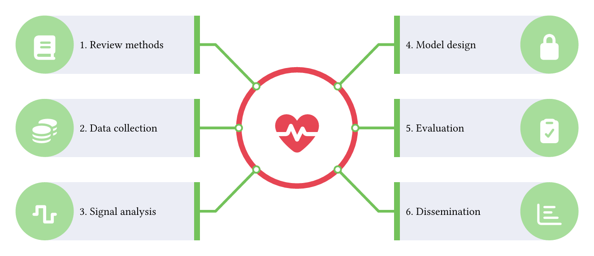

Items are up to 6 tuples `(icon-glyph, label)` or `(icon-glyph, label, color)`; the first three render on the left, the last three mirrored on the right. Any Font Awesome codepoint works as the glyph.

| Parameter | Default | Description |
|---|---|---|
| `items` | — | List of item tuples (see above). |
| `core` | heartbeat icon | Content shown at the centre of the ring. |
| `accent` | `rgb("#73c25a")` | Tab, connector, and ring-dot colour. |
| `badge-color` | `rgb("#a7dd9b")` | Icon badge fill. |
| `icon-color` | `white` | Icon glyph colour inside the badge. |
| `ring` | `rgb("#e64553")` | Central ring colour. |
| `box-fill` | `rgb("#ebedf5")` | Label card background. |
| `box-radius` | `0pt` | Label card corner radius. |
| `box-h` | `3cm` | Badge diameter and minimum card height; cards grow to fit their text. |
| `ring-radius` | `3` | Central ring radius. |

### card-table
A card-style table with rounded cells, coloured header, and alternating row fills.

```typst
#card-table(
  ("Study", "Approach", "Dataset"),
  (
    ("Guo et al.",  "Propose two...", "Homemade"),
    ("Gurunathan",  "Exhaustive...", "PUT Vein"),
    ("Zhang et al.", "ML-based",     "InHouse"),
  ),
)
```

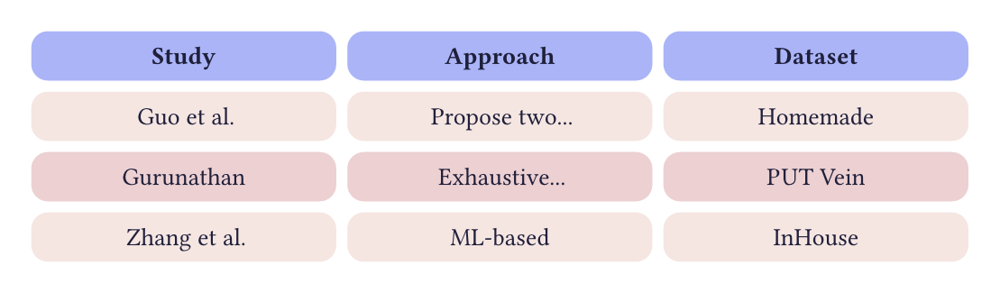

| Parameter | Default | Description |
|---|---|---|
| `headers` | — | Tuple of header cells. |
| `rows` | — | List of rows; each row is a tuple of cells or a `card-row(...)`. |
| `weights` | `none` | Relative column widths, e.g. `(2, 1, 1)`. `none` = all equal. |
| `header-fill` | `rgb("#aab4f7")` | Header row background. |
| `row-fills` | `(rgb("#f5e6e2"), rgb("#ecd0d2"))` | Alternating row backgrounds (cycled). |
| `text-fill` | `rgb("#1f1f3a")` | Body text colour. |
| `header-text-fill` | `auto` | Header text colour; `auto` = same as `text-fill`. |
| `size` | `18pt` | Text size. |
| `radius` | `12pt` | Cell corner radius. |
| `gutter` | `8pt` | Gap between cells and rows. |
| `inset` | `12pt` | Cell padding. |

To override a single row's colours, wrap it with `card-row`:

```typst
#card-row(("This work", "Ours", "New"), fill: rgb("#a7dd9b"), text-fill: white)
```

| Parameter | Default | Description |
|---|---|---|
| `cells` | — | Tuple of cells for the row. |
| `fill` | `none` | Row background; `none` = keep the alternating fill. |
| `text-fill` | `none` | Row text colour; `none` = keep `text-fill` of the table. |
