# typart

Figures for papers in computer science and its neighbours — machine learning, signals, networks and IoT, image processing, cryptography, security — and SmartArt-style diagrams for slides and posters, in Typst: flowcharts, sequence diagrams, neural networks, packet layouts, graphs, timing diagrams, pixel grids, PRISMA flows, cross-validation schemes, confusion matrices, process, cycle, hierarchy and relationship diagrams, plus data widgets, timelines, Gantt charts and tables.

- **Fits where you put it.** Sizes follow the document's font size, and a diagram never overflows its container: wider than the column, it scales down; `width:` sets it exactly.
- **One look.** Every colour, stroke and radius comes from one theme, which follows the document's text colour and page fill (dark slides work as they are); text on a fill always takes the readable colour.
- **Text always fits.** Boxes grow to fit their longest label; round and slanted shapes keep their size and shrink all labels to one shared size that fits, as SmartArt does.
- **Fast.** Native Typst primitives and no dependencies. Importing the package costs about 4 ms, because a diagram's code loads the first time it is used; a diagram then takes about 2 ms, and a flowchart time proportional to its nodes (400 of them in 0.25 s). `bench/run.sh` measures it; there, an eight-node pipeline takes 18 ms against 231 ms in fletcher.
- **Errors that say what to fix.** `hlist: got one (label, [color]) pair instead of an array of items; add a trailing comma: ((label, color),)`.

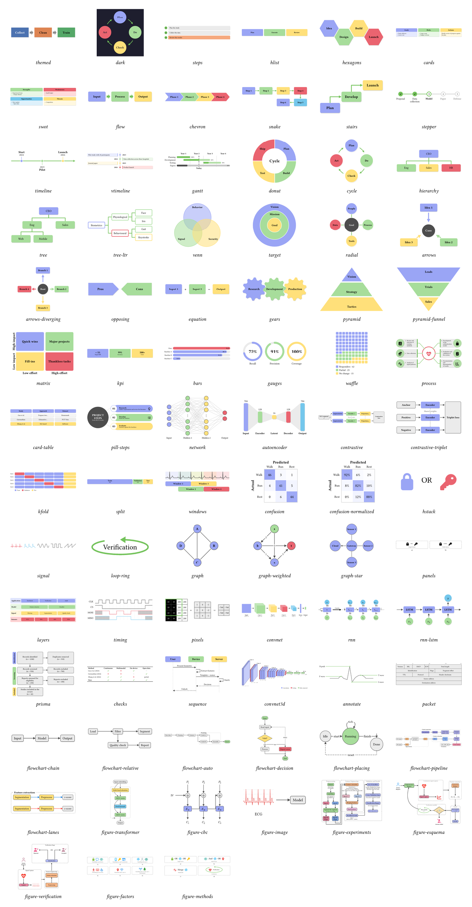

## Installation

```typst
#import "@preview/typart:0.3.0": *
```

Its names are common words (`matrix`, `process`, `node`, …). To keep them out of your scope, import the package as a module and call `#ta.cycle(..)`:

```typst
#import "@preview/typart:0.3.0" as ta
```

## Common to every diagram

**Items.** A diagram takes its items as a list, the way SmartArt's text pane does:

```typst
#cycle[
  - Plan
  - Do
  - Check
  - Act
]
```

There are three ways to write items, from quickest to most explicit:

- A list. A bullet list gives one label per item; a term list gives items with two parts, such as a date and a label (`/ 2024: Start`) or a label and a number (`/ Train: 70`). `#fill(..)` after an item gives it a colour: `- Review #fill(red)`.
- An array, where an item is a label or a tuple that may end in a colour: `([Plan], [Do], ([Act], red))`. One item still needs its trailing comma: `(([Only], red),)`.
- Dictionaries that name each part: `((label: [Plan]), (label: [Act], color: red))`. Each diagram's table gives the names.

Items without a colour cycle through the theme's palette (lavender, green, amber, red, sky; exported as `palette`).

**Lengths.** Every dimension is a Typst length and defaults are in `em`, so a diagram is drawn for the text size around it: put it in a 9pt figure or on a 24pt slide and it keeps its proportions. Heights are minimums: boxes grow to fit their text.

| Parameter | Default | Description |
|---|---|---|
| `width` | `auto` | `auto` keeps the natural size and scales the drawing down when the container is narrower; list-like diagrams (`hlist`, `steps`, `cards`, `bars`, `gantt`, …) fill the container instead. A length or a ratio (`8cm`, `70%`) sets the width: drawings scale as a whole, list-like diagrams reflow. A drawing that would shrink below 70% on its own (the theme's `min-scale`) stops with a message instead of rendering text too small to read. |
| `text-size` | `1em` | Size of the labels, relative to the surrounding text. |
| any theme key | — | Every key of the theme below is also a parameter of every diagram, for that diagram only: `#flow(items, accent: gray, corner-radius: 0pt)`. |
| `theme` | `(:)` | The same overrides as one dictionary, e.g. `theme: (accent: gray)`, handy to reuse a set of them. |

**Theme.** `default-theme` holds every shared look decision:

| Key | Default | Used for |
|---|---|---|
| `palette` | lavender, green, amber, red, sky | Item fills, in order. At least 0.1 apart in luminance (distinct in greyscale) and light enough for dark text at 4.5:1. |
| `ink` | `auto` | Text and dark shapes; `auto` is the document's text colour. |
| `surface` | `auto` | What lies behind the diagram (gaps between shapes, label backing); `auto` is the page fill, else white. |
| `accent` | `rgb("#73c25a")` | Arrows, connectors and highlights. |
| `line` | `auto` | Outlines and flowchart edges; `auto` is the ink softened towards the surface. |
| `panel` | `auto` | Neutral boxes; `auto` is the surface tinted with ink. |
| `muted` | `auto` | Tracks and inactive parts. |
| `stroke` | `0.08em` | Outline thickness. |
| `thick` | `0.2em` | Connector and ring thickness. |
| `corner-radius` | `0.35em` | Corners of boxes. |
| `small` | `80%` | Secondary text, relative to `text-size`. |
| `large` | `150%` | Headline values. |
| `min-scale` | `70%` | How far a drawing may shrink on its own to fit its container before it fails; `0%` lifts the limit. |
| `shadow` | `true` | A soft shadow under boxes and circles; `false` draws everything flat. |

Text drawn on a fill is the ink or the surface colour, whichever contrasts more. A key passed to a diagram changes that diagram; `typart-theme` sets keys for every diagram after it, like a set rule:

```typst
#typart-theme(accent: luma(140), palette: (rgb("#4c72b0"), rgb("#dd8452"), rgb("#55a868")), corner-radius: 0pt)
#flow[
  - Collect
  - Clean
  - Train
]
```

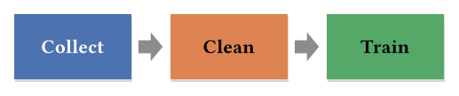

`typart-theme` adds a short second layout pass (about 0.4 ms per diagram in `tests/all.typ`). `themed` gives the same look without it: it returns the diagrams with the theme applied, `#let (flow, cycle) = themed(accent: luma(140))`. What a diagram receives itself adds to either. Parts that have a colour of their own take a parameter named after them (`fills` in `tree`, one colour per level; `input-fill` in `rnn`; …), listed in each diagram's table.

On a dark page nothing needs to be set:

```typst
#set page(fill: rgb("#1e1e2e"))
#set text(fill: white)
#cycle[
  - Plan
  - Do
  - Check
  - Act
]
```

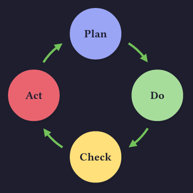

## List

### steps

A vertical numbered list that fills the width. Items without a colour of their own sit on the neutral panel fill, so a `(label, color)` item stands out.

```typst
#steps[
  - Plan the study
  - Collect the data
  - Review the results #fill(rgb("#f5a97f"))
]
```

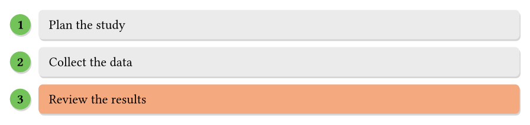

| Parameter | Default | Description |
|---|---|---|
| `items` | — | Labels, or `(label, color)` pairs. |
| `gap` | `0.6em` | Space between rows, and between a number and its box. |
| `inset` | `0.8em` | Padding inside each box. |

### hlist

Equal blocks side by side that share the width. All blocks take the height of the tallest label.

```typst
#hlist[
  - Plan
  - Execute
  - Review
]
```

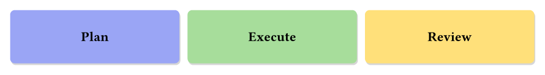

| Parameter | Default | Description |
|---|---|---|
| `items` | — | Labels, or `(label, color)` pairs. |
| `item-height` | `4em` | Minimum block height; blocks grow to fit the tallest label. |
| `gap` | `0.6em` | Space between blocks. |
| `inset` | `0.7em` | Padding inside each block. |

### hexagons

A zig-zag honeycomb strip. The hexagons keep their size; the labels shrink to one shared size that fits.

```typst
#hexagons[
  - Idea
  - Design
  - Build
  - Launch
]
```

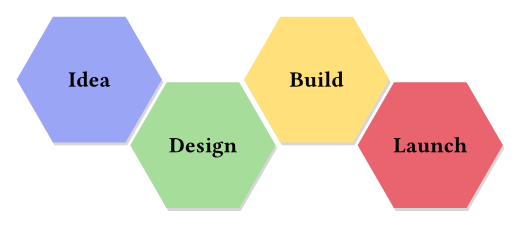

| Parameter | Default | Description |
|---|---|---|
| `items` | — | Labels, or `(label, color)` pairs. |
| `radius` | `3.3em` | Centre-to-corner radius of each hexagon. |
| `gap` | `0.25em` | Space between neighbouring hexagons. |

### cards

A coloured header over a tinted body: a horizontal bullet list. Cards in one row share the height of the tallest header and body.

```typst
#cards[
  / Goals:
    - Faster delivery
    - Lower cost
  / Risks:
    - Scope creep
    - Budget overrun
  / Actions: Weekly review of progress against the plan.
]
```

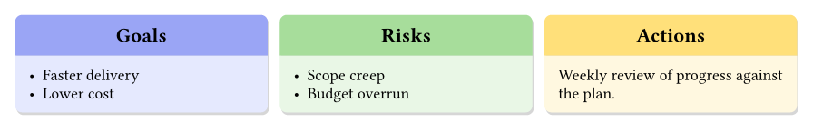

| Parameter | Default | Description |
|---|---|---|
| `items` | — | `(title, body)` or `(title, body, color)` tuples. |
| `columns` | `auto` | Cards per row; `auto` puts them all in one row. |
| `gap` | `0.6em` | Space between cards. |
| `inset` | `0.7em` | Padding inside headers and bodies. |

### swot

Strengths, weaknesses, opportunities and threats as a 2×2 of `cards`, in the palette's green, red, sky and amber.

```typst
#swot(
  [- Experienced team \ - Unique dataset],
  [- Small budget],
  [- New market \ - Open data],
  [- Competition],
)
```

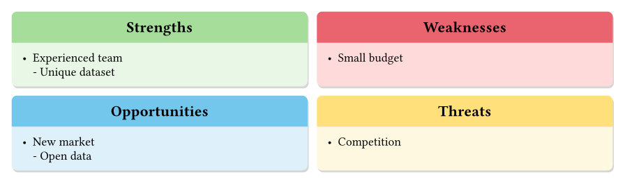

| Parameter | Default | Description |
|---|---|---|
| `strengths`, `weaknesses`, `opportunities`, `threats` | — | The body of each card. |
| `titles` | `([Strengths], [Weaknesses], [Opportunities], [Threats])` | The four headers. |
| `..style` | — | Any `cards` parameter: `gap`, `inset`, `text-size`, `width`, `theme`. |
| `fills` | `auto` | The four header colours, in the order of the quadrants; `auto` is the palette's green, red, sky and amber. |

## Process

### flow

Blocks joined by block arrows: the basic process. `dir: ttb` stacks it top to bottom.

```typst
#flow[
  - Input
  - Process
  - Output
]
```

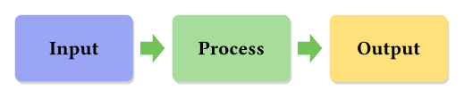

| Parameter | Default | Description |
|---|---|---|
| `items` | — | Labels, or `(label, color)` pairs. |
| `dir` | `ltr` | `ltr` runs left to right, `ttb` top to bottom. |
| `item-width` | `6em` | Block width. |
| `item-height` | `3.4em` | Minimum block height; blocks grow to fit the tallest label. |
| `gap` | `2em` | Space between blocks, which holds the arrow. |

### chevron

Sequential chevrons pointing right, for phases that follow each other.

```typst
#chevron[
  - Phase 1
  - Phase 2
  - Phase 3
  - Phase 4
]
```

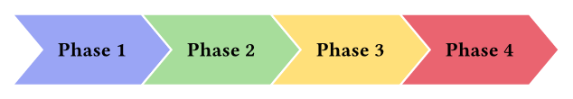

| Parameter | Default | Description |
|---|---|---|
| `items` | — | Labels, or `(label, color)` pairs. |
| `item-width` | `8em` | Length of each chevron, point included. |
| `item-height` | `3.6em` | Minimum height; grows to fit the tallest label. |
| `notch` | `1.5em` | Depth of the notch and of the point. |

### snake

A process that wraps into rows, each row running the opposite way to the one above.

```typst
#snake[
  - Step 1
  - Step 2
  - Step 3
  - Step 4
  - Step 5
  - Step 6
]
```

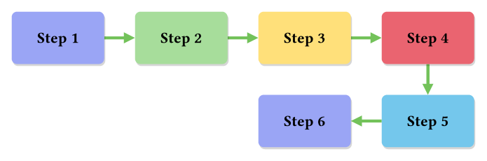

| Parameter | Default | Description |
|---|---|---|
| `items` | — | Labels, or `(label, color)` pairs. |
| `columns` | `4` | Boxes per row. |
| `item-width` | `6em` | Box width. |
| `item-height` | `3.4em` | Minimum box height; boxes grow to fit the tallest label. |
| `gap` | `2em` | Space between boxes: one length, or an `(x, y)` pair. |

### stairs

An ascending staircase joined by elbow arrows, for growth or maturity levels.

```typst
#stairs[
  - Plan
  - Develop
  - Launch
]
```

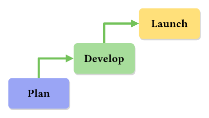

| Parameter | Default | Description |
|---|---|---|
| `items` | — | Labels, or `(label, color)` pairs, lowest step first. |
| `item-width` | `5.6em` | Box width. |
| `item-height` | `2.8em` | Minimum box height; boxes grow to fit the tallest label. |
| `step` | `(6em, 3.2em)` | Offset `(right, up)` from one step to the next: one length for both, or a pair. Never less than what keeps the steps apart and the arrows visible. |

### stepper

Numbered milestones on a line with done, current and upcoming states: where a project stands.

```typst
#stepper(current: 2)[
  - Proposal
  - Data collection
  - Model
  - Paper
  - Defense
]
```

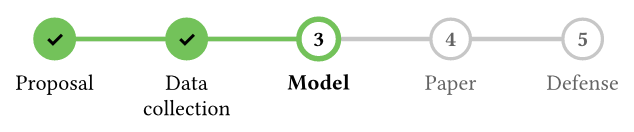

| Parameter | Default | Description |
|---|---|---|
| `items` | — | Labels. |
| `current` | `0` | Index (from 0) of the step in progress: earlier steps are done, later ones upcoming. `items.len()` marks every step done. |
| `step` | `6em` | Distance between milestones; labels wrap to it. |
| `node-radius` | `0.9em` | Radius of each numbered circle. |

### timeline

Milestones along a horizontal arrow, alternating above and below it.

```typst
#timeline[
  / 2024: Start
  / 2025: Pilot
  / 2026: Launch
]
```

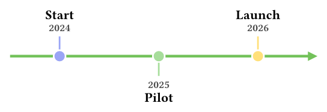

| Parameter | Default | Description |
|---|---|---|
| `items` | — | `(date, label)` or `(date, label, color)` tuples. |
| `step` | `7.5em` | Distance between milestones. |

### vtimeline

A vertical timeline that fills the width: cards alternate left and right of a central spine, each facing its date.

```typst
#vtimeline[
  / 2023: Pilot study with 20 participants
  / 2024: Data collection across three hospitals
  / 2025: Journal paper
  / 2026: Product launch
]
```

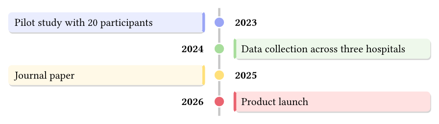

| Parameter | Default | Description |
|---|---|---|
| `items` | — | `(date, label)` or `(date, label, color)` tuples. |
| `gap` | `0.6em` | Space between rows. |

### gantt

A Gantt chart that fills the width: task bars with progress, period headers, grid lines and a "today" marker. It works in any unit: `span` is the total number of months, years or weeks.

```typst
#gantt(
  (
    ("Planning", 0, 12, 100),
    ("Development", 6, 30, 60),
    ("Testing", 24, 40, 30),
    ("Papers", 0, 48, 20, false),
  ),
  span: 48, grid-step: 12,
  periods: ("Year 1", "Year 2", "Year 3", "Year 4"),
  today: 20,
)
```

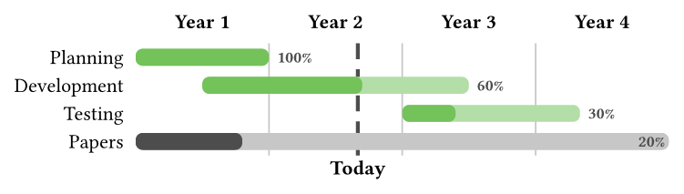

| Parameter | Default | Description |
|---|---|---|
| `tasks` | — | `(name, start, end)`, `(name, start, end, progress)` or `(name, start, end, progress, group)` tuples; `progress` is a percentage, `group: false` greys the task out (e.g. papers), and a trailing colour replaces the accent for that task. |
| `span` | `48` | Length of the time axis, in the unit of `start` and `end`. |
| `grid-step` | `auto` | A faint vertical line every this many units; `auto` draws one per period boundary. |
| `today` | `none` | Position of the dashed marker; `none` hides it. |
| `today-label` | `[Today]` | Label under the marker. |
| `periods` | `()` | Header labels spread evenly across the span. |
| `progress-fill` | `auto` | Fill of the completed part of every bar; `auto` is the task's colour. |
| `track-fill` | `auto` | Fill of the rest of every bar; `auto` is a tint of the task's colour. |
| `row-gap` | `0em` | Space between task rows. |
| `period-gap` | `0em` | Space between the headers and the first task. |
| `name-width` | `31%` | Share of the width taken by the task names; names wrap to it. |
| `gap` | `0.6em` | Space between the names and the bars. |

## Cycle

### donut

A ring split into equal labelled segments, with an optional label in the hole.

```typst
#donut(center: [Cycle])[
  - Plan
  - Build
  - Test
  - Ship
]
```

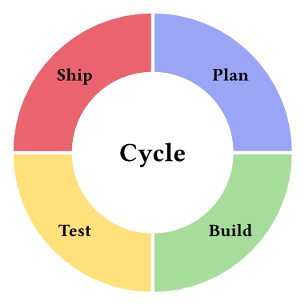

| Parameter | Default | Description |
|---|---|---|
| `items` | — | Array of labels or `(label, color)` tuples, clockwise from the top. |
| `center` | `none` | Content shown in the hole. |
| `radius` | `8em` | Outer radius. |
| `thickness` | `3.5em` | Ring thickness. |

### cycle

Nodes on a ring joined by curved arrows. Labels share one size that fits every circle.

```typst
#cycle[
  - Plan
  - Do
  - Check
  - Act
]
```

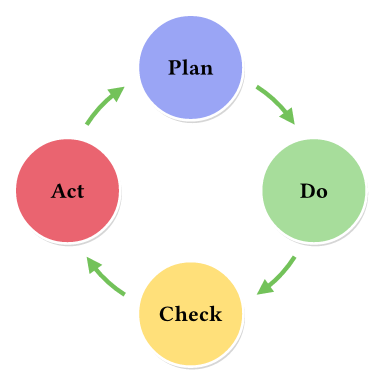

| Parameter | Default | Description |
|---|---|---|
| `items` | — | Array of labels or `(label, color)` tuples, clockwise from the top. |
| `radius` | `auto` | Ring radius; `auto` grows with the number of items. A minimum: the ring widens until an arrow fits between neighbours. |
| `node-radius` | `2.4em` | Radius of each node circle. |

## Hierarchy

### hierarchy

One root over a single row of children. The root takes the first palette colour and the children cycle through the rest.

```typst
#hierarchy[CEO][
  - Eng
  - Sales
  - HR
]
```

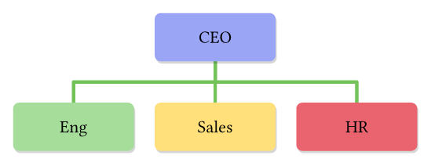

| Parameter | Default | Description |
|---|---|---|
| `root` | — | Label of the root box. |
| `children` | — | Array of labels or `(label, color)` tuples. |
| `item-width` | `7em` | Box width. |
| `item-height` | `2.8em` | Minimum box height; all boxes grow to fit the tallest label. |
| `gap` | `(1.2em, 2.4em)` | Space between children and between the root and the children's row (one length for both). |
| `root-fill` | `auto` | Fill of the root; `auto` is the first palette colour. |

### tree

A multi-level hierarchy, top-down by default, written as a nested list. The root takes the first palette colour and the other nodes the second; `fills` gives your own colours, one per level. Box heights grow to fit wrapped text.

```typst
#tree[
  - CEO
    - Eng
      - Web
      - Mobile
    - Sales
]
```

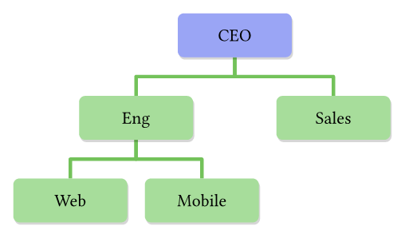

`dir` lays the levels out along any direction, `filled: false` draws outlined boxes, and `#fill(..)` after a label colours that node:

```typst
#tree(dir: ltr, filled: false)[
  - Biometrics
    - Physiological
      - Face
      - Iris
    - Behavioural #fill(palette.at(3))
      - Gait
      - Keystroke #fill(palette.at(2))
]
```

A tree can also be written as data: a node is a label, `(label, children)`, `(label, color)`, `((label, color), children)` or `(label: .., children: .., color: ..)`.

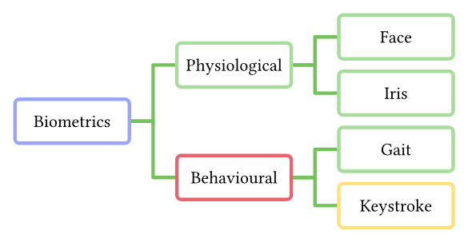

| Parameter | Default | Description |
|---|---|---|
| `root` | — | A nested list with one top item, or the root node as data. |
| `dir` | `ttb` | Direction the levels follow: `ttb`, `btt`, `ltr` or `rtl`. |
| `item-width` | `6.5em` | Box width. |
| `item-height` | `2.5em` | Minimum box height; a box grows to fit its label. |
| `gap` | `auto` | `(siblings, levels)` space between boxes (one length for both); `auto` is `(1em, 2.2em)`, or `(0.7em, 2.7em)` for sideways trees. |
| `filled` | `true` | Filled boxes; `false` draws outlines in the node's colour. |
| `fills` | `auto` | The colours of the levels, root first: `(navy, orange, olive)`. The last one serves every deeper level; `auto` is the first two palette colours. A `#fill(..)` on a node wins. |

## Relationship

### venn

Two or three overlapping circles.

```typst
#venn[
  - Behavior
  - Signal
  - Security
]
```

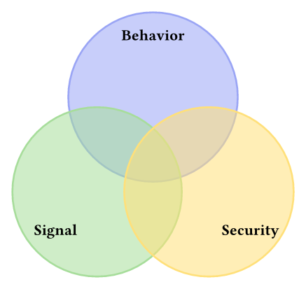

| Parameter | Default | Description |
|---|---|---|
| `items` | — | Two or three labels or `(label, color)` tuples. |
| `radius` | `5.5em` | Radius of each circle. |
| `transparency` | `45%` | Transparency of the circle fills, so the overlaps show. |

### target

Concentric rings, outermost first; the last item is the bullseye.

```typst
#target[
  - Vision
  - Mission
  - Goal
]
```

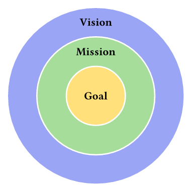

| Parameter | Default | Description |
|---|---|---|
| `items` | — | Array of labels or `(label, color)` tuples, from the outer ring inwards. |
| `radius` | `8em` | Radius of the outermost ring. |

### radial

A centre joined by spokes to satellite circles.

```typst
#radial[Goal][
  - People
  - Process
  - Tools
  - Data
]
```

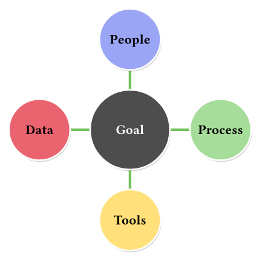

| Parameter | Default | Description |
|---|---|---|
| `center` | — | Label of the central circle. |
| `items` | — | Array of labels or `(label, color)` tuples, clockwise from the top. |
| `radius` | `auto` | Distance from the centre to the satellites. A minimum: it grows until the satellites clear the centre and each other. |
| `node-radius` | `2.3em` | Radius of each satellite. |
| `core-radius` | `3em` | Radius of the central circle. |
| `core-fill` | `auto` | Fill of the centre; `auto` is the theme's line colour. |

### arrows

Boxes around a centre with arrows converging on it, or diverging from it with `diverge: true`.

```typst
#arrows(core: [Core])[
  - Idea 1
  - Idea 2
  - Idea 3
]
```

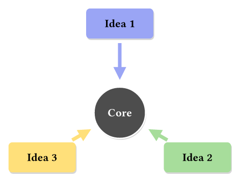

```typst
#arrows(core: [Root], diverge: true)[
  - Branch 1
  - Branch 2
  - Branch 3
  - Branch 4
]
```

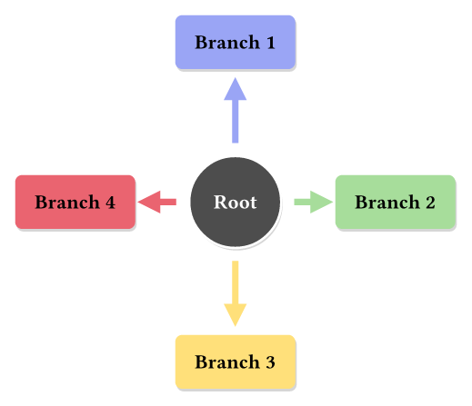

| Parameter | Default | Description |
|---|---|---|
| `items` | — | Array of labels or `(label, color)` tuples, clockwise from the top. |
| `core` | `none` | Label of the central circle. |
| `diverge` | `false` | Arrows point away from the centre. |
| `radius` | `8em` | Distance from the centre to the boxes. A minimum: it grows until every arrow has room and neighbouring boxes are clear of each other. |
| `item-width` | `6em` | Box width. |
| `item-height` | `2.7em` | Minimum box height; all boxes grow to fit the tallest label. |
| `core-radius` | `2.3em` | Radius of the central circle. |
| `core-fill` | `auto` | Fill of the centre; `auto` is the theme's line colour. |

### opposing

Two block arrows facing each other, for contrasts and trade-offs.

```typst
#opposing[
  - Pros
  - Cons
]
```

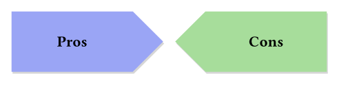

| Parameter | Default | Description |
|---|---|---|
| `items` | — | Exactly two labels or `(label, color)` tuples. |
| `item-width` | `10em` | Width of each arrow. |
| `item-height` | `4em` | Minimum arrow height; grows to fit the labels. |
| `notch` | `2em` | Depth of the arrow point. |
| `gap` | `0.8em` | Space between the two points. |

### equation

Boxes joined by `+` signs, with `=` before the last one: A + B = C. `operators` replaces the signs, e.g. `operators: ($xor$, [=])` for plaintext ⊕ keystream = ciphertext.

```typst
#equation[
  - Input 1
  - Input 2
  - Output
]
```

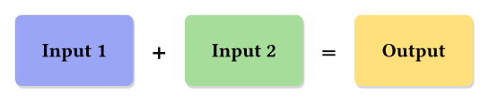

| Parameter | Default | Description |
|---|---|---|
| `items` | — | Two or more labels or `(label, color)` tuples; the last one is the result. |
| `item-width` | `6em` | Box width. |
| `item-height` | `3.6em` | Minimum box height; all boxes grow to fit the tallest label. |
| `gap` | `2.6em` | Space between boxes, holding the operator. |
| `operators` | `auto` | The sign between each pair of boxes; `auto` is `+` between items and `=` before the last. |

### gears

Up to three interlocking cogs.

```typst
#gears[
  - Research
  - Development
  - Production
]
```

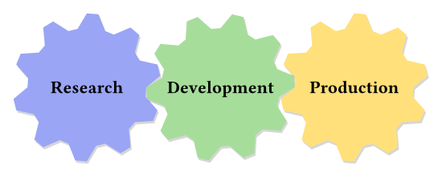

| Parameter | Default | Description |
|---|---|---|
| `items` | — | One to three labels or `(label, color)` tuples. |
| `radius` | `4.2em` | Outer radius of each cog. |
| `teeth` | `10` | Teeth per cog. |

## Matrix and pyramid

### pyramid

A pyramid of stacked levels, or a funnel with `flip: true`. Labels share one size that fits every level.

```typst
#pyramid[
  - Vision
  - Strategy
  - Tactics
]
```

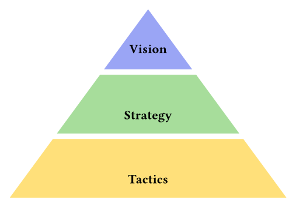

```typst
#pyramid(flip: true)[
  - Leads
  - Trials
  - Sales
]
```

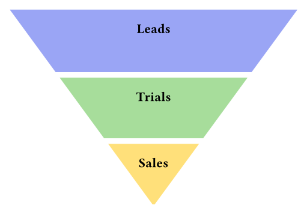

| Parameter | Default | Description |
|---|---|---|
| `levels` | — | Array of labels or `(label, color)` tuples, top first. |
| `base` | `22em` | Width of the widest edge. |
| `height` | `15em` | Total height. |
| `gap` | `0.3em` | Space between levels. |
| `flip` | `false` | Widest level on top (a funnel). |

### matrix

A 2×2 matrix with optional axis labels.

```typst
#matrix(x-axis: ([Low effort], [High effort]), y-axis: ([High impact], [Low impact]))[
  - Quick wins
  - Major projects
  - Fill-ins
  - Thankless tasks
]
```

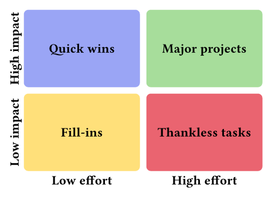

| Parameter | Default | Description |
|---|---|---|
| `cells` | — | Exactly four labels or `(label, color)` tuples: top-left, top-right, bottom-left, bottom-right. |
| `x-axis` | `none` | Two labels under the columns. |
| `y-axis` | `none` | Two labels beside the rows, top first. |
| `item-width` | `9em` | Cell width. |
| `item-height` | `6em` | Minimum cell height; cells grow to fit the tallest label. |
| `gap` | `0.5em` | Space between cells. |

## Data and poster

### kpi

Stat cards with a headline value and a caption, filling the width. Items are `(value, label)` or `(value, label, color)`.

```typst
#kpi[
  / < 1%: Target EER
  / 99%: Accuracy
  / 500+: Users
]
```

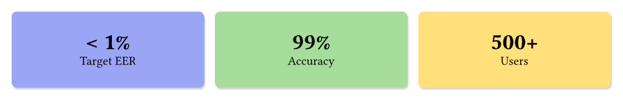

| Parameter | Default | Description |
|---|---|---|
| `items` | — | Cards: `(value, label)` or `(value, label, color)`. The value is set at the theme's `large` size, the label at `small`. |
| `item-height` | `5em` | Minimum card height; cards grow to fit their content. |
| `gap` | `0.7em` | Space between cards. |
| `inset` | `0.8em` | Card padding. |

### bars

Labelled horizontal bars with their values: a results table made visual. One series takes one colour (the palette's first); give an item its own colour to highlight it. A value that does not fit inside its bar is drawn right after it.

```typst
#bars(unit: "%")[
  / Ours: 94.2 #fill(palette.at(3))
  / Baseline A: 88.7
  / Baseline B: 81.3
  / Baseline C: 12.5
]
```

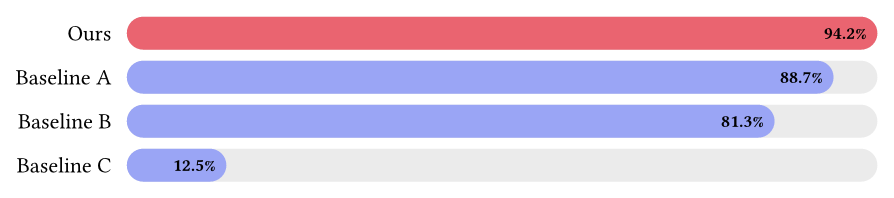

| Parameter | Default | Description |
|---|---|---|
| `items` | — | Bars: `(label, value)` or `(label, value, color)`; values are numbers. |
| `max` | `auto` | Value of a full bar; `auto` = the largest value. |
| `unit` | `""` | Text appended to every value, e.g. `"%"` or `" ms"`. |
| `item-height` | `1.5em` | Bar thickness. |
| `gap` | `0.5em` | Space between bars. |

Labels wrap once they would take more than 40% of the width.

### gauges

Progress rings with a headline percentage and a caption. Items are `(value, label)` or `(value, label, color)`, with the value from 0 to 100.

```typst
#gauges[
  / 72: Recall
  / 91: Precision
  / 100: Coverage
]
```

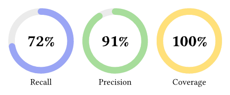

| Parameter | Default | Description |
|---|---|---|
| `items` | — | Rings: `(value, label)` or `(value, label, color)`; the value is a percentage. |
| `radius` | `3em` | Outer radius of each ring. |
| `thickness` | `0.6em` | Ring thickness. |
| `gap` | `0.8em` | Space between rings. |

### waffle

A grid of squares showing shares of a whole, with a legend. Items are `(label, count)` or `(label, count, color)`; cells beyond the counts stay neutral.

```typst
#waffle[
  / Responders: 62
  / Partial: 23
  / No change: 15
]
```

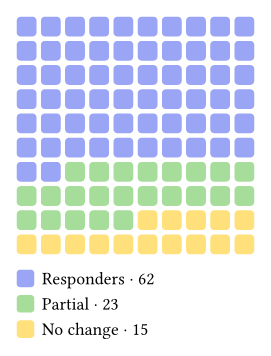

| Parameter | Default | Description |
|---|---|---|
| `items` | — | Parts: `(label, count)` or `(label, count, color)`; counts are whole cells. |
| `total` | `100` | Number of cells. |
| `columns` | `10` | Cells per row. |
| `cell` | `0.9em` | Side of a cell. |
| `gap` | `0.2em` | Space between cells. |

### process

A central ring joined to icon cards on both sides: the first three items go on the left, the rest on the right. Items are `(icon, label)` or `(icon, label, color)`, up to six; the icon is a Font Awesome glyph string or any content. An item without a colour takes the theme's accent. Requires the [Font Awesome 7 Free](https://fontawesome.com) font for glyph icons.

```typst
#process((
  ("\u{f02d}", [1. Review and selection of existing methods.]),
  ("\u{f51e}", [2. Data collection.]),
  ("\u{f83e}", [3. Analysis of signal patterns.]),
  ("\u{f023}", [4. Development of the authentication model.]),
  ("\u{f46c}", [5. Evaluation and validation of the system.]),
  ("\u{f080}", [6. Documentation and dissemination of results.]),
))
```

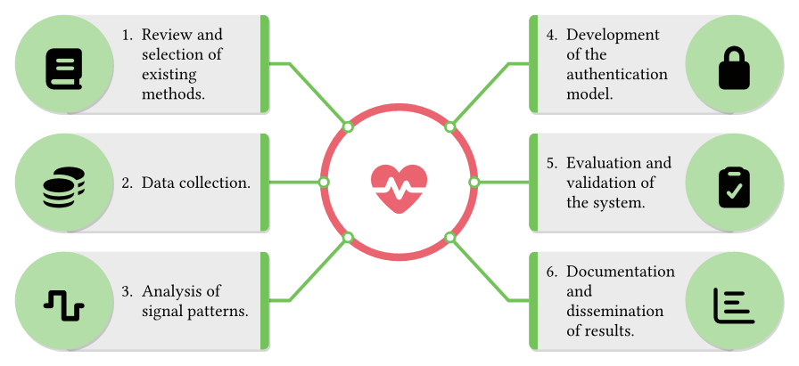

| Parameter | Default | Description |
|---|---|---|
| `items` | — | One to six cards: `(icon, label)` or `(icon, label, color)`. |
| `core` | `auto` | Content inside the ring; `auto` = a heartbeat icon in the ring's colour. |
| `item-width` | `12em` | Card width. |
| `item-height` | `4.4em` | Minimum card height; cards grow to fit their text, and the icon badge is as tall as the card. |
| `core-radius` | `4.4em` | Radius of the central ring. |
| `ring` | `auto` | Ring colour; `auto` = the palette's red. |

### card-table

A table of rounded cells with a coloured header and alternating row tints, filling the width. Every cell in a row takes the height of the tallest one. Wrap a row in `card-row` to give it its own colours.

```typst
#card-table(
  ("Study", "Approach", "Dataset"),
  (
    ([Guo et al.], [Propose two...], [Homemade]),
    ([Gurunathan], [Exhaustive...], [PUT Vein]),
    card-row(([Zhang et al.], [ML-based], [InHouse]), fill: palette.at(2)),
  ),
)
```

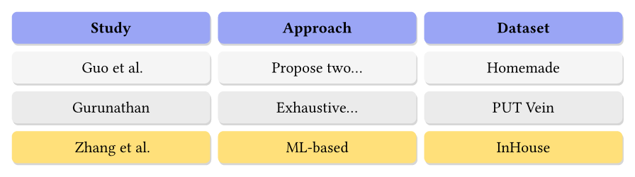

| Parameter | Default | Description |
|---|---|---|
| `headers` | — | Header cells; their number sets the number of columns. |
| `rows` | — | Rows: an array of cells each, or `card-row(cells, fill: none, text-fill: none)`. |
| `weights` | `none` | Relative column widths, one number per column; `none` = all equal. |
| `header-fill` | `auto` | Header colour; `auto` = the palette's first colour. |
| `row-fills` | `auto` | Colours the rows alternate through; `auto` = two neutral tints. |
| `gap` | `0.5em` | Space between cells. |
| `inset` | `0.7em` | Cell padding. |

### pill-steps

A hub joined to numbered pill rows, each with a title, a body and an optional icon. Items are `(title, body)`, `(title, body, icon)` or either with a trailing colour; the icon is a Font Awesome glyph string or any content. Pills grow to fit wrapped text.

```typst
#pill-steps(
  (
    ([Research], [Gather requirements and review the literature], "\u{f0eb}"),
    ([Develop], [Build the solution], "\u{f0ae}"),
    ([Evaluate], [Measure against the baselines]),
  ),
  title: [PROJECT \ STEPS],
  hub-body: [From idea to results],
)
```

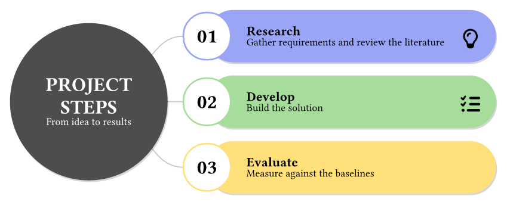

| Parameter | Default | Description |
|---|---|---|
| `items` | — | Steps: `(title, body[, icon][, color])`. |
| `title` | `[INFOGRAPHIC \ STEPS]` | Hub title. |
| `hub-body` | `none` | Smaller text under the hub title. |
| `hub-radius` | `6em` | Radius of the hub. |
| `node-radius` | `1.8em` | Radius of the numbered circles. |
| `item-width` | `22em` | Pill width. |
| `item-height` | `4em` | Minimum pill height; a pill grows to fit its text. |
| `gap` | `1em` | Space between pills. |
| `hub-gap` | `3em` | Space between the hub and the pills. |
| `hub-fill` | `auto` | Fill of the hub; `auto` is the theme's line colour. |

## Paper figures

Ready-made figures that papers keep redrawing — `sequence`, `network`, `convnet`, `convnet3d`, `autoencoder`, `rnn`, `contrastive`, `prisma`, `kfold`, `split`, `windows`, `confusion`, `checks`, `layers`, `annotate`, `packet`, `timing`, `graph`, `pixels` — and building blocks for the rest: `panels` lays out framed sub-figures with captions and a), b)… labels, `loop-ring` draws a "repeat / continuous" ring around any content, and `flowchart` (further down) composes method diagrams. They go from the shortest to write to the longest. Icons in the examples are Font Awesome glyphs.

### network

A fully connected neural network: one column of neurons per layer, every neuron linked to every neuron of the next layer. Layers too large to draw are abbreviated with an ellipsis.

```typst
#network[
  / 4: Input
  / 8: Hidden 1
  / 8: Hidden 2
  / 2: Output
]
```

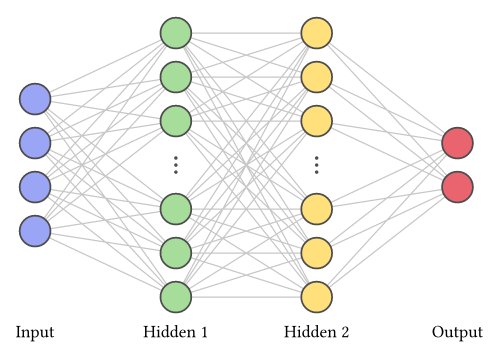

| Parameter | Default | Description |
|---|---|---|
| `layers` | — | Array of `(count, label)` or `(count, label, color)`: the number of neurons and the caption under the layer (`none` for no caption). |
| `node-radius` | `0.7em` | Radius of a neuron. |
| `gap` | `(5em, 0.6em)` | Space between layers and between the neurons of a layer (one length for both). |
| `max-nodes` | `6` | A layer with more neurons shows this many around a vertical ellipsis. |

### autoencoder

An autoencoder: layers as bars whose height follows their size, narrowing to the latent code and widening back. Also the figure for any bottleneck, such as dimensionality reduction or a projection head.

```typst
#autoencoder[
  / 784: Input
  / 128: Encoder
  / 16: Latent
  / 128: Decoder
  / 784: Output
]
```

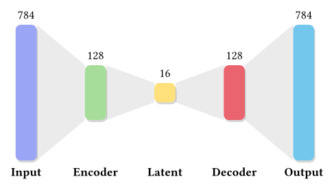

| Parameter | Default | Description |
|---|---|---|
| `layers` | — | Array of `(count, label)` or `(count, label, color)`: the number of units, shown above the bar, and the caption under it (`none` for no caption). |
| `item-width` | `1.4em` | Width of a bar. |
| `height` | `9em` | Height of the largest layer; the others follow the square root of their size. |
| `gap` | `3.2em` | Space between layers. |

### contrastive

The branches of a contrastive model. One input fans out into two views that go through the same stages and meet in the loss; several inputs (a Siamese pair, a triplet) take one branch each. A dashed line joins the twins that share weights.

```typst
#contrastive[ECG segment $x$][
  - Augmentation
  - Encoder $f$
  - Projection $g$
]
```

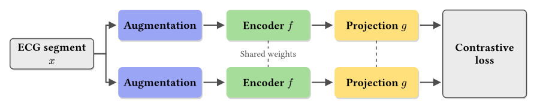

```typst
#contrastive(loss: [Triplet loss])[
  - Anchor
  - Positive
  - Negative
][
  - Encoder
]
```

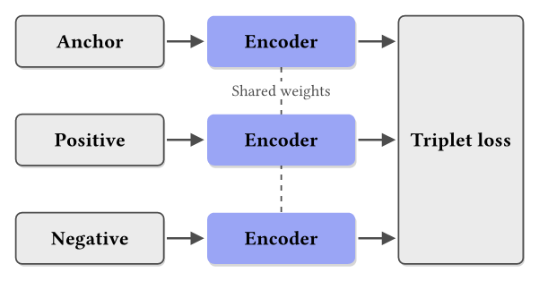

| Parameter | Default | Description |
|---|---|---|
| `inputs` | — | One input, which feeds two branches, or an array with one input per branch. |
| `stages` | — | The stages every branch goes through, as labels or `(label, color)`. |
| `loss` | `[Contrastive loss]` | The box where the branches meet; `none` leaves them open. |
| `shared` | `[Shared weights]` | The note on the dashed line between twin stages; `none` removes the lines. With one input the first stage makes the views and is not joined. |
| `item-width` | `7.5em` | Width of a box. |
| `item-height` | `2.6em` | Minimum height of a box; boxes grow to fit the tallest label. |
| `gap` | `(2.2em, 2.4em)` | Space between stages and between branches (one length for both). |

### kfold

K-fold cross-validation: one row per fold, split into `k` parts with the validation part highlighted, and an optional held-out test block. Fills the available width.

```typst
#kfold(k: 5, test: 20%)
```

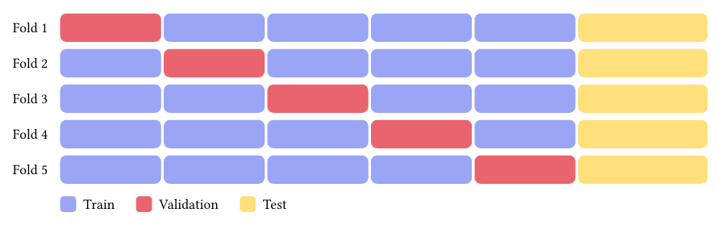

| Parameter | Default | Description |
|---|---|---|
| `k` | `5` | Number of folds (at least 2). |
| `labels` | `([Train], [Validation], [Test])` | Legend labels for the three kinds of block. |
| `prefix` | `[Fold]` | Text before each row's number. |
| `test` | `none` | Share of the data held out for testing, as a ratio such as `20%`; drawn at the right of every row. |
| `item-height` | `1.6em` | Height of a row. |
| `gap` | `0.4em` | Space between rows. |
| `fills` | `auto` | The colours of the training, validation and test parts, in that order. |

### split

One bar divided in proportion to its parts: a train / validation / test partition, or the phases of an experimental protocol with their durations (`unit: " min"`). Fills the available width.

```typst
#split[
  / Train: 70
  / Validation: 15
  / Test: 15
]
```

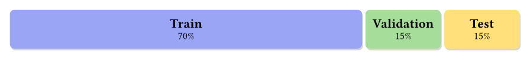

| Parameter | Default | Description |
|---|---|---|
| `items` | — | Array of `(label, value)` or `(label, value, color)`; each part is as wide as its value. |
| `unit` | `"%"` | Text after each value. |
| `item-height` | `3em` | Height of the bar. |
| `gap` | `0.25em` | Space between parts. |

### windows

A signal cut into sliding windows: each window is drawn under the stretch it covers, and overlapping windows take turns on separate rows. The body is any content — a `signal`, an image, a plot.

```typst
#windows(signal("ecg", cycles: 6, width: 24em, height: 3em), count: 4, overlap: 50%)
```

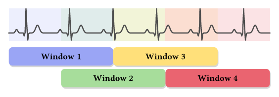

| Parameter | Default | Description |
|---|---|---|
| `body` | — | What is segmented; the windows span its width. |
| `count` | `4` | Number of windows. |
| `overlap` | `50%` | Share of a window that the next one repeats; `0%` puts them side by side. |
| `prefix` | `[Window]` | Text before each window's number. |
| `item-height` | `1.7em` | Height of a window. |
| `gap` | `0.3em` | Space between the rows of windows. |

### confusion

A confusion matrix: actual classes in rows, predicted classes in columns, each cell shaded by its value. With other titles it is a plain labelled heatmap of any square matrix.

```typst
#confusion(((46, 3, 1), (4, 41, 5), (0, 6, 44)), ([Walk], [Run], [Rest]))
```


`normalize: true` shades and prints every cell as a share of its row, so classes of different sizes compare directly:

```typst
#confusion(((46, 3, 1), (4, 41, 5), (0, 6, 44)), ([Walk], [Run], [Rest]), normalize: true)
```

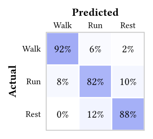

| Parameter | Default | Description |
|---|---|---|
| `matrix` | — | Array of rows of numbers, one row and one column per label. |
| `labels` | — | One label per class, used for both rows and columns; they shrink together to fit a cell's width. |
| `x-title` | `[Predicted]` | Title above the columns (`none` to omit). |
| `y-title` | `[Actual]` | Title beside the rows, read bottom to top (`none` to omit). |
| `cell` | `3em` | Side of a cell. |
| `normalize` | `false` | Shade and show each cell as a percentage of its row total instead of the raw value (shaded against the largest cell). |
| `fill` | `auto` | The colour of the largest value, the others fading to the surface; `auto` is the first palette colour. |

### icon and hstack

Two helpers for figure content: `icon` sets a glyph from an icon font ([Font Awesome 7 Free](https://fontawesome.com) by default), and `hstack` puts items side by side on a common middle line.

```typst
#hstack(icon("\u{f023}", fill: palette.at(0)), [OR], icon("\u{f084}", fill: palette.at(3)))
```


| Parameter | Default | Description |
|---|---|---|
| `icon(glyph, ..)` | — | The glyph, e.g. `"\u{f023}"` (any font's codepoint). |
| `fill` | `auto` | Glyph colour; `auto` = the current text colour. |
| `size` | `2em` | Glyph size. |
| `font` | `"Font Awesome 7 Free"` | Icon font. |
| `hstack(..items, ..)` | — | Items to lay out in a row. |
| `gap` | `1em` | Space between items. |

### signal

A short waveform drawn natively, to stand for a signal inside a node, a panel or `windows` without an image file.

```typst
#hstack(signal("ecg", stroke: palette.at(3)), signal("ppg", stroke: palette.at(4)), signal("sine"), signal("square"), signal("sawtooth"))
```

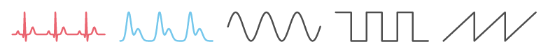

| Parameter | Default | Description |
|---|---|---|
| `kind` | — | `"sine"`, `"square"`, `"sawtooth"`, `"ecg"` (P wave, QRS complex, T wave) or `"ppg"` (systolic peak and dicrotic wave). |
| `cycles` | `3` | Number of periods drawn. |
| `width` | `6em` | Width of the waveform. |
| `height` | `2em` | Height of the waveform. |
| `stroke` | `auto` | Colour, thickness or both; `auto` is the theme's line. |

### loop-ring

An open ellipse with an arrowhead around any content, for "repeat" or "continuous" steps. It is an inline box sized by its content, so it has no `width`.

```typst
#loop-ring[Verification]
```

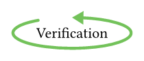

| Parameter | Default | Description |
|---|---|---|
| `body` | — | Content inside the ring. |
| `inset` | `0.4em` | Space between the content and the ring. |
| `theme` | `(:)` | The ring takes the theme's `accent` colour and `thick` stroke. |

### graph

A graph: nodes on a ring joined by the edges you write, `"A -- B"` for a link and `"A -> B"` for an arrow. An edge may carry a label, such as a weight, and `nodes` colours the ones you name.

```typst
#graph(("A -- B", "B -- C", "C -- D", "D -- A", "A -- C"))
```

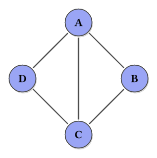

```typst
#graph(
  (("s -> a", [4]), ("s -> b", [2]), ("b -> a", [1]), ("a -> t", [3]), ("b -> t", [5])),
  nodes: (("s", palette.at(1)), ("t", palette.at(3))),
)
```


`layout: "star"` puts the first node in the middle: a hub and its devices.

```typst
#graph(("Gateway -- Sensor 1", "Gateway -- Sensor 2", "Gateway -- Sensor 3", "Gateway -> Cloud"), layout: "star")
```


| Parameter | Default | Description |
|---|---|---|
| `edges` | — | Array of edges: `"A -- B"` (a line) or `"A -> B"` (an arrow), or `(edge, label)` / `(edge, label, color)`. Nodes are created from the names. |
| `nodes` | `()` | Node names to place first, in this order, or `(name, color)` to colour a node. |
| `layout` | `"circle"` | `"circle"` puts every node on the ring; `"star"` puts the first one in the middle. |
| `radius` | `auto` | Minimum radius of the ring; it grows so neighbours never touch. |
| `node-radius` | `auto` | Radius of a node; `auto` fits the longest name. |
| `node-fill` | `auto` | Fill of the nodes without a colour of their own; `auto` is the first palette colour. |

### panels

A grid of framed sub-figures, each with an optional caption inside and a number below: a), b), … Items are a body or a `(body, caption)` pair; panels in one row share their height.

```typst
#panels((
  (hstack(icon("\u{f023}"), [OR], icon("\u{f084}")), [Single-factor]),
  (hstack(icon("\u{f023}"), [AND], icon("\u{f084}")), [Multi-factor]),
))
```


| Parameter | Default | Description |
|---|---|---|
| `items` | — | Panels: a body or `(body, caption)`. |
| `columns` | `2` | Panels per row. |
| `numbering` | `"a)"` | Numbering pattern for the labels below the panels; `none` hides them. |
| `gap` | `1.1em` | Space between panels. |
| `inset` | `0.7em` | Padding inside panels. |
| `fill` | `none` | Panel background. |

`panels` has no text of its own to size, so it takes `width` and `theme` but not `text-size`.

### layers

A layered architecture or protocol stack: one full-width band per layer, with its name on the left and its components as equal blocks. The first item is the top layer.

```typst
#layers((
  ([Application], ([Enrolment], [Verification], [Audit])),
  ([Model], ([Feature extractor], [Classifier])),
  ([Signal], ([Filtering], [Segmentation], [Quality check])),
  ([Sensors], ([ECG], [PPG], [IMU], [EDA])),
))
```


| Parameter | Default | Description |
|---|---|---|
| `items` | — | Array of `(label, blocks)` or `(label, blocks, color)`; `blocks` is an array of contents (a single block takes a trailing comma: `([IP],)`). |
| `gap` | `0.5em` | Space between layers and between the blocks of a layer. |
| `inset` | `0.6em` | Padding inside each band. |

### timing

A digital timing diagram: one row per signal, each written as a string with one character per time step: `0` low, `1` high, `x` unknown.

```typst
#timing[
  / CLK: 0101010101010101
  / CS: 1100000000000011
  / MOSI: xx1100110011xxxx #fill(palette.at(3))
  / MISO: xxxx0011110000xx #fill(palette.at(4))
]
```


| Parameter | Default | Description |
|---|---|---|
| `signals` | — | Array of `(label, levels)` or `(label, levels, color)`; `levels` is a string of `0`, `1` and `x`. |
| `step` | `1.5em` | Width of a time step. |
| `item-height` | `1.5em` | Height of a signal. |
| `gap` | `0.8em` | Space between signals. |

### pixels

A matrix drawn cell by cell: an image patch, a convolution kernel, an S-box, an array. `shade` paints the cells as an image (smallest value black, largest white) and `mark` outlines a window of cells.

```typst
#let patch = ((10, 10, 200, 200), (10, 10, 200, 200), (10, 10, 200, 200), (10, 10, 200, 200))
#hstack(
  pixels(patch, shade: true, mark: ((0, 0), (2, 2))),
  $ast$,
  pixels(((1, 0, -1), (2, 0, -2), (1, 0, -1))),
  $=$,
  pixels(((-760, -760), (-760, -760))),
)
```


| Parameter | Default | Description |
|---|---|---|
| `cells` | — | Array of rows of equal length; a cell is a number or any content. |
| `cell` | `2em` | Side of a cell. |
| `shade` | `false` | `true` shades each cell by its value, as a greyscale image; every cell must then be a number. |
| `values` | `true` | `false` hides the values and leaves the cells. |
| `mark` | `none` | `((row, column), (row, column))`: the first and last cell of a window to outline, counted from 0. |

### convnet

A convolutional network as stacks of feature maps that shrink and multiply along the network, ending in vectors: the LeNet-style figure. A layer is `(size, channels, label)`; a size of 1 is a vector (dense layer). The caption under each layer adds its shape.

```typst
#convnet((
  (32, 1, [Input]),
  (28, 6, [Conv 1]),
  (14, 6, [Pool 1]),
  (10, 16, [Conv 2]),
  (5, 16, [Pool 2]),
  (1, 120, [Dense]),
  (1, 10, [Output]),
))
```


| Parameter | Default | Description |
|---|---|---|
| `layers` | — | Array of `(size, channels, label)` or `(size, channels, label, color)`: the side of the feature maps, how many there are, and the caption (`none` for the shape alone). A size of 1 draws a vector. |
| `item-height` | `6em` | Side of the largest feature map; the others follow the square root of their size. |
| `gap` | `2.2em` | Space between layers, which holds the arrow. |
| `max-planes` | `5` | A layer with more channels draws this many maps. |

### rnn

A recurrent network unrolled in time. Each step is `(input, state, output)`, read bottom to top as it is drawn; `weights` labels the input, recurrent and output arrows, and `folded` adds the compact network with its loop and an arrow that unfolds it.

```typst
#rnn(
  (
    ($x_(t-1)$, $h_(t-1)$, $y_(t-1)$),
    ($x_t$, $h_t$, $y_t$),
    ($x_(t+1)$, $h_(t+1)$, $y_(t+1)$),
  ),
  weights: ($U$, $V$, $W$),
  folded: ($x$, $h$, $y$),
)
```


A step may be just its input: the state then shows `cell`, and a step without an output has none. A many-to-one LSTM:

```typst
#rnn(($x_1$, $x_2$, ($x_3$, none, $y$)), cell: [LSTM], ellipsis: false)
```


| Parameter | Default | Description |
|---|---|---|
| `steps` | — | One item per time step: an input, `(input, state)` or `(input, state, output)`, with an optional colour for the state box. A `none` state shows `cell`. |
| `cell` | `[RNN]` | The label of a state that has none of its own. |
| `weights` | `none` | The labels of the input, recurrent and output arrows, e.g. `($U$, $V$, $W$)`. |
| `folded` | `none` | `(input, state, output)` of the folded network, drawn before the steps with its loop and the unfold arrow. |
| `unfold` | `[Unfold]` | The label over the unfold arrow. |
| `ellipsis` | `true` | Dots before the first step and after the last: the sequence goes on. |
| `item-width` | `4.4em` | Width of a state box. |
| `item-height` | `2.4em` | Height of a state box. |
| `node-radius` | `1.3em` | Radius of the input and output circles. |
| `gap` | `(2.6em, 1.7em)` | Space between steps and between a state and its input or output (one length for both). |
| `state-fill` | `auto` | Fill of the state boxes; `auto` is the first palette colour. A step's own colour wins. |
| `input-fill` | `auto` | Fill of the input circles; `auto` is the second palette colour. |
| `output-fill` | `auto` | Fill of the output circles; `auto` is the fifth palette colour. |

### prisma

A PRISMA flow diagram for systematic reviews: the records go down a column of steps and what each step leaves out branches to the right. A step is a box or a `(box, excluded)` pair; `stages` label consecutive steps on the left.

```typst
#prisma(
  (
    ([Records identified \ (n = 1240)], [Duplicates removed \ (n = 310)]),
    ([Records screened \ (n = 930)], [Records excluded \ (n = 700)]),
    ([Reports assessed for eligibility \ (n = 230)], [Reports excluded \ (n = 188)]),
    [Studies included in the review \ (n = 42)],
  ),
  stages: [
    / Identification: 1
    / Screening: 2
    / Included: 1
  ],
)
```


| Parameter | Default | Description |
|---|---|---|
| `steps` | — | Array of steps, top to bottom: a box, or `(box, excluded)` to branch a second box to the right. |
| `stages` | `()` | A term list (`/ label: count`) or an array of `(label, count)` or `(label, count, color)`: each stage covers its `count` consecutive steps; the counts must add up to the number of steps. |
| `item-width` | `13em` | Width of a box; its height grows to fit the text. |
| `gap` | `(2.4em, 1.6em)` | Space between the two columns and between steps (one length for both). |
| `inset` | `0.6em` | Padding inside the boxes. |

### checks

A comparison matrix for related-work sections: methods in rows, criteria in columns, and a check, a cross or a dash in each cell. Set like a booktabs table: three rules, no vertical lines.

```typst
#checks(
  ([Method], [Continuous], [Multimodal], [On-device], [Open data]),
  (
    ([Guo et al. (2023)], true, false, true, none),
    ([Gurunathan (2024)], false, false, none, true),
    ([Zhang et al. (2022)], true, true, false, [partial]),
    ([*Ours*], true, true, true, true),
  ),
)
```


| Parameter | Default | Description |
|---|---|---|
| `columns` | — | Array of header contents; the first heads the label column. |
| `rows` | — | Array of rows, each with a label followed by one cell per remaining column: `true` (check mark), `false` (cross), `none` (dash, for unknown or not applicable) or any content shown as is. |
| `gap` | `0.5em` | Vertical padding of every cell. |
| `fills` | `auto` | The colours of the check and of the cross, in that order; `auto` is the accent and the palette's red. |

### sequence

A UML-style sequence diagram: participants across the top, their lifelines, and one arrow per message in time order. Use it for protocols, handshakes and any exchange between parties or system components.

```typst
#sequence(
  (("u", [User]), ("d", [Device]), ("s", [Server])),
  (
    ("u", "d", [Present biometric]),
    ("d", "d", [Extract features]),
    ("d", "s", [Template + nonce]),
    ("s", "s", [Match]),
    ("s", "d", [Decision], "reply"),
    ("d", "u", [Unlock], "reply"),
  ),
)
```


| Parameter | Default | Description |
|---|---|---|
| `participants` | — | Array of `(name, label)` or `(name, label, color)`; `name` is the string the messages refer to. |
| `messages` | — | Array of `(from, to, label)` or `(from, to, label, kind)`, drawn top to bottom. `kind` is `"call"` (solid line, the default) or `"reply"` (dashed line); a message from a participant to itself is a loop beside its lifeline. |
| `item-width` | `6em` | Width of a participant box; its height grows to fit the label. |
| `gap` | `(3em, 1.8em)` | Space between participant boxes and minimum distance between consecutive arrows (one length for both); a row grows to fit a wrapped label. |

### convnet3d

A convolutional network as blocks in perspective, the VGG-style figure (`convnet` draws it as feature maps). An item is a stage: `(size, channels, label, repeat)` draws `repeat` layers of that shape, as tall as their feature maps and as thick as their channels. A pooling slab is added wherever the next stage is smaller, a size of 1 is a fully connected layer, and `input` stands an image in front as the first face.

```typst
#set text(size: 9pt)
#convnet3d((
  (224, 64, [Conv-1], 2),
  (112, 128, [Conv-2], 2),
  (56, 256, [Conv-3], 3),
  (28, 512, [Conv-4], 3),
  (14, 512, [Conv-5], 3),
  (1, 4096, [FC-6]),
  (1, 4096, [FC-7]),
  (1, 1000, [FC-8]),
))
```


| Parameter | Default | Description |
|---|---|---|
| `stages` | — | Array of `(size, channels, label)` or `(size, channels, label, repeat)`, with an optional colour: the side of the feature maps, their number, the caption over the stage and how many layers it has. A size of 1 is a fully connected layer. |
| `input` | `none` | Content (an image) drawn in front of the first stage, in the same perspective. |
| `legend` | `([Convolution], [Pooling], [Fully connected])` | The labels of the legend, for the kinds of layer present; `none` hides it. |
| `pool` | `true` | Draws a pooling slab between a stage and a smaller one. |
| `item-height` | `11em` | Height of the largest layer; the others follow the square root of their size. |
| `gap` | `0.9em` | Space between stages. |
| `fills` | `auto` | The colours of the convolution, pooling and fully connected layers, in that order. A stage's own colour wins. |

### annotate

Callouts on any content — an image, a plot, another diagram: a dot at each point of interest and a leader line to a label beside the content. Labels on the same side never overlap; a label is pushed below the previous one when their points are close.

```typst
#let beat = curve(
  stroke: 1.2pt + luma(80),
  curve.move((0cm, 2.2cm)), curve.line((1.4cm, 2.2cm)), curve.quad((1.8cm, 1.6cm), (2.2cm, 2.2cm)),
  curve.line((2.8cm, 2.4cm)), curve.line((3.2cm, 0.3cm)), curve.line((3.6cm, 2.8cm)), curve.line((4cm, 2.2cm)),
  curve.quad((5cm, 1.2cm), (5.8cm, 2.2cm)), curve.line((7cm, 2.2cm)),
)
#annotate(
  box(width: 7cm, height: 3cm, beat),
  (
    (point: (26%, 63%), label: [P wave]),
    (point: (46%, 10%), label: [R peak]),
    (point: (51%, 93%), label: [S wave]),
    (point: (71%, 57%), label: [T wave]),
  ),
)
```


| Parameter | Default | Description |
|---|---|---|
| `body` | — | The content to annotate; it keeps its own size (give an image a `width`). |
| `notes` | — | Array of `((x, y), label)`, `((x, y), label, color)` or `(point: (x, y), label: .., color: ..)`; `x` and `y` are ratios of the body's width and height from its top-left corner. Notes with `x` below `50%` are labelled on the left, the others on the right. |
| `gap` | `2em` | Space between the body and the labels. |

### packet

The layout of a packet header, a frame or a register: fields as wide as their bits, wrapped in rows, under a ruler of bit positions. A field that crosses a row continues on the next one; fields of whole rows become one tall box. Fills the available width.

```typst
#packet[
  / Version: 4
  / IHL: 4
  / DSCP: 6
  / ECN: 2
  / Total length: 16
  / Identification: 16
  / Flags: 3
  / Fragment offset: 13
  / TTL: 8
  / Protocol: 8
  / Header checksum: 16
  / Source address: 32
  / Destination address: 32
]
```


| Parameter | Default | Description |
|---|---|---|
| `fields` | — | The fields in order, as a term list (`/ name: bits`) or an array of `(label, bits)` or `(label, bits, color)`. |
| `bits` | `32` | Bits per row. |
| `item-height` | `2.4em` | Height of a row. |

## Flowcharts and pipelines

`flowchart` draws method, pipeline, decision and state diagrams. The shortest one is a chain of arrows: with no nodes declared, every name becomes a box.

```typst
#flowchart(edge("Input", "Model", "Output"))
```


Three pieces build the rest:

- `node(name, body, ..)` — a box, pill, circle, ellipse, diamond, loop or no shape at all (`shape: none`) with any content (icons, images, math), and an optional `caption` hanging below it.
- `edge("a", "b", "c", ..)` — arrows in a chain: `a → b → c`, between nodes or named groups. Routing is automatic: straight when the two shapes face each other, elbowed otherwise, and a dot marks where edges fork or merge. With `avoid-crossings: true` on the flowchart, an edge whose usual path would run through a node, cross another edge or lie on it takes another shape. An edge from a node to itself is a loop.
- `group(title, ..)` — a dashed frame around the nodes written inside it (or named, or lying between two grid corners), titled on its border or `inside: true`; give it a `name` to connect edges to the whole frame.

**Where things go.** A node's position is written on the node, in one of three ways:

- `(column, row)`: a cell of the grid, counted from 0; fractions such as `(0.5, 1)` sit between two cells.
- `right`, `left`, `above` or `below`: the cell next to the node declared just before. A chain is then one line per box, and adding a box in the middle is adding a line.
- `(below, "name")`: the cell next to the node with that name.

```typst
#flowchart(
  node("load", (0, 0), [Load]),
  node("filter", right, [Filter]),
  node("segment", right, [Segment]),
  node("check", (below, "filter"), [Quality check]),
  node("report", right, [Report]),
  edge("load", "filter", "segment"),
  edge("filter", "check", "report"),
)
```


Leave the positions out altogether and the layout is automatic: each node goes one layer after its longest chain of predecessors and is aligned with them. Either way, columns and rows take the size of their largest node, and gaps widen to fit group frames and arrows.

Once a flowchart declares nodes, every name in an edge or a group must be one of them: a misspelt name is an error, not a new box.

```typst
#flowchart(
  node("data", [Raw data]), node("clean", [Cleaning]), node("feat", [Features]),
  group([Training], node("a", [Model A]), node("b", [Model B]), node("ens", [Ensemble])),
  node("out", [Report], shape: "pill", fill: palette.at(1)),
  edge("data", "clean", "feat", "a", "ens", "out"),
  edge("feat", "b", "ens"),
)
```


A decision flowchart, top to bottom, with edge labels and a dashed back edge. `avoid-crossings` takes the "retry" edge around the diamond instead of through it:

```typst
#flowchart(
  dir: ttb,
  avoid-crossings: true,
  node("start", [Start], shape: "pill", fill: palette.at(1)),
  node("read", [Read input]),
  node("ok", [Valid?], shape: "diamond", fill: palette.at(2)),
  node("run", [Process]),
  node("err", [Report error], fill: palette.at(3)),
  node("end", [End], shape: "pill", fill: palette.at(1)),
  edge("start", "read", "ok"),
  edge("ok", "run", label: [yes]),
  edge("ok", "err", label: [no]),
  edge("run", "end"),
  edge("err", "end"),
  edge("err", "read", dash: "dashed", label: [retry]),
)
```


**Placing things by hand.** When the automatic result is not what you want, one local change fixes it: `shift` moves a node off its grid point, `exit` and `enter` choose the sides an edge leaves and arrives by, `label-pos` slides a label along its edge, `via` forces waypoints and `bend` curves the edge.

```typst
#flowchart(
  node("idle", (0, 0), [Idle], shape: "circle"),
  node("run", right, [Running], shape: "circle", fill: palette.at(1)),
  node("done", right, [Done], shape: "circle", shift: (0em, 2.5em)),
  edge("idle", "run", label: [start]),
  edge("run", "run", label: [tick]),
  edge("run", "done", exit: right, enter: top, label: [finish], label-pos: 35%),
  edge("done", "idle", exit: bottom, enter: bottom, dash: "dashed", label: [reset]),
)
```


A research pipeline: the frames hold their boxes, a row of boxes is a line of code, and the arrows are three chains. `node.with(..)` makes a preset for boxes that share a style.

```typst
#set text(size: 8pt)
#let (key, model, dct, feat, eval) = (
  rgb("#8f8fde"), rgb("#a9a9e6"), rgb("#f5b57a"), rgb("#89b4fa"), rgb("#f38ba8"),
).map(color => node.with(fill: color))

#flowchart(
  gap: 3em,
  node("ecg", (0, 1), [ECG signal]), node("ppg", below, [PPG signal]),
  group([Chaotic projection],
    key("pwd", (3, 0), [User password]), key("sha", right, [SHA-256]),
    model("map", right, [Chaotic map \ (logistic / tent)]), model("smat", right, [Projection \ $S in RR^(d times n)$])),
  group([Signal fusion], title-pos: bottom,
    dct("dct1", (1, 1), [DCT]), dct("dct2", below, [DCT]),
    node("cat", (2, 1), [Concatenate \ first halves]), dct("idct", right, [IDCT])),
  group([Feature extraction], feat("mfcc", (4, 1), [MFCC]), feat("x", right, [Features \ $x in RR^n$])),
  model("tpl", (6, 1), [Template \ $t = S x$]),
  group([Evaluation], title-pos: bottom,
    eval("match", (below, "tpl"), [Cosine matcher]), node("metrics", left, [AUC · EER · DET])),
  edge("pwd", "sha", "map", "smat", "tpl"),
  edge("ecg", "dct1", "cat", "idct", "mfcc", "x", "tpl", "match", "metrics"),
  edge("ppg", "dct2", "cat"),
)
```


**Larger figures.** When one call gets long, give each part a name and let the last line show the structure; a part is whatever `flowchart` accepts:

```typst
#let fusion = group([Signal fusion], node("dct", (0, 0), [DCT]), node("cat", right, [Concatenate]))
#let features = group([Features], node("mfcc", right, [MFCC]), node("x", right, [Features]))
#let arrows = (edge("dct", "cat", "mfcc", "x"),)

#flowchart(fusion, features, arrows)
```

### flowchart

| Parameter | Default | Description |
|---|---|---|
| `..children` | — | Nodes, edges and groups, in any order. |
| `dir` | `ltr` | Flow direction for automatic layout and elbow routing: `ltr` or `ttb`. |
| `gap` | `(3.6em, 2.6em)` | Minimum gap between columns and between rows (one length for both); gaps widen to fit group frames and titles. |
| `inset` | `0.65em` | Default padding inside nodes. |
| `group-inset` | `0.9em` | Space between a group frame and its nodes. |
| `group-stretch` | `none` | Default `stretch` of every group, e.g. `(top, bottom)`. |
| `title-style` | `(weight: "bold")` | Text settings for every group title, e.g. `(weight: "regular", size: 1.2em)`. |
| `caption-style` | `(:)` | Text settings for every node caption, e.g. `(size: 0.8em)`. |
| `independent-columns` | `false` | `true` lets each lane (columns joined by nodes placed between them) size its own rows, so a tall node in one lane does not stretch the others. |
| `avoid-crossings` | `false` | `true` makes an edge whose usual path runs through a node, crosses another edge or lies on it try its other shapes, in the order the edges are written. It does not promise zero crossings, and it costs time (17 ms more for the 25-node tree of `bench/run.sh`), so it is off unless you ask. |

Nodes are filled with the theme's `panel` and outlined with `line` at `stroke`; edges are 1.4 × `stroke`; `loop` nodes use `accent` at `thick`; `rect` corners are `corner-radius`.

### node

| Parameter | Default | Description |
|---|---|---|
| `name` | — | Identifier used by edges and groups; unique. |
| `pos` | automatic | Optional position: `(column, row)` (fractions sit between tracks), a side of the node before (`right`, `left`, `above`, `below`), or `(side, "name")` for the cell next to a named node. Give one to all nodes, or to none for the automatic layout. |
| `body` | — | Any content. |
| `shape` | `"rect"` | `"rect"`, `"pill"`, `"circle"`, `"ellipse"`, `"diamond"`, `"loop"` (an open ellipse with an arrowhead, coloured by `stroke`) or `none` (the content alone). |
| `caption` | `none` | Content below the shape; edges leaving downwards start under it. |
| `fill` | `auto` | Fill colour; the text takes the colour that reads best on it. |
| `stroke` | `auto` | Outline. |
| `width` | `auto` | Fixed width (the text wraps inside); `auto` = natural width. |
| `height` | `auto` | Minimum height of the shape. |
| `inset` | `auto` | Padding; `auto` = the flowchart's `inset`. |
| `shift` | `(0pt, 0pt)` | `(dx, dy)` offset from the grid point; the grid and the other nodes stay put, the edges follow. |

### edge

| Parameter | Default | Description |
|---|---|---|
| `..names` | — | Two or more node or group names; consecutive pairs are connected. In a flowchart that declares no nodes, every name becomes a box labelled with it. The same name twice draws a loop on that node. |
| `marks` | `"->"` | `"->"`, `"<-"`, `"<->"` or `"-"`. |
| `label` | `none` | Content shown on the edge. |
| `label-pos` | `auto` | How far along the edge the label sits, `0%` to `100%`; `auto` is the middle of the longest leg. |
| `stroke` | `auto` | Stroke of this edge; what it leaves out comes from the theme, so `stroke: red` keeps the default thickness and `stroke: 2pt` the default colour. |
| `dash` | `none` | Dash pattern, e.g. `"dashed"`, `"dotted"`. |
| `route` | `auto` | `"straight"`, `"hv"`, `"vh"`, `"hvh"`, `"vhv"` (h = horizontal, v = vertical leg) or `"detour"`. |
| `exit`, `enter` | `auto` | Side the edge leaves its first end and reaches its last end by: `left`, `right`, `top` or `bottom`. On a loop, `exit` is the side it sits on. |
| `via` | `()` | Grid points the edge passes through, e.g. `((1.5, 4), (1.5, 0))`; fractions allowed. |
| `bend` | `0deg` | Curves the edge by this angle; positive bends to the left of the direction of travel. |

### group

| Parameter | Default | Description |
|---|---|---|
| `title` | — | Title of the frame; `none` for a plain frame. |
| `..members` | — | What the frame encloses: nodes (and groups) written inside it, names of nodes and earlier named groups, or `(column, row)` corners: `(1, 0), (5, 2)` encloses every node inside that rectangle and every earlier named group whose nodes all lie there. |
| `name` | `none` | Lets edges start or end at the frame. |
| `inside` | `false` | `true` writes the title inside the frame, centred, instead of on its border. |
| `title-pos` | `top` | `top` or `bottom`. |
| `fill` | `none` | Frame background. |
| `stroke` | `auto` | Frame outline; `auto` is a dashed soft line. |
| `stretch` | `auto` | Edges that grow until they meet another frame or node, or the outer edge of the diagram: `bottom`, `right`, `(bottom, right)`, … Groups stretch in declaration order; `auto` takes the flowchart's `group-stretch`. |
| `join` | `none` | Name of another group; the two frames are drawn as the outline of their union (one shape when they touch). |

Repeated parts are plain Typst: `node.with(..)` presets a style, and a function can return several nodes and edges at once (`flowchart` flattens nested arrays):

```typst
#let prep = node.with(fill: palette.at(2))
#let lane(id, row, color) = (
  prep("seg-" + id, (0, row), [Segmentation]),
  prep("pre-" + id, right, [Preprocess]),
  node("z-" + id, right, [z-score]),
  edge("seg-" + id, "pre-" + id, "z-" + id, stroke: color),
)

#flowchart(group([Feature extraction], lane("e", 0, blue), lane("p", 1, red)))
```


## Composed figures

`flowchart` draws the figures that have no widget of their own. A Transformer encoder block, with its residual connections as bent edges and the repetition as the frame's title:

```typst
#flowchart(
  dir: ttb,
  gap: (3em, 1.6em),
  node("in", (0, 0), [Input embedding], shape: "pill"),
  group([× N], title-pos: bottom,
    node("att", below, [Multi-head attention], fill: palette.at(2)),
    node("norm1", below, [Add & norm], fill: palette.at(1)),
    node("ff", below, [Feed forward], fill: palette.at(4)),
    node("norm2", below, [Add & norm], fill: palette.at(1)),
  ),
  node("out", below, [Output], shape: "pill"),
  edge("in", "att", "norm1", "ff", "norm2", "out"),
  edge("in", "norm1", bend: -50deg),
  edge("norm1", "norm2", bend: -50deg),
)
```


Cipher block chaining: a function returns the nodes and edges of one block, and the chain is the same block three times.

```typst
#let block(i) = (
  node("p" + str(i), (i, 0), $P_#i$, shape: none),
  node("x" + str(i), below, $xor$, shape: "circle", inset: 0.2em),
  node("e" + str(i), below, $E_K$, fill: palette.at(0)),
  node("c" + str(i), below, $C_#i$, shape: none),
  edge("p" + str(i), "x" + str(i), "e" + str(i), "c" + str(i)),
)
#flowchart(
  gap: (3em, 1.4em),
  block(1), block(2), block(3),
  node("iv", (left, "x1"), [IV], shape: none),
  edge("iv", "x1"),
  edge("e1", "x2", exit: right, enter: left),
  edge("e2", "x3", exit: right, enter: left),
)
```


**Images.** A `node` body, a `panels` item and a `loop-ring` accept any content, so a picture is just `image(...)`; the path is resolved from your own document. Combine it with `shape: none` for a bare picture, and with `caption:` for a label under it:

```typst
#flowchart(
  node("sig", image("images/ecg.svg", width: 3cm), shape: none, caption: [ECG]),
  node("model", [Model]),
  edge("sig", "model"),
)
```


A method diagram in three lanes: `independent-columns: true` lets each lane stack its own rows, captions hang under the boxes, fractional positions centre a node over two columns, routes go through grid points (`via`), arrows reaching the same side of a node get their own slots, `stretch` grows the K-Fold frame to the right and the Validation frame down until they meet, and `join` draws both as one outline:

```typst
#set text(size: 7.5pt, weight: "bold")
#let (green, red, blue, orange, violet) = (rgb("#a7dd9b"), rgb("#f38ba8"), rgb("#89b4fa"), rgb("#f9b98a"), rgb("#b4bcfa"))

#flowchart(
  line: black, stroke: 0.1em, corner-radius: 0.6em,
  title-style: (weight: "regular", fill: luma(110), size: 1.15em),
  caption-style: (size: 0.65em),
  independent-columns: true,
  gap: (2.2em, 1.6em),
  group([Preprocessing], inside: true,
    node("dataset", (0.5, 0), [Dataset], fill: green, caption: [Dataset Name \ Users: Number]),
    node("load", (0.5, 1), [Load Data], fill: green, caption: [Num. Segments: N \ Size segment: Fs\*t]),
    node("sig1", (0, 2), [Signal1], fill: red),
    node("sig2", (1, 2), [Signal2], fill: blue),
    node("seg", (0.5, 3), [Segment-by-segment \ preprocessing], fill: green),
    node("pre1", (0, 4), [Signal1 \ Prepo], fill: red.darken(10%)),
    node("pre2", (1, 4), [Signal2 \ Prepo], fill: blue.darken(10%)),
  ),
  group([Feature Engineering], inside: true,
    node("feat", (2.5, 0), [Feature extraction], fill: orange,
      caption: [Wavelet: bior3.3 \ characteristics by coefficient: \ [mean, std, var, kurtosis, skewness, \ energy, entropy, max, min, median, iqr, range, mad]]),
    node("f1", (2, 1), [Signal1 F], fill: red.lighten(50%)),
    node("f2", (3, 1), [Signal2 F], fill: blue.lighten(50%)),
    node("merge", (2.5, 2), [Merging features], fill: orange),
    node("final", (2.5, 3), [Final features], fill: rgb("#f5c2e7")),
  ),
  group(none, name: "kfold-box", stretch: right,
    node("kfold", (2.5, 4), [Stratified K-Fold], fill: violet, caption: [Folds: 5 \ [Fold 1] [Fold 2] … [Fold k]]),
  ),
  group([Validation and Results], inside: true, stretch: bottom, join: "kfold-box",
    node("list", (4, 0), [List of classifiers], fill: violet,
      caption: [classifiers: [Random Forest, Logistic \ Regression, KNN, Decision Tree, \ Naive Bayes, Extra Trees, LDA]]),
    node("cv", (4, 1), [Cross-Validation loop], fill: violet, caption: [Train and test classifier by classifier]),
    node("report", (4, 2), [Classification Report], fill: violet, caption: [Save in parquet packages]),
    node("viz", (4, 3), [Visualization], fill: violet),
  ),

  edge("dataset", "load"),
  edge("load", "sig1", "seg", "pre1"),
  edge("load", "sig2", "seg", "pre2"),
  edge("pre1", "feat", via: ((0, 4.7), (1.6, 4.7), (1.6, 0))),
  edge("pre2", "feat", via: ((1, 4.55), (1.5, 4.55), (1.5, 0))),
  edge("feat", "f1", "merge", "final", "kfold"),
  edge("feat", "f2", "merge"),
  edge("kfold", "list", via: ((3.45, 4), (3.45, 0))),
  edge("list", "cv", "report", "viz"),
)
```


A continuous-authentication scheme: icons as nodes, edges between whole groups, a decision diamond, a `loop` node and a curved back edge:

```typst
#set text(size: 9pt, weight: "bold")

#flowchart(
  line: black, stroke: 0.12em, corner-radius: 0.6em,
  title-style: (weight: "regular", fill: luma(110), size: 1.15em),
  gap: (3.4em, 3.6em),
  node("user", (0, 0), icon("\u{f007}", fill: rgb("#64b5f6"), size: 3em), caption: [Sesion \ Request], shape: none),
  node("auth", (1, 0), [Authentication \ Request], fill: rgb("#a7dd9b")),
  group([Continuous signal capture], name: "capture-box", inside: true,
    node("watch", (2, 0), icon("\u{f21e}", fill: rgb("#f44336"), size: 3.6em), shape: none),
    node("capture", (2, 1), [Signal Capture], fill: rgb("#f38ba8")),
    node("plot", (3, 1), icon("\u{f201}", fill: rgb("#e53935"), size: 3.6em), shape: none),
  ),
  group([Feature extraction], name: "features", inside: true,
    node("convert", (4, 0), [Convert to \ Features], fill: rgb("#f9b98a")),
    node("vector", (4, 1), text(weight: "regular", size: 1.3em, $[F_1, F_2, ..., F_n]$), shape: none),
  ),
  group([Model], name: "model-box", inside: true,
    node("model", (4, 2), [Pre-trained \ model], fill: rgb("#b4bcfa")),
    node("classify", (4, 3), [Classify], fill: rgb("#b4bcfa")),
  ),
  group([Verification module], inside: true,
    node("again", (2, 2), [New session \ time], shape: "loop"),
    node("check", (3, 2), [Is #icon("\u{f007}", fill: rgb("#64b5f6"), size: 1.8em) ?], shape: "diamond", fill: rgb("#f6dfac")),
  ),
  node("ended", (3, 3), icon("\u{f506}", fill: rgb("#f06292"), size: 3em), caption: [Session ended], shape: none),

  edge("user", "auth", "capture-box"),
  edge("watch", "capture", "plot"),
  edge("capture-box", "features"),
  edge("convert", "vector"),
  edge("features", "model-box"),
  edge("model", "classify"),
  edge("model", "check"),
  edge("check", "again", label: text(weight: "regular")[yes]),
  edge("check", "ended", label: text(weight: "regular")[no]),
  edge("again", "auth", bend: 45deg),
)
```


A verification pipeline with an image node (`images/ecg.svg`), edges between whole groups and two branches leaving one node through waypoints:

```typst
#set text(size: 9pt, weight: "bold")

#flowchart(
  line: black, stroke: 0.12em, corner-radius: 0.6em,
  title-style: (weight: "regular", size: 1.15em),
  gap: (2.6em, 2.4em),
  node("user", (0, 0), icon("\u{f007}", fill: rgb("#c48b9f"), size: 3.4em), caption: [Sesion \ Request], shape: none),
  group([Signal Capture], name: "capture-box", inside: true,
    node("watch", (0, 1), icon("\u{f21e}", fill: rgb("#f44336"), size: 4em), shape: none),
    node("capture", (0, 2), [Capture], fill: rgb("#f38ba8"), width: 8em),
    node("ecg", (1, 2), image("images/ecg.svg", width: 6em), shape: none),
  ),
  group([Feature Engineering], name: "features", inside: true,
    node("feat", (2, 1), [Feature extraction], fill: rgb("#f9b98a"), width: 10em, height: 3.4em),
    node("prep", (2, 2), [Preprocesing], fill: rgb("#f9b98a"), width: 10em, height: 3.4em),
  ),
  group([Verification Stage], name: "verification", inside: true,
    node("rejected", (1, -1), icon("\u{f235}", fill: rgb("#f06292"), size: 3.4em), caption: [Rejected], shape: none),
    node("or", (2, -1), text(weight: "regular", size: 1.4em)[OR], shape: none),
    node("accepted", (3, -1), icon("\u{f4fc}", fill: rgb("#c48b9f"), size: 3.4em), caption: [Accepted], shape: none),
    node("auth", (2, 0), [Autentication], fill: rgb("#b4bcfa"), width: 10em),
  ),

  edge("user", "capture-box", "features", "verification"),
  edge("watch", "capture", "ecg"),
  edge("prep", "feat"),
  edge("auth", "rejected", via: ((1.75, -1),)),
  edge("auth", "accepted", via: ((2.25, -1),)),
)
```


Sub-figure grids with `panels`:

```typst
#set text(size: 9pt)

#panels(columns: 3, numbering: "1)", (
  (hstack(icon("\u{f023}", fill: rgb("#8bc34a")), icon("\u{f27a}", fill: rgb("#2196f3")), icon("\u{f06e}", fill: rgb("#26a69a"))), [Something a user knows]),
  (hstack(icon("\u{f3cf}", fill: rgb("#29b6f6")), icon("\u{f084}", fill: rgb("#ffc107")), icon("\u{f2c2}", fill: rgb("#2196f3"))), [Something in a user's possession]),
  (hstack(icon("\u{f577}", fill: rgb("#29b6f6")), icon("\u{f007}", fill: rgb("#90a4ae")), icon("\u{f06e}", fill: rgb("#00897b"))), [Something the user is]),
  (hstack(icon("\u{f554}", fill: rgb("#e53935")), icon("\u{f11c}", fill: rgb("#e53935")), icon("\u{f25a}", fill: rgb("#1e88e5"))), [Something the user does]),
  (hstack(icon("\u{f3c5}", fill: rgb("#ef5350")), icon("\u{f1eb}", fill: rgb("#1e88e5"))), [Somewhere that a user is]),
  (hstack(icon("\u{f519}", fill: rgb("#1e88e5")), icon("\u{f1bb}", fill: rgb("#43a047"))), [Something that is in the user's environment]),
))
```


```typst
#set text(size: 9pt)
#let op(t) = text(size: 1.6em, t)

#panels(columns: 2, (
  (hstack(icon("\u{f023}", fill: rgb("#8bc34a")), op[OR], icon("\u{f577}", fill: rgb("#29b6f6")), op[OR], icon("\u{f084}", fill: rgb("#ffc107"))), [Single-Factor]),
  (hstack(icon("\u{f06e}", fill: rgb("#26a69a")), op[And], icon("\u{f577}", fill: rgb("#29b6f6")), op[OR], icon("\u{f3c5}", fill: rgb("#ef5350"))), [Multi-Factor]),
  (hstack(icon("\u{f83e}", fill: rgb("#e53935")), op[Merge], icon("\u{f577}", fill: rgb("#29b6f6"))), [Multimodal]),
  (loop-ring(hstack(icon("\u{f21e}", fill: rgb("#e53935")), [Verification])), [Continuous]),
))
```


## Development

The README is the source of every image: each example followed by `` is compiled and compared with that image.

```sh
tests/run.sh            # examples against their images, tests/checks.typ, tests/errors.txt
tests/run.sh --update   # rewrite the images from the examples
bench/run.sh            # cost per diagram, flowchart scaling, comparison with fletcher
```

The tests need `typst`, ImageMagick and the Font Awesome 7 Free font; the benchmark needs `hyperfine`.

## Migrating from 0.2

| 0.2 | 0.3 |
|---|---|
| Bare numbers meaning centimetres (`w: 4`) | Lengths, `em` by default (`item-width: 6em`). |
| `w`, `h`, `bw`, `bh`, `cw`, `ch`, `box-w`, `box-h`, `pill-w`, `bar-h`, `height` | `item-width`, `item-height`. |
| `r`, `core-r`, `hub-r`, `step-r`, `node`, `ring-radius` | `radius`, `core-radius`, `hub-radius`, `node-radius`. |
| `gutter`, `gx`/`gy`, `dx`/`dy`, `xstep`/`ystep`, `gap-x`/`level-gap`, `vgap`, flowchart `spacing` | `gap` (one length or an `(x, y)` pair); `stairs` takes `step: (dx, dy)`. |
| `cols` | `columns`. |
| `size`, `value-size`, `label-size`, `body-size`, `date-size`, … | `text-size`; secondary sizes come from the theme's `small` and `large`. |
| `text-fill`, `accent`, `box-fill`, `node-stroke`, `edge-stroke`, corner `radius`, … | The theme keys, passed to the diagram: `accent: ..`, `panel: ..`, `line: ..`, `stroke: ..`, `corner-radius: ..`, `ink: ..`; text on a fill picks its own colour. |
| `pyramid(width: ..)` | `pyramid(base: ..)`; `width` now scales any diagram. |
| `waffle(a, b, c)`, `panels(a, b, c)` | `waffle((a, b, c))`, `panels((a, b, c))`. |
| Misspelt arguments such as `node(.., shap: "pill")` were ignored | Unknown arguments, shapes, marks and names are errors. |

Earlier releases are tagged `v0.1.0` … `v0.2.2`.
