<p align="center">
    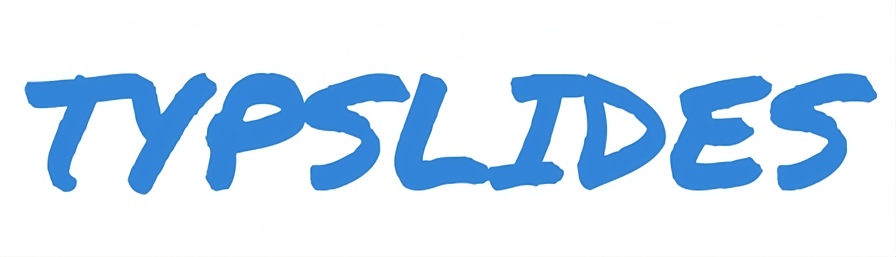
</p>

<p align="center">
    
    
    
    
</p>

<p align="justify">
<strong>Typslides</strong> is a minimalist package for creating presentations with <a href="https://typst.app/">typst</a>, designed to offer a simple and fast user experience. Structure your content with different slide styles and aesthetic elements. With a clear and concise syntax, Typslides makes it easy to create elegant and well-organized presentations.
</p>

<p align="justify">
Default <strong>themes</strong>:
</p>

<p align="center">
🔵 <strong>bluey</strong>   🔴 <strong>reddy</strong>   🟢 <strong>greeny</strong>   🟡 <strong>yelly</strong>   🟣 <strong>purply</strong>   🔵 <strong>dusky</strong>   ⚫ <strong>darky</strong>
</p>

# Contents

- [Quickstart](#quickstart)
- [Sample slides](#sample-slides)
- [Presentation setup](#presentation-setup)
- [Slide types](#slide-types)
- [Text and layout components](#text-and-layout-components)
- [Dynamic display: `#pause`, `#only` and `#uncover`](#dynamic-display-pause-only-and-uncover)
- [Themes and colors](#themes-and-colors)
- [Sections, outline and progress](#sections-outline-and-progress)
- [Cheat sheet](#cheat-sheet)

# Quickstart

This is a simple usage example:

```typst
#import "@preview/typslides:1.4.0": *

// Project configuration
#show: typslides.with(
  ratio: "16-9",
  theme: "bluey",
  font: "Fira Sans",
  font-size: 20pt,
  link-style: "color",
  show-progress: true,
)

// The front slide is the first slide of your presentation
#front-slide(
  title: "This is a sample presentation",
  subtitle: [Using _typslides_],
  authors: "A. Manjavacas",
  info: [#link("https://github.com/manjavacas/typslides")],
)

// Custom outline
#table-of-contents()

// Title slides create new sections
#title-slide[
  This is a _Title slide_
]

// A simple slide
#slide[
  - This is a simple `slide` with no title.
  - #stress("Bold and coloured") text by using `#stress(text)`.
  - Sample link: #link("typst.app").
    - Link styling using `link-style`: `"color"`, `"underline"`, `"both"`
  - Font selection using `font: "Fira Sans"`, `size: 21pt`.

  #framed[This text has been written using `#framed(text)`. The background color of the box is customisable.]

  #framed(title: "Frame with title")[This text has been written using `#framed(title:"Frame with title")[text]`.]
]

// Focus slide
#focus-slide[
  This is an auto-resized _focus slide_.
]

// Blank slide
#blank-slide[
  - This is a `#blank-slide`.

  - Available #stress[themes]#footnote[Use them as *color* functions! e.g., `#reddy("your text")`]:

  #framed(back-color: white)[
    #bluey("bluey"), #reddy("reddy"), #greeny("greeny"), #yelly("yelly"), #purply("purply"), #dusky("dusky"), darky.
  ]

  // #show: typslides.with(
  // ratio: "16-9",
  // theme: "bluey",
  // ...
  // )

  - Or just use *your own theme color*:
    - `theme: rgb("30500B")`
]

// Slide with title
#slide(title: "Outlined slide", outlined: true)[
  - Check out the *progress bar* at the bottom of the slide.

    #h(1cm) `show-progress: true`

  - Outline slides with `outlined: true`.

  #grayed([This is a `#grayed` text. Useful for equations.])
  #grayed($ P_t = alpha - 1 / (sqrt(x) + f(y)) $)

]

// Dynamic display
#slide(title: "Pause, only and uncover")[

  #stress[Dynamic display] with `#pause`, `#only` and `#uncover`...

  #only(1)[*Frame 1*: this text is replaced later (`#only`).]
  #only("2-")[*Frames 2 and 3*: this is the replacement (`#only`).]
  #uncover(3)[*Frame 3*: this line was invisible, but its space was reserved (`#uncover`).]

  #pause
  - Appears in *Frame 2* (`#pause`).
  #pause
  - Appears in *Frame 3* (`#pause`).
]

// Columns
#slide(title: "Columns")[

  #cols(columns: (2fr, 1fr, 2fr), gutter: 2em)[
    #grayed[Columns can be included using `#cols[...][...]`]
  ][
    #grayed[And this is]
  ][
    #grayed[an example.]
  ]

  - Custom spacing: `#cols(columns: (2fr, 1fr, 2fr), gutter: 2em)[...]`

  - Sample references: @typst, @typslides.
    - Add a #stress[bibliography slide]...

    1. `#let bib = bibliography("you_bibliography_file.bib")`
    2. `#bibliography-slide(bib)`
]

// Bibliography
#let bib = bibliography("bibliography.bib")
#bibliography-slide(bib)
```

# Sample slides

<kbd>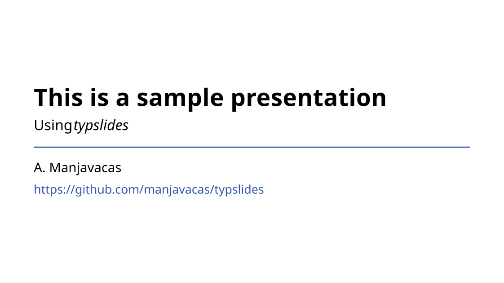</kbd> <kbd>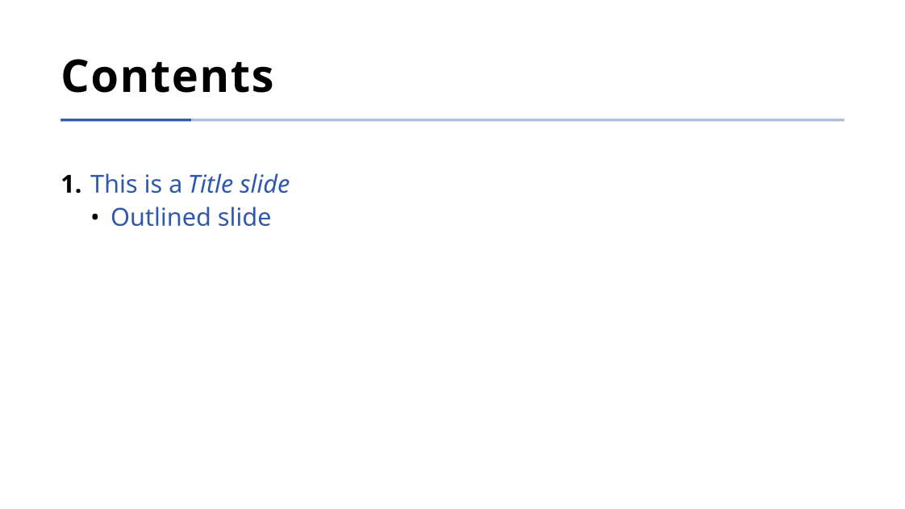</kbd> <kbd>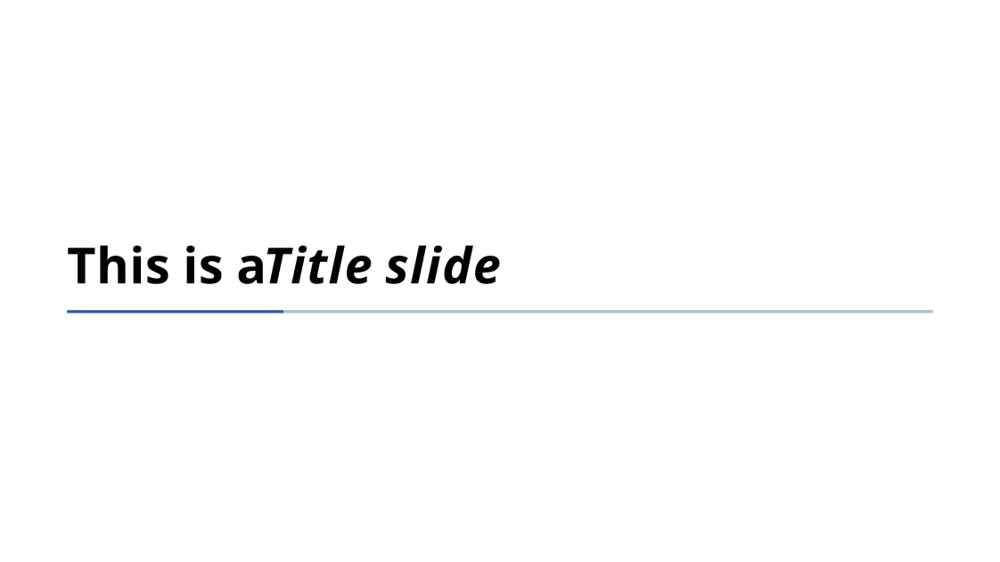</kbd> <kbd>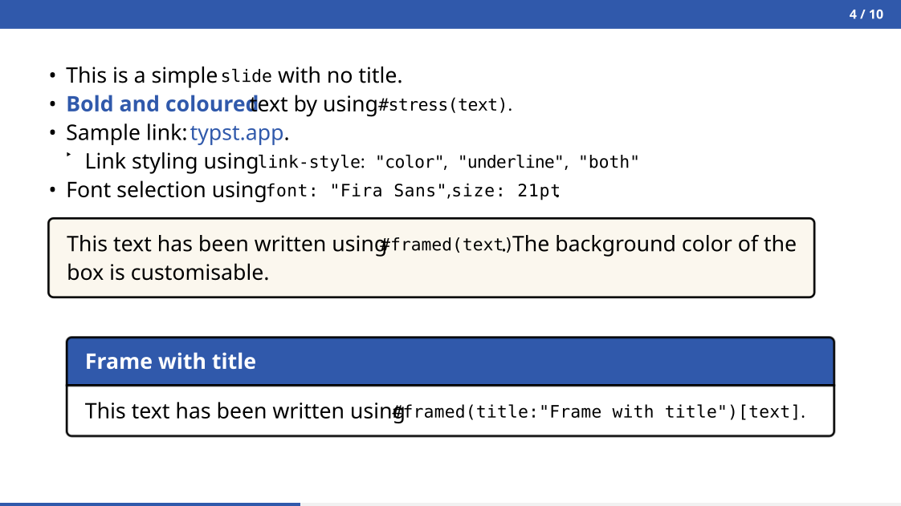</kbd> <kbd>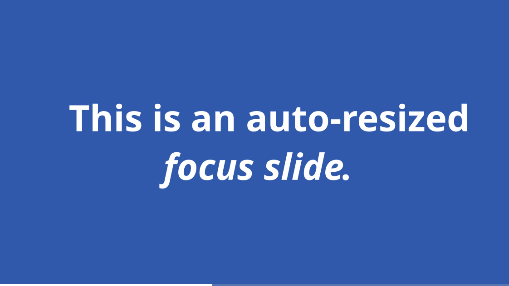</kbd> <kbd>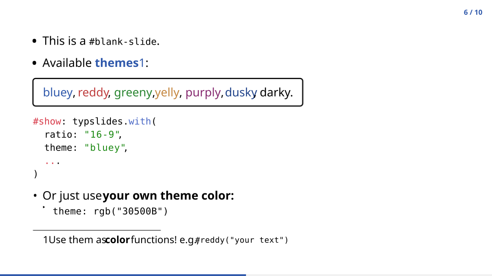</kbd> <kbd>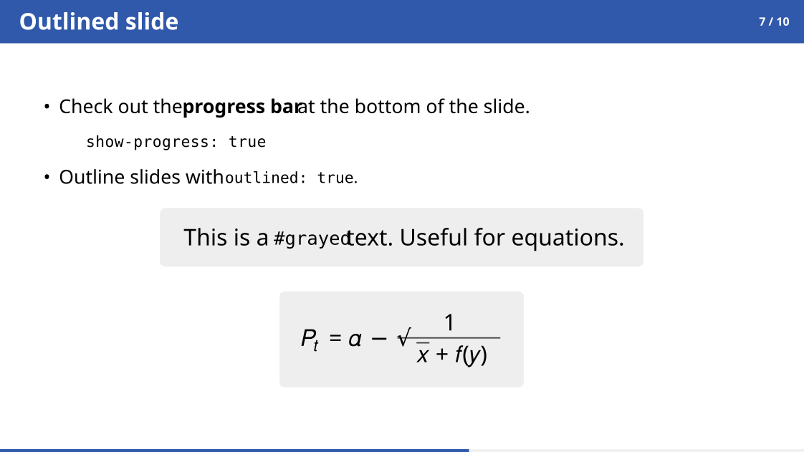</kbd> <kbd>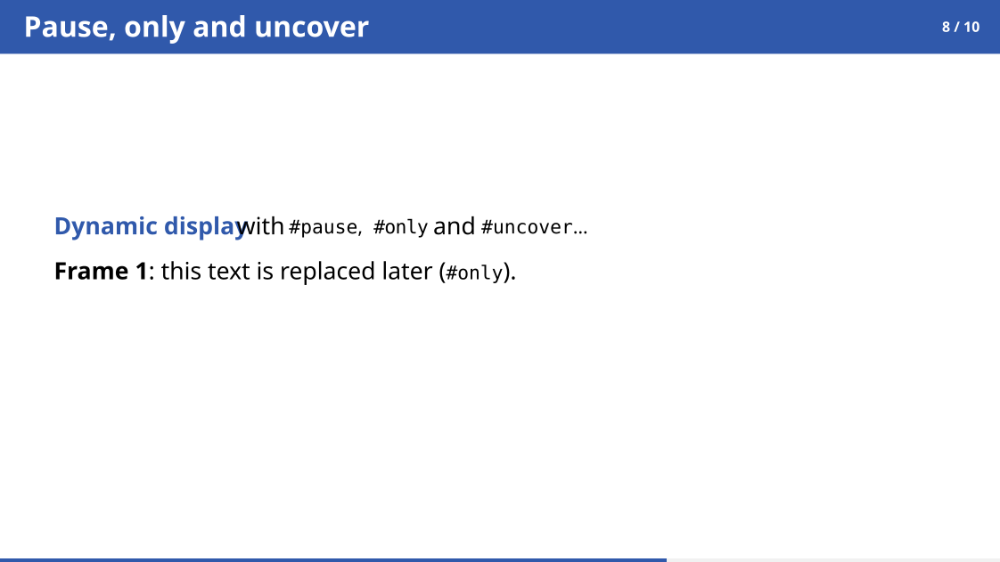</kbd> <kbd>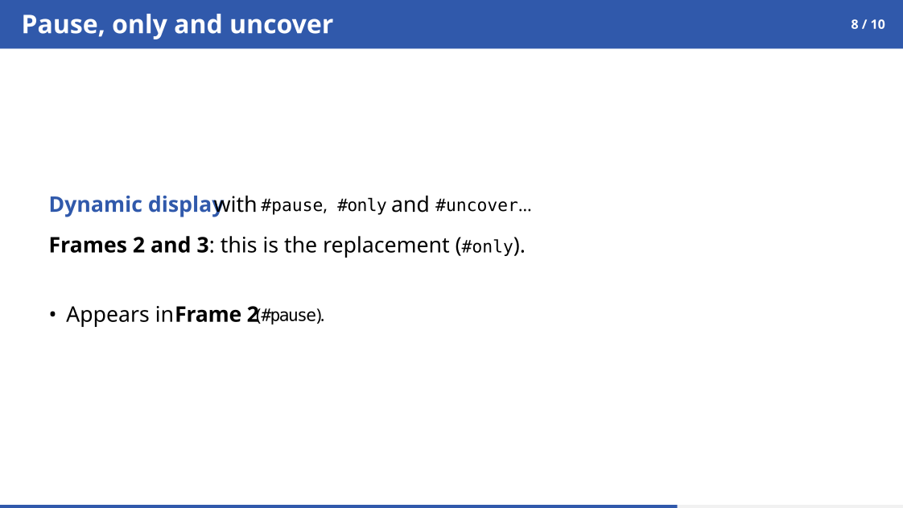</kbd><kbd>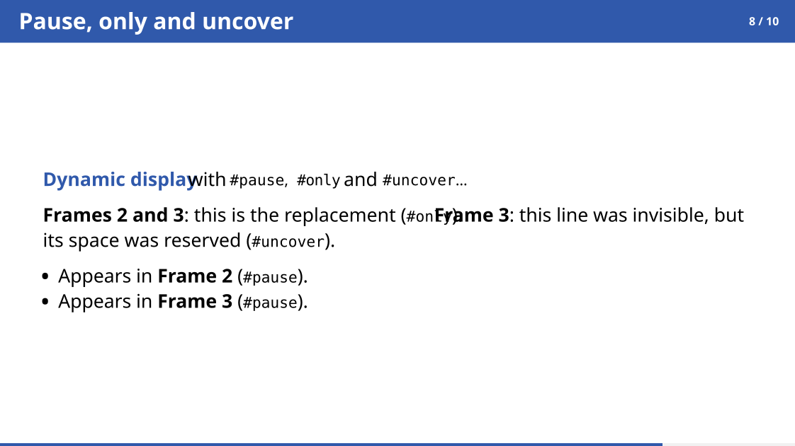</kbd><kbd>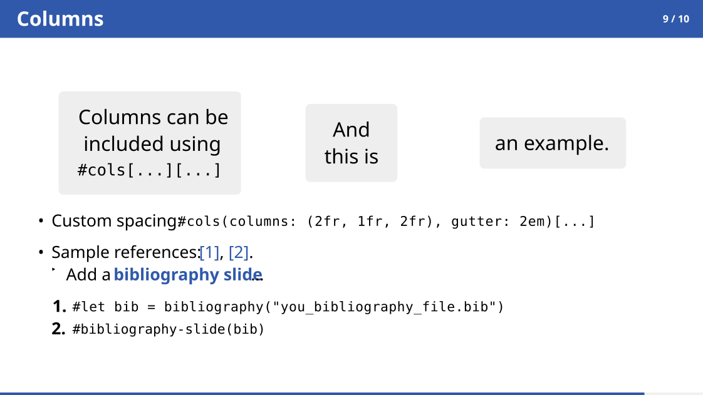</kbd><kbd>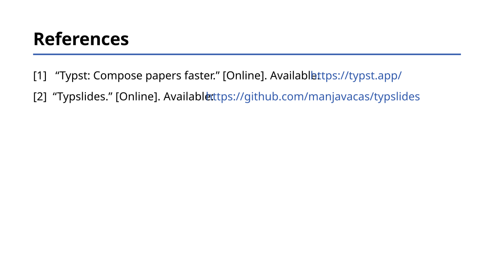</kbd>

# Presentation setup

Every presentation starts by applying `typslides` with a `#show` rule. All arguments are optional:

```typst
#show: typslides.with(
  ratio: "16-9",
  theme: "bluey",
  font: "Fira Sans",
  font-size: 21pt,
  link-style: "color",
  show-page-numbers: true,
  show-progress: false,
  progress-height: 3pt,
  back-color: white,
)
```

| Argument | Default | Description |
|---|---|---|
| `ratio` | `"16-9"` | Aspect ratio of the slides, e.g. `"16-9"` or `"4-3"`. |
| `theme` | `"bluey"` | Name of a [built-in theme](#themes-and-colors) or any custom color, e.g. `rgb("30500B")`. |
| `font` | `"Fira Sans"` | Font family of the whole presentation. |
| `font-size` | `21pt` | Base font size. |
| `link-style` | `"color"` | How links look: `"color"`, `"underline"` or `"both"`. |
| `show-page-numbers` | `true` | Show the slide number (`current / total`) in `slide` and `blank-slide`. |
| `show-progress` | `false` | Show a progress bar at the bottom of the slides. |
| `progress-height` | `3pt` | Thickness of the progress bar. |
| `back-color` | `white` | Default background color of all slides. |

References (`@label`), links and footnotes are automatically colored with the theme color.

# Slide types

| Function | Purpose |
|---|---|
| [`front-slide`](#front-slide) | Cover of the presentation. |
| [`table-of-contents`](#table-of-contents) | Automatic outline. |
| [`title-slide`](#title-slide) | Section title (creates a new section). |
| [`slide`](#slide) | Standard content slide, with or without title. |
| [`focus-slide`](#focus-slide) | Full-color slide with a big, auto-resized message. |
| [`blank-slide`](#blank-slide) | Content slide without header. |
| [`bibliography-slide`](#bibliography-slide) | References slide. |

All of them accept `back-color` to override the default background of that single slide.

## `front-slide`

The first slide of the presentation.

```typst
#front-slide(
  title: "This is a sample presentation",
  subtitle: [Using _typslides_],
  authors: "A. Manjavacas",
  info: [#link("https://github.com/manjavacas/typslides")],
)
```

| Argument | Default | Description |
|---|---|---|
| `title` | `none` | Main title. |
| `subtitle` | `none` | Subtitle. |
| `authors` | `none` | Author name(s). |
| `info` | `none` | Extra information (date, link, institution...). |
| `back-color` | global | Background color. |
| `margin` | `auto` | Page margins of this slide. |

## `table-of-contents`

Generates the outline automatically from the [sections and outlined slides](#sections-outline-and-progress) of the presentation. Entries are clickable links.

```typst
#table-of-contents()
#table-of-contents(title: "Index", text-size: 20pt)
```

| Argument | Default | Description |
|---|---|---|
| `title` | `"Contents"` | Title of the outline. |
| `text-size` | `23pt` | Font size of the entries. |
| `back-color` | global | Background color. |

## `title-slide`

Creates a new **section** (it is added to the outline).

```typst
#title-slide[Introduction]
```

| Argument | Default | Description |
|---|---|---|
| `body` | — | Title of the section. |
| `text-size` | `42pt` | Font size of the title. |
| `back-color` | global | Background color. |

## `slide`

The standard content slide. Without `title` it only has a thin colored header.

```typst
#slide[
  - A simple slide with no title.
]

#slide(title: "With title", outlined: true)[
  - A slide with title that also appears in the outline.
]
```

| Argument | Default | Description |
|---|---|---|
| `title` | `none` | Title shown in the colored header. |
| `outlined` | `false` | Add the slide to the outline (as a subsection of the current section). |
| `back-color` | global | Background color. |
| `margin` | automatic | Custom page margins. |
| `subslides` | `auto` | Number of [dynamic frames](#dynamic-display-pause-only-and-uncover). Normally computed automatically. |
| `body` | — | Content of the slide. |

## `focus-slide`

A full-color slide for a key message. The text is automatically resized to fit the page.

```typst
#focus-slide[
  This is an auto-resized _focus slide_.
]
```

| Argument | Default | Description |
|---|---|---|
| `text-color` | `white` | Text color. |
| `text-size` | `60pt` | Initial size (reduced automatically if the text does not fit). |
| `back-color` | theme color | Background color. |

## `blank-slide`

A content slide without header, with the maximum area available. It still shows the page number and the progress bar, and it supports [dynamic display](#dynamic-display-pause-only-and-uncover).

```typst
#blank-slide[
  Free layout here.
]
```

| Argument | Default | Description |
|---|---|---|
| `back-color` | global | Background color. |
| `subslides` | `auto` | Number of dynamic frames. |

## `bibliography-slide`

Shows the references of a `.bib` file. Cite with `@key` anywhere in the presentation.

```typst
#let bib = bibliography("bibliography.bib")
#bibliography-slide(bib)
#bibliography-slide(bib, title: "Bibliography")
```

| Argument | Default | Description |
|---|---|---|
| `bib-call` | — | The `bibliography(...)` call. |
| `title` | `"References"` | Title of the slide. |
| `back-color` | global | Background color. |

# Text and layout components

## `stress`

Highlights text with the theme color and a semibold weight.

```typst
This is #stress[important].
```

## `framed`

A box to highlight content, with an optional title bar.

```typst
#framed[A simple box.]
#framed(title: "Title")[A box with title.]
#framed(back-color: white)[A box with custom background.]
```

| Argument | Default | Description |
|---|---|---|
| `title` | `none` | Title shown in a bar with the theme color. |
| `back-color` | automatic | Background color of the box. |

## `grayed`

A centered gray box, useful for equations, code or notes.

```typst
#grayed[Some note]
#grayed($ P_t = alpha - 1 / (sqrt(x) + f(y)) $)
#grayed(text-size: 20pt, fill-color: yellow.lighten(70%))[Custom]
```

| Argument | Default | Description |
|---|---|---|
| `text-size` | `24pt` | Font size of the content. |
| `fill-color` | light silver | Background color. |

## `cols`

Multi-column layouts.

```typst
#cols[Left][Right]

#cols(columns: (2fr, 1fr, 2fr), gutter: 2em)[
  First
][
  Second
][
  Third
]
```

| Argument | Default | Description |
|---|---|---|
| `columns` | equal widths | Widths of the columns. Must match the number of content blocks. |
| `gutter` | `1em` | Spacing between columns. |

## Color functions

Color a piece of text with any of the theme colors: `#bluey`, `#reddy`, `#greeny`, `#yelly`, `#purply`, `#dusky`.

```typst
This is #reddy[red] and this is #greeny("green").
```

## Other useful things

Everything from plain typst works as usual: lists, numbered lists, equations, tables, images, `#footnote`, `#link`, `#h`/`#v`...

# Dynamic display: `#pause`, `#only` and `#uncover`

Beamer-like overlays: one slide can be revealed step by step without duplicating it. Each step is a *frame* (a page of the PDF). All the frames of a slide share the same slide number.

```typst
#slide(title: "Pause, only and uncover")[
  #only(1)[*Frame 1*: this text is replaced later (`#only`).]
  #only("2-")[*Frames 2 and 3*: this is the replacement (`#only`).]
  #uncover(3)[*Frame 3*: this line was invisible, but its space was reserved (`#uncover`).]

  - Always visible.
  #pause
  - Appears in *Frame 2* (`#pause`).
  #pause
  - Appears in *Frame 3* (`#pause`).
]
```

## `#pause`

Hides everything after it until the next frame. The hidden content **keeps its space**, so the visible content does not move between frames. A slide with *N* pauses has *N + 1* frames.

```typst
#slide[
  - First idea.
  #pause
  - Second idea.

  #framed[Shown together with the second idea.]
]
```

## `#only(spec)[...]`

Shows the content **only** in the frames matching `spec`. In the other frames it is removed and takes no space.

## `#uncover(spec)[...]`

Like `#only`, but in the other frames the content is hidden instead of removed, so it **keeps its space**.

## Frame specification (`spec`)

| `spec` | Frames |
|---|---|
| `2` | Only frame 2 |
| `"2-"` | From frame 2 on |
| `"-3"` | Up to frame 3 |
| `"2-4"` | Frames 2, 3 and 4 |
| `"1, 3-"` | Frame 1 and from frame 3 on |
| `(1, "3-")` | An array mixing any of the above |

## Things to know

- A `#pause` hides **everything that comes after it**, including `#only` and `#uncover`, until its frame arrives. Place them *before* the first `#pause` (or after the last one if you want them in the final frame only).
- `#pause` must be at the top level of the slide body (list and enum items included). Inside other functions such as `#framed[...]` or `#cols[...]`, use `#uncover`/`#only` instead.
- The number of frames is computed automatically from the pauses and from the `#only`/`#uncover` of the slide. If some of them are inside functions that cannot be inspected, set it manually: `#slide(subslides: 4)[...]`.
- Available in `slide` and `blank-slide`.
- The progress bar advances with every frame, while the slide number does not.

# Themes and colors

Choose a theme in the setup:

```typst
#show: typslides.with(theme: "reddy")
```

| Theme | Color |
|---|---|
| `bluey` | 🔵 `#3059AB` (default) |
| `reddy` | 🔴 `#BF3D3D` |
| `greeny` | 🟢 `#28842F` |
| `yelly` | 🟡 `#C4853D` |
| `purply` | 🟣 `#862A70` |
| `dusky` | 🔵 `#1F4289` |
| `darky` | ⚫ black |

Or use **your own color**:

```typst
#show: typslides.with(theme: rgb("30500B"))
```

The theme color is used in headers, bullets, links, references, footnotes, `#stress`, `#framed` titles, dividers and progress bars. The default background of all slides can be changed with `back-color`, and individually with the `back-color` argument of each slide.

# Sections, outline and progress

- Every `#title-slide` creates a **section**.
- Every slide with `outlined: true` becomes a **subsection** of the last section, and also shows its title in the outline.
- `#table-of-contents()` builds the outline from them. If there are no sections, only the outlined slides are listed.

```typst
#table-of-contents()

#title-slide[Introduction]
#slide(title: "Motivation", outlined: true)[...]
#slide(title: "Goals", outlined: true)[...]

#title-slide[Results]
#slide(title: "Experiments", outlined: true)[...]
```

With `show-progress: true`, a progress bar is shown at the bottom of content slides, and a progress divider under the titles of `table-of-contents`, `title-slide` and `bibliography-slide`. In `focus-slide` the bar is white.

# Cheat sheet

| I want to... | Use |
|---|---|
| Configure the presentation | `#show: typslides.with(...)` |
| Create the cover | `#front-slide(...)` |
| Add an outline | `#table-of-contents()` |
| Start a new section | `#title-slide[...]` |
| Add a content slide | `#slide(title: "...")[...]` |
| Show a slide in the outline | `#slide(outlined: true)[...]` |
| Emphasize a key message | `#focus-slide[...]` |
| Use the whole page | `#blank-slide[...]` |
| Add references | `#bibliography-slide(bib)` |
| Highlight a word | `#stress[...]` |
| Add a box (with title) | `#framed(title: "...")[...]` |
| Add an equation/note box | `#grayed[...]` |
| Use columns | `#cols[...][...]` |
| Reveal content step by step | `#pause` |
| Show content in specific frames only | `#only(spec)[...]` |
| Show content in specific frames (keeping space) | `#uncover(spec)[...]` |
