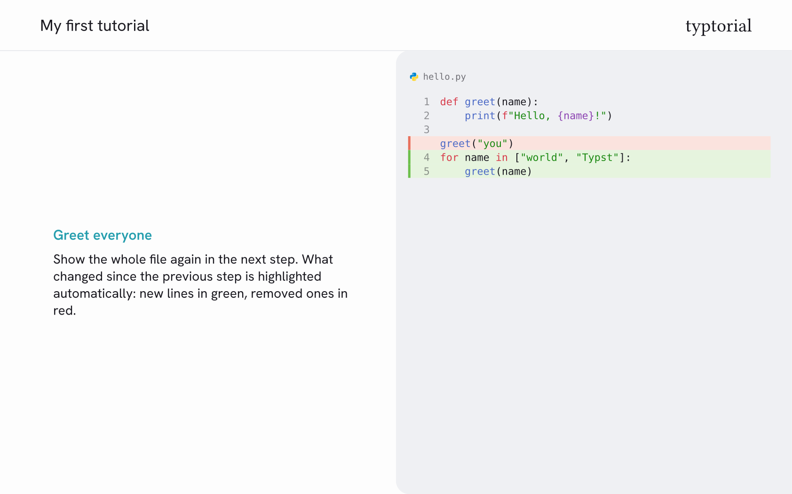

# typtorial



Step-by-step code tutorials with Typst. Every level-1 heading becomes a step with the
explanation on the left and the code on the right. What changed in a file since the
previous step is highlighted automatically.

The same source compiles to PDF slides and, with Typst's experimental HTML export, to a
single-page website.

## Usage

````typ
#import "@preview/typtorial:0.1.0": tutorial

#show: tutorial.with(title: [My first tutorial])

= Say hello

First we print a greeting.

```python hello.py
print("Hello")
```

= Greet the world

Now we greet the whole world.

```python hello.py
print("Hello, world")
```
````

```sh
typst compile my-tutorial.typ
typst compile --features html --format html my-tutorial.typ
```

Or start from the bundled example with `typst init @preview/typtorial`.

## Your own rules

Set and show rules work as usual when they come *after* `#show: tutorial…`, yet they only
affect the PDF: Typst's HTML export carries structure, not text styling. Font sizes that
should apply to the website as well belong under `sizes` in the theme.

```typ
#show: tutorial.with(title: [My first tutorial])

#set par(justify: true)
#show heading.where(level: 1): it => text(size: 24pt, it)
```

## Code blocks

- The word after the backticks is the language, an optional second word is the file
  name: ` ```python src/main.py `.
- A block is compared with the previous block of the same file name. Added lines are
  marked green, removed lines red.
- Blocks are shown with line numbers and a file-type icon.
- `#diff-off` shows the following blocks plainly, `#diff-on` resumes the comparison with
  the last block shown before. Import both next to `tutorial`. `diff: false` in the call
  switches the highlighting off for the whole tutorial.

## Options

| Parameter | Default | Meaning |
|---|---|---|
| `title` | `none` | Title, shown on the title page and at the top left of every page |
| `abstract` | `none` | Short summary shown before the first step |
| `lang` | `"en"` | Language of the text; also sets the labels on the website |
| `mode` | `"light"` | `"light"` or `"dark"`; color scheme of the PDF |
| `diff` | `true` | Highlight what changed in a file since the previous step; `false` for unrelated excerpts |
| `show-removed` | `true` | Keep removed code lines visible, highlighted in red |
| `logo`, `logo-dark` | `none` | Image at the top right, e.g. `image("logo.svg")` |
| `source`, `source-name` | `none` | Text of the source file, offered as a download on the website |
| `theme` | `(:)` | Fonts, colors, brand text and layout, see below |
| `fonts`, `sizes`, `colors`, `brand`, `layout`, `dark` | `(:)` | Single theme settings given directly; they override `theme` |

## Theme

A theme is a dictionary, usually loaded from a YAML file:

```typ
#show: tutorial.with(theme: yaml("my.theme.yaml"))
```

```yaml
fonts:
  text: Helvetica Neue
sizes:
  text: 16
  heading: 20
colors:
  accent: "#239dad"
  heading: "#127885"
brand:
  text: My team
layout:
  title-page: true
  abstract: with-title
dark:
  colors:
    background: "#15141a"
```

Every setting can also be passed directly to the function, grouped like in the file.
A value given this way overrides the one from the theme file:

```typ
#show: tutorial.with(
  theme: yaml("my.theme.yaml"),
  colors: (accent: "#d6336c"),
  layout: (dots: true, abstract: "separate"),
)
```

The package also ships three more themes:

- `themes.paper`: warm paper tones, a serif text font and a yellow accent
- `themes.crimson`: a red gradient with white text and a light code panel
- `themes.signal`: greys, square corners and yellow headings on a black bar

```typ
#import "@preview/typtorial:0.1.0": tutorial, themes

#show: tutorial.with(theme: themes.paper)
```

Only the settings you want to change are needed. All settings are listed with
comments in [`themes/default.theme.yaml`](themes/default.theme.yaml); `theme.schema.json` describes
them for editors that support JSON Schema for YAML files.

A theme with its own colors gets a dark color scheme by adding a `dark` section. The
website then follows the reader's system setting and offers a button to switch.

## Website output

The website needs Typst's HTML export, which is experimental: pass
`--features html --format html` and expect two warnings. Styles and script are embedded,
so the result is a single HTML file.

## Fonts

Typst only ships serif and monospace fonts, and a package cannot bring its own. Every font
setting therefore accepts a list of fallbacks, and the first one that is installed is used:

```yaml
fonts:
  text: [Hanken Grotesk, Helvetica Neue, Arial, Liberation Sans, DejaVu Sans]
```

The default theme looks best with
[Hanken Grotesk](https://fonts.google.com/specimen/Hanken+Grotesk?preview.script=Latn),
a free font you can download from Google Fonts and install. Without it the next font of
the list is used: the bundled themes come with such lists, so the text is sans-serif on
macOS, Windows and Linux alike. Typst prints an `unknown font family` warning for every font of a list that is
not installed; the result is still correct.

On the website the browser picks from the same list among the fonts on the reader's
machine.

## License

The package is licensed under the MIT license, see `LICENSE`. The files in `template/`
are licensed under MIT-0 instead: use and change them in your own project without
attribution.

## Credits

The file-type icons in `src/icons/` are from the
[Material Icon Theme](https://github.com/material-extensions/vscode-material-icon-theme)
(MIT license, see `src/icons/LICENSE`).
