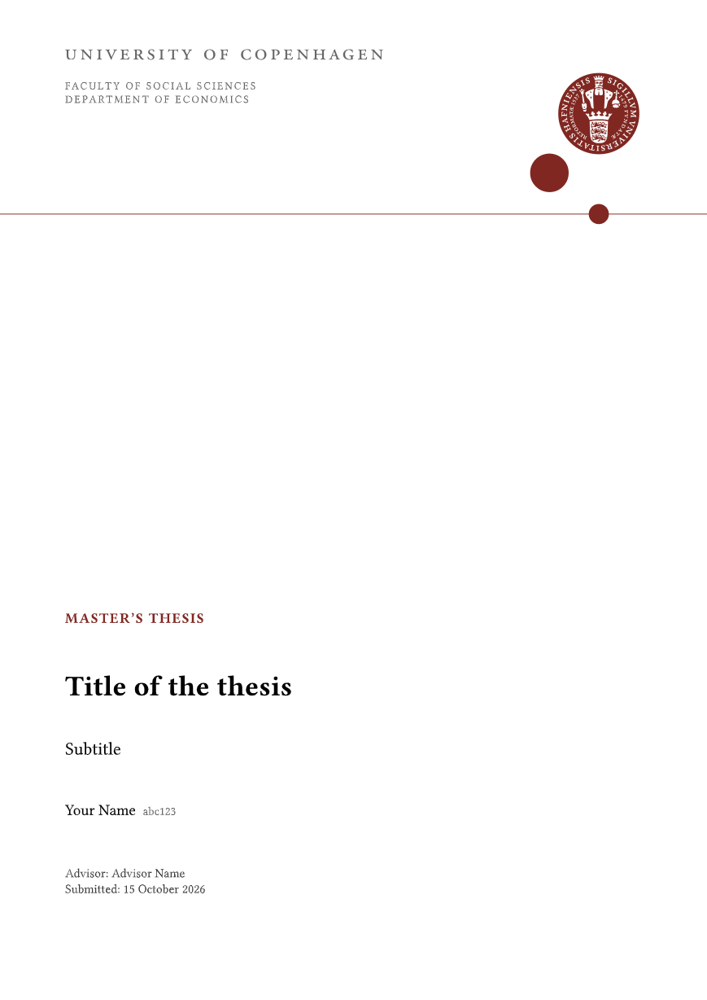

# `ucph-lehmann-thesis`

_This template is **NOT** affiliated with the University of Copenhagen. The logo is the property of the University of Copenhagen._

**ucph-lehmann-thesis** is a [Typst](https://github.com/typst/typst) template for theses and projects at the University of Copenhagen (bachelor's projects, master's theses, PhD theses). It uses the official logo, follows the logo placement for publications in the [UCPH design guide](https://designguide.ku.dk/), and has labels in English and Danish. It is an **unofficial** template and a companion to the slide theme [ucph-nielsine-touying](https://github.com/jorgenhost/ucph-nielsine-touying).

<kbd></kbd>

## Getting started

```typ
#import "@preview/ucph-lehmann-thesis:0.1.0" as ul

#show: ul.thesis.with(
  lang: "en", // or "da"
  type: [Master's thesis],
  title: [Title of the thesis],
  subtitle: [Subtitle],
  authors: ((name: "Your Name", id: "abc123"),),
  advisors: ("Advisor Name",),
  date: datetime.today(),
  faculty: [Faculty of Social Sciences],
  department: [Department of Economics],
  abstracts: (en: [...], da: [...]),
  character-count: true,
)

= Introduction
...

#bibliography("refs.bib", style: "harvard-cite-them-right")

#show: ul.appendix

= Additional tables
...
```

Locally, `typst init @preview/ucph-lehmann-thesis` creates a new thesis from the template.

## What you get

- **Front page** with the official logotype and seal, faculty and department, an optional cover image, title block, authors, advisors and submission date.
- **Information page** generated from the same metadata (faculty, department, authors, title, description, advisors, date), so nothing is typed twice.
- **Abstracts** in one or both languages (`abstracts: (en: [..], da: [..])`), each hyphenated in its own language, plus an optional preface.
- **Contents**, and optional lists of figures and tables.
- Roman page numbers in the front matter, arabic from chapter 1.
- Chapters on new pages, with figures, tables and equations numbered per chapter (2.1, 2.2, …) and lettered in the appendix (A.1, …). References read "Chapter 2", "Section 2.1", "Appendix A".
- **Character count**: with `character-count: true`, the information page shows the number of characters including spaces in the main text and the equivalent in UCPH normal pages (2,400 characters). Figures, tables, equations, the reference list and the appendix are left out. Rules differ between programmes, so check yours.
- `twoside: true` for double-sided printing.

## Options

| Option | Default | |
|---|---|---|
| `lang` | `"en"` | `"en"` or `"da"`: labels, hyphenation, date format and logotype |
| `type`, `title`, `subtitle` | `none` | |
| `authors`, `advisors` | `()` | a name, or an array of names or `(name: .., id: ..)` |
| `date` | `none` | a `datetime` (formatted per language) or any content |
| `faculty`, `department` | `none` | |
| `description` | `none` | shown on the information page |
| `cover-image` | `none` | e.g. `image("cover.jpg")` |
| `abstracts` | `(:)` | keyed by language |
| `preface` | `none` | |
| `info-page` | `true` | |
| `character-count` | `false` | |
| `outline-depth` | `3` | |
| `list-of-figures`, `list-of-tables` | `false` | |
| `chapter-pagebreak` | `true` | |
| `twoside` | `false` | |
| `font` | `"Libertinus Serif"` | body text |
| `heading-font` | `"Libertinus Serif"` | headings and front page |
| `font-size` | `11pt` | |
| `paper` | `"a4"` | |

## Logos and colours

The package exports the extracted logo variants and the UCPH palette:

```typ
#import "@preview/ucph-lehmann-thesis:0.1.0" as ul

#ul.logo("seal", width: 2cm)
#ul.logos.seal 
#ul.logo("logo-stacked-da", width: 5cm)
#text(fill: ul.colors.red)[KU red]
```

Variants: `seal`, `seal-negative`, `seal-line`, `logo-en`, `logo-da`, `logo-right-en`, `logo-right-da`, `logo-stacked-en`, `logo-stacked-da`, `logo-stacked-negative-en`, `logo-stacked-negative-da`, `wordmark-en`, `wordmark-da`. `ul.colors.print` holds the official CMYK values of the logo red and logotype grey. See `examples/asset-gallery.pdf`.

## Development

```
git clone https://github.com/jorgenhost/ucph-lehmann-thesis
cd ucph-lehmann-thesis
```

The SVGs in `assets/logos/` are cut from the official logo sheets by `tools/extract-logos.py`. To regenerate them, download the sheets from the design guide into `tools/sources/` and run `just logos`.

## Why "Lehmann"?

Inge Lehmann (1888–1993) graduated in mathematics and physical science from the University of Copenhagen in 1920. In 1936 she used seismic records to show that the Earth has a solid inner core inside the liquid outer core, in a paper with perhaps the shortest title in academia: "P′". She led the seismological department of the Geodetic Institute until 1953 and kept publishing well after retirement. Read more [here](https://news.ku.dk/lehmann_eng/).

> AI disclosure: this template was developed with the help of an AI assistant (Claude, by Anthropic), which was used for writing code, extracting the logo files and drafting documentation.