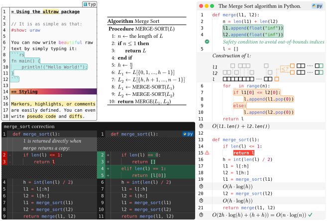
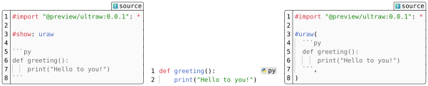
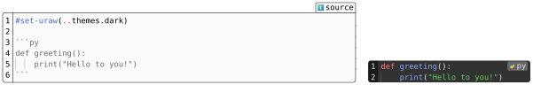
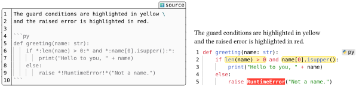
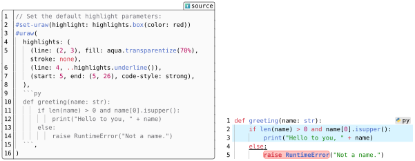
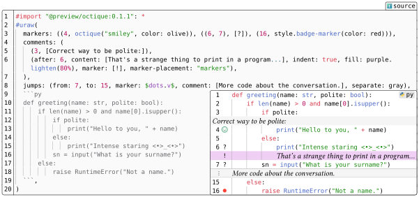
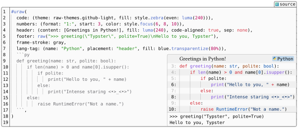
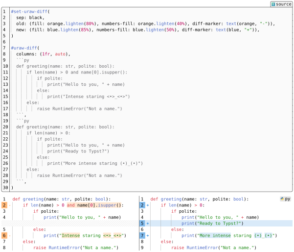
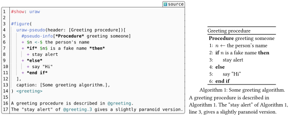

# ultraw

**`ultraw`** is a Typst package that lets you customize raw text. It provides many features like highlighting some code, adding markers and comments, jumping over lines, several themes (including a dark one), presenting diffs and writing pseudo code.

## Overview

## Getting started

The main function of the **`ultraw`** package is `uraw`. It can be used as a show rule for the whole document to format all raw blocks or per raw block to have precise settings, markers, comments, highlights, etc. The two following examples produce the same result:

The `set-uraw` function enables changing the settings of `uraw` globally, for example to change the theme:

**`ultraw`** provides a lightweight, quick and robust way to highlight raw text by typing highlight delimiters right inside the raw block:

By default, only the base (`*:...:*`) and alert (`*!...!*`) highlights are available. Other highlights are provided and can be added using the `highlights` module. Highlights can also be defined locally when using the `uraw` function:

Markers (lying in the numbers column), comments (between lines of code) and jumps (skipping numbers and possibly raw text lines) are available. Here is a complete example showing them:

More styling options allow customizing the whole look:

Formatting inline raw text is also possible with the `uraw-inline` function.

Diffs are defined with the `uraw-diff` function that automatically produces the diff between two versions of some code. By default, it has the same theme as `uraw` and supports more styling options (settable via `set-uraw-diff`). Here is an example:

Writing pseudo code is also possible with **`ultraw`** with the `uraw-pseudo` function. It enables defining pseudo code as numbered lists (with `+`):

Lines of `uraw`, `uraw-diff` and `uraw-pseudo` outputs inside labeled figures can be referenced (e.g. `@label.3` for the third line) **if** `#show: uraw` is used.

## Documentation

Look at the complete [Documentation](https://github.com/JulesViennotFranca/ultraw/blob/v0.0.1/docs/doc.pdf) for more cool features.
