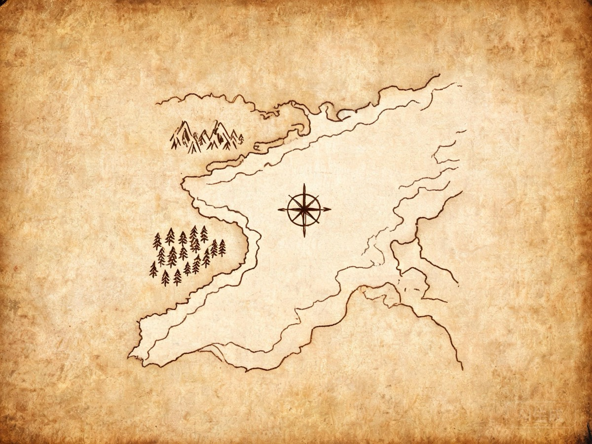

# 示例

示例

## 项目结构

- `配置.typ` —— 站点配置:标题、作者、元素系统数据
- `内容/` —— 分章正文,每个 `.typ` 都会编译出一份文档
- `脚本/` —— 独立页入口 `页面.typ`
- `附件/` —— 元素系统数据与素材

## 元素系统一览

同一概念在不同系统下叫不同名字:

| 元素 | 普通 | 别名 | 学术 |
| --- | --- | --- | --- |
| 古龙 | 龙 | 龙 | 古代龙 |
| 巨人 | 巨人 | 石头人 | 巨怪 |

## 模板

有一个GitHub模板仓库[UHeg](https://github.com/kych-net/UHeg)
