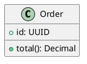

<p align="center">
  
</p>
<h1 align="center">Unimola</h1>

<p align="center">
  <a href="https://github.com/RepolloDev/unimola">
    
  </a>
  <a href="https://github.com/RepolloDev/unimola/blob/v0.1.0/example/demo.pdf">
    
  </a>
</p>

> Render PlantUML diagrams natively as SVG using a pure-Rust WebAssembly plugin powered by `plantuml-core`. It does not require Java or any external Graphviz installation, making it ideal for use in Typst documents.

<p align="center">
  
</p>

> See [example/demo.typ](https://github.com/RepolloDev/unimola/blob/v0.1.0/example/demo.typ) for a complete runnable document.

## Usage

Import the package from Typst Universe:

```typst
#import "@preview/unimola:0.1.0": (
  unimola,
  unimola-config,
  show-unimola-blocks,
)
```

These imports provide:

- `unimola`: Renders PlantUML source as an SVG diagram in the document.
- `unimola-config`: Sets default options for subsequent diagrams, such as themes, preambles, and included files.
- `show-unimola-blocks`: Creates a show-rule handler that automatically renders fenced `plantuml` or `puml` blocks.

### Render a diagram inline or as a block

The `unimola` function accepts PlantUML markup as a plain string, a fenced `raw` block, or the output of `read(...)`, and compiles it into an embedded SVG `image`. When `auto-wrap` is enabled (the default), you can omit `@startuml` and `@enduml` and Unimola wraps the snippet automatically before rendering.

````typst
#unimola(
  width: 80%,
  ```plantuml
  @startuml
  Alice -> Bob: Hello
  Bob --> Alice: Hi!
  @enduml
  ```,
)
````

### Render inside a `figure`

Because `unimola` returns standard Typst `content`, you can pass it directly into Typst's native `#figure` element to attach captions, numbering, and cross-references (`@fig-sequence`).

````typst
#figure(
  caption: [Order processing sequence],
  unimola(
    width: 85%,
    ```plantuml
    Alice -> API: POST /orders
    API --> Alice: 201 Created
    ```,
  ),
) <fig-sequence>
````

### Automatic rendering for fenced code blocks

Instead of calling `#unimola(...)` around every diagram, you can bind `show-unimola-blocks` to a `#show raw.where(...)` rule. Any fenced `plantuml` or `puml` block that appears after the rule is intercepted and rendered directly as an SVG diagram:

````typst
#show raw.where(lang: "plantuml"): show-unimola-blocks(width: 90%)
#show raw.where(lang: "puml"): show-unimola-blocks(width: 90%)



```puml
[*] --> Registered
Registered --> Delivered : ship
Delivered --> [*]
```
````

### Global configuration and custom themes

Use `unimola-config(...)` to define document-wide defaults for `theme`, `preamble`, `auto-wrap`, `deterministic`, or `includes`. Any `#unimola(...)` call whose arguments remain `auto` inherits those defaults and can override them individually.

To apply custom styles, inject `skinparam` or `<style>` rules through `preamble`, or pass a virtual dictionary to `includes` so PlantUML's `!theme` and `!include` directives resolve directly from Typst's `read(...)` output.

```typst
#unimola-config(preamble: read("themes/corporate.puml"))

// Override per diagram
#unimola(theme: "amiga", preamble: none, "Alice -> Bob: Hi")

// Resolve `!theme corporate` from a virtual includes map
#unimola(
  preamble: none,
  includes: (corporate: read("themes/corporate.puml")),
  "@startuml\n!theme corporate\nAlice -> Bob: Custom\n@enduml",
)
```

### Load from an external `.puml` file

Typst scopes file access inside a package to that package's own directory, so external `.puml` files must be read from your document with `read("diagram.puml")` and passed as a string to `unimola`.

```typst
#unimola(read("diagram.puml"), width: 90%)
```

## API Reference

### `unimola`

Renders PlantUML markup as an SVG `image`, or displays a framed red error box if the diagram contains syntax or encoding errors without aborting compilation. Parameters set to `auto` inherit from `unimola-config(...)`.

| Parameter | Type | Default | Description |
| --- | --- | --- | --- |
| `source` | `str`, `content` | — | PlantUML markup string, `raw` block, or `read(...)` output. |
| `theme` | `none`, `str`, `auto` | `auto` | Bundled PlantUML `!theme` name (e.g. `"amiga"`, `"plain"`, `"cerulean"`). |
| `preamble` | `none`, `str`, `auto` | `auto` | Extra `skinparam` or `<style>` block injected after `@startuml`. |
| `auto-wrap` | `bool`, `auto` | `auto` | Wraps markup in `@startuml ... @enduml` when no `@start` line exists. |
| `deterministic` | `bool`, `auto` | `auto` | Uses deterministic font metrics for reproducible layouts. |
| `includes` | `dictionary`, `auto` | `auto` | Virtual map of `"name": content` for `!include` and custom `!theme`. |
| `width` | `auto`, `length`, `ratio`, `relative` | `auto` | Target image width passed to Typst `image`. |
| `height` | `auto`, `length`, `ratio`, `relative` | `auto` | Target image height passed to Typst `image`. |
| `fit` | `str` | `"contain"` | Image fit mode (`"contain"`, `"cover"`, or `"stretch"`). |
| `scale` | `none`, `auto`, `ratio`, `float`, `int` | `none` | Optional reflowing scale factor applied around the rendered image. |
| `alt` | `none`, `str` | `none` | Alternative accessibility text for the SVG image. |

### Helper Functions

- `unimola-config(theme: auto, preamble: auto, auto-wrap: auto, deterministic: auto, includes: auto) -> content`: Updates document-wide defaults in `state` for subsequent `unimola` and `show-unimola-blocks` calls.
- `show-unimola-blocks(..) -> function`: Returns a show-rule handler for `raw` code blocks, forwarding all `unimola` styling and sizing parameters.
- `unimola-svg(source, theme: none, preamble: none, auto-wrap: true, deterministic: false, includes: (:)) -> str`: Evaluates the diagram and returns the raw SVG string directly, or panics on error.
- `unimola-result(source, theme: none, preamble: none, auto-wrap: true, deterministic: false, includes: (:)) -> dictionary`: Returns the raw plugin response dictionary `(ok, kind, svg, error)` without rendering an image.
- `unimola-version() -> str`: Returns the PlantUML specification version reported by `plantuml-core`.

## How It Works

When Typst evaluates `#unimola(...)`, it serializes the diagram source and configuration options (`theme`, `preamble`, `auto_wrap`, `deterministic`, `includes`) into JSON bytes and passes them to `assets/unimola.wasm` over `wasm-minimal-protocol`.

Inside the WebAssembly plugin, the Rust bridge normalizes the source, resolves any virtual `!include` or `!theme` entries in memory via `plantuml-core`, and renders the SVG purely in Rust using `graphviz-pure`. Typst then decodes the JSON envelope and embeds the resulting SVG into the document with `image(bytes(svg), format: "svg")`.

## License

MIT License. See [LICENSE](LICENSE) for details.
