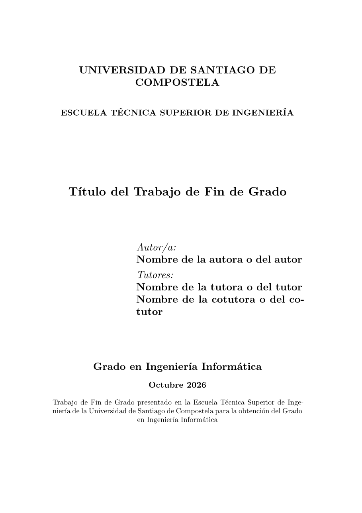

# xemelgo-etse

Typst template for the TFG report of the Computer Engineering degree (GrEI) at the ETSE, USC.
A clone of the official LaTeX templates, in Spanish, Galician or English.

**Unofficial**: not affiliated with the USC or the ETSE.

  
  
  
  

## How to use

1. Create the project: *Start from template* in the web app, or `typst init @preview/xemelgo-etse:0.1.0`.
2. Choose your [model](#which-model): `modeloA`, `modeloB` or `modeloC` in `main.typ`.
3. Fill in the [options](#options): title, authors (you first, then tutors)…
4. Add the logo: [download it](https://www.usc.gal/gl/usc/institucional/imaxe-corporativa), then `logo: image("logo_usc.pdf")`.
5. Write: `=` chapter, `==` section. Appendices go after `#show: apendices`.
6. Cite with `@key` from `refs.bib`.
7. Remove `#include "ejemplos.typ"` before submitting.

## Which model?

Same layout, different suggested chapters. Ask your tutor if unsure.

| Model | TFG type |
|-------|----------|
| `modeloA` | Research or experiments |
| `modeloB` | Software or hardware system |
| `modeloC` | Project or business plan |

See the [examples](#examples) for each model's chapters.

## Options

| Option             | Default   | Description |
|--------------------|-----------|-------------|
| `title`            | `[Title]` | Title. |
| `subtitle`         | `none`    | Subtitle. |
| `authors`          | `()`      | Student, then tutors: `(name: "...")`. Tutors may add `department: "..."`. |
| `logo`             | `none`    | Logo, e.g. `image("logo_usc.pdf")`. |
| `date`             | `auto`    | A `datetime`. `auto` is today. |
| `lang`             | `"es"`    | `"es"`, `"gl"` or `"en"`. |
| `i18n`             | `(:)`     | Change texts: `(es: (abstract: [Sinopsis]))`. Keys in [`src/i18n.typ`](src/i18n.typ). |
| `certification`    | `true`    | Tutors' certification page. |
| `acknowledgements` | `none`    | Acknowledgements page. |
| `abstract`         | `none`    | Abstract page. |
| `blank-pages`      | `true`    | Chapters on odd pages, for printing. `false` for a compact PDF. |
| `code-style`       | `"latex"` | `"latex"` or `"wired"` (as in [wired-ieee](https://typst.app/universe/package/wired-ieee)). |
| `code-numbers`     | `false`   | Line numbers, with `code-style: "wired"`. |
| `bibliography`     | `none`    | A `bibliography(..)`, in IEEE style. |

## Other functions

| Function      | Use |
|---------------|-----|
| `apendices`   | `#show: apendices` before the appendices (A, B, C…). |
| `short-title` | `= Long title #short-title[Short]`: short title for the index and the header. |
| `caratula`    | CD cover. Options: `title`, `authors`, `course`, `session`, `lang`, `i18n`, `logo`. |

## Examples

- [Model A](template/main.typ) (the `typst init` template)
- [Model B](examples/modeloB.typ)
- [Model C](examples/modeloC.typ)
- [CD cover](examples/caratula.typ)

## License

Code: [MIT](LICENSE). Template files: [MIT-0](LICENSE-MIT-0), so your TFG needs no license notice.
